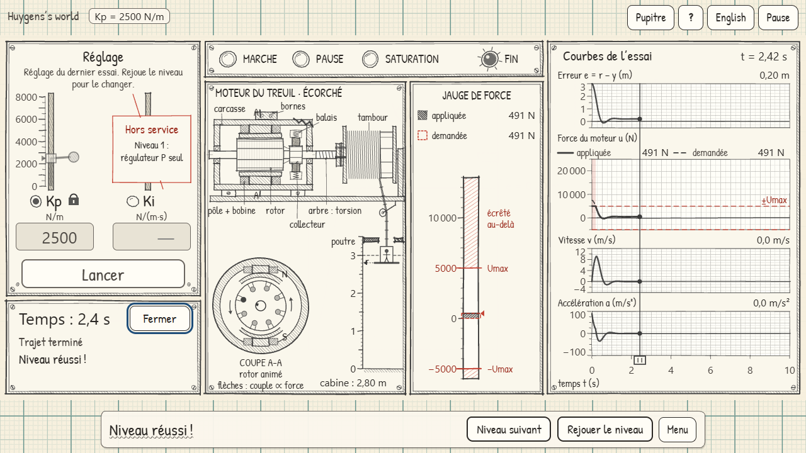
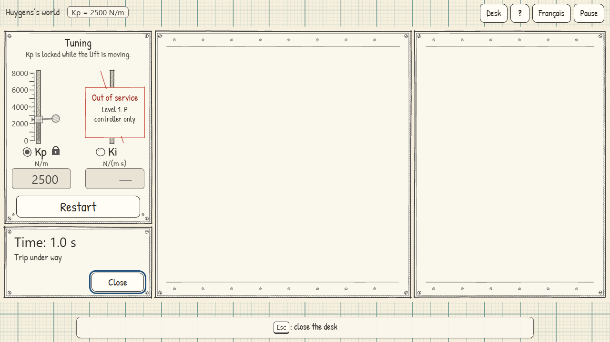

# Huygens’s world

_Dépôt `pid-game` · jeu web éducatif sur l'automatique et le contrôleur PID._



Un bonhomme bâton dessiné au crayon traverse un monde de papier millimétré ; chaque obstacle est un système dont le joueur règle le contrôleur. Titre provisoire « Huygens’s world », en hommage à Christiaan Huygens.

_English version below._

## Jouer en ligne

**<https://lucashg7892.github.io/pid-game/>**, dans un navigateur récent (Chrome, Edge ou Firefox ; WebGPU ou WebGL2).

## Comment jouer

1. Sur l'écran titre, choisissez **Jouer**, puis un niveau dans le menu.
2. Appuyez sur **E** (de n'importe où sur le quai) : le pupitre de contrôle s'ouvre et le bonhomme rejoint son poste.
3. Réglez le gain avec le levier du pupitre, avec **+** et **−**, ou dans le champ numérique, puis lancez l'ascenseur avec **E**, **Entrée** ou le bouton « Lancer ».
4. Gain trop faible : la cabine s'arrête trop bas ; trop fort : elle heurte la poutre. Pendant et après le trajet, rouvrez le pupitre avec **E** ou le bouton « Pupitre » (lecture seule, le jeu continue) : moteur en écorché, force demandée et appliquée, courbes, et à l'issue un curseur pour reparcourir l'essai. **T** ouvre le tableau d'école et ses équations. **R** pour réessayer, **?** pour l'aide.

## État actuel

**Version 0.3.0** (2026-11-19) : écran titre, menu et deux niveaux jouables, en français et en anglais, avec le pupitre de contrôle, le tableau d'école, l'embarquement et la sortie du bonhomme.

- **Niveau 1 : le vide.** Contrôleur proportionnel : on règle Kp.
- **Niveau 2 : la mémoire.** Contrôleur PI : Kp est fixé, on règle Ki.
- **Pupitre de contrôle** (touche **E** ou bouton « Pupitre ») : leviers Kp et Ki, écorché du moteur du treuil avec voyants et jauge de force, quatre courbes (erreur, force du moteur, vitesse, accélération) et, à l'issue, un curseur de relecture du trajet.
- **Tableau d'école** (touche **T**, ou clic sur le chevalet) : les équations du niveau et « D'où vient la force ? », calculés avec les valeurs de l'instant de la pause.
- **Embarquement et sortie** animés du bonhomme, et bouton « Niveau suivant » à la réussite du niveau 1.
- Noyau de simulation validé contre un oracle exact MATLAB, hors du site, pour les contrôleurs P et PI.
- 1 043 tests unitaires (et 1 ignoré) et 210 tests de bout en bout ; intégration continue à chaque push sur `main` ; site publié automatiquement depuis `main`.
- Limites : WebGPU réel n'est exercé par aucun test automatique ; commandes tactiles non essayées sur un vrai écran tactile ; affichage en portrait étroit perfectible. Liste complète : [docs/defauts-connus.md](docs/defauts-connus.md).

Le détail est dans [docs/CHANGELOG.md](docs/CHANGELOG.md).

## Prérequis

- Node.js **22.12.0 ou plus récent** (`engines` de `package.json`). Vitest 5.1.0 l'exige.
- `.nvmrc` contient `22` : avec nvm, vérifiez que la version obtenue est au moins 22.12.
- npm (testé avec npm 10.9.9 et Node v22.23.4).

## Installation et lancement

Pas à pas sous Windows : [tutoriel « Lancer le projet sur son PC »](docs/tutoriel-lancer-en-local.md).

```sh
npm ci
npm run dev
```

Ouvrez l'adresse affichée par Vite (par défaut `http://localhost:5173/pid-game/`). Sous PowerShell, si `npm` est refusé, utilisez `npm.cmd`.

`node_modules/` contient des binaires natifs propres au système. S'il a été installé sous Linux, relancez `npm ci` sous Windows (et inversement).

## Scripts principaux

| Commande           | Effet                                                              |
| ------------------ | ------------------------------------------------------------------ |
| `npm run dev`      | serveur de développement Vite                                      |
| `npm run check`    | typecheck, lint, tests puis build ; à lancer avant toute livraison |
| `npm run test`     | tests unitaires Vitest                                             |
| `npm run test:cov` | tests unitaires et couverture de `src/sim`                         |
| `npm run e2e`      | tests de bout en bout (après `npx playwright install chromium`)    |
| `npm run build`    | build de production dans `dist/` (base `/pid-game/`)               |

Liste complète : [docs/developpement.md](docs/developpement.md).

## Documentation

Index : [docs/README.md](docs/README.md). Bilan de la version : [docs/bilan-v0.1.md](docs/bilan-v0.1.md). Défauts connus : [docs/defauts-connus.md](docs/defauts-connus.md). Pour commencer : [interface du joueur](docs/interface.md), [pupitre de contrôle](docs/pupitre.md), [tableau d'école](docs/tableau-ecole.md), [rendu au crayon](docs/rendu.md), [noyau de simulation](docs/simulation.md), [physique de l'ascenseur](docs/physique/ascenseur.md).

## Licence

MIT. Voir le fichier [LICENSE](LICENSE). Police Patrick Hand : SIL Open Font License 1.1 (`public/fonts/OFL.txt`).

---

# Huygens’s world (English)

_Repository `pid-game` · an educational web game about control theory and the PID controller._



A pencil-drawn stick figure walks across graph paper; each obstacle is a system whose controller the player tunes. Working title "Huygens’s world", a tribute to Christiaan Huygens.

## Play online

**<https://lucashg7892.github.io/pid-game/>**, in a recent browser (Chrome, Edge or Firefox; WebGPU or WebGL2).

## How to play

1. On the title screen, choose **Play**, then a level from the menu.
2. Press **E** (from anywhere on the ledge): the control desk opens and the figure walks to its post.
3. Set the gain with the desk lever, with **+** and **−**, or in the number field, then launch the lift with **E**, **Enter** or the "Launch" button.
4. Gain too low: the lift stops short; too high: it hits the beam. During and after the run, reopen the desk with **E** or the "Desk" button (read-only, the game keeps running): winch motor cutaway, requested and applied force, charts, and after the run a cursor to replay it. **T** opens the classroom blackboard with the equations. **R** to try again, **?** for help.

## Current status

**Version 0.3.0** (2026-11-19): title screen, menu and two playable levels, in French and English, with the control desk, the classroom blackboard, and animated boarding and exit.

- **Level 1: The Gap.** Proportional controller: you tune Kp.
- **Level 2: Memory.** PI controller: Kp is fixed, you tune Ki.
- **Control desk** (**E** key or "Desk" button): Kp and Ki levers, cutaway of the winch motor with lamps and force gauge, four charts (error, motor force, speed, acceleration) and, after a run, a replay cursor.
- **Classroom blackboard** (**T** key, or click the easel): the level's equations and "Where does the force come from?", computed with the values at the moment of the pause.
- Animated **boarding and exit**, and a "Next level" button when level 1 is won.
- Simulation core checked against an exact MATLAB oracle, outside the site, for both the P and PI controllers.
- 1,043 unit tests (and 1 skipped) and 210 end-to-end tests; continuous integration on every push to `main`; the site is deployed automatically from `main`.
- Limits: real WebGPU is not exercised by any automated test; touch controls not tried on a real touch screen; narrow portrait layout could be better. Full list of known issues (in French): [docs/defauts-connus.md](docs/defauts-connus.md).

## Requirements

- Node.js **22.12.0 or later** (required by Vitest 5.1.0). `.nvmrc` says `22`: make sure you get at least 22.12.
- npm.

## Install and run

Step-by-step guide for Windows (in French): [docs/tutoriel-lancer-en-local.md](docs/tutoriel-lancer-en-local.md).

```sh
npm ci
npm run dev       # Vite dev server, then open http://localhost:5173/pid-game/
npm run check     # typecheck, lint, test, build
npm run test:cov  # unit tests with coverage of src/sim
```

On Windows PowerShell, if `npm` is blocked by the execution policy, use `npm.cmd`. End-to-end tests: `npx playwright install chromium`, then `npm run e2e`.

`node_modules/` contains platform-specific binaries: reinstall with `npm ci` when switching between Linux and Windows.

## Documentation

Technical documentation is in French: [docs/README.md](docs/README.md).

## License

MIT. See the [LICENSE](LICENSE) file. Patrick Hand font: SIL Open Font License 1.1.
