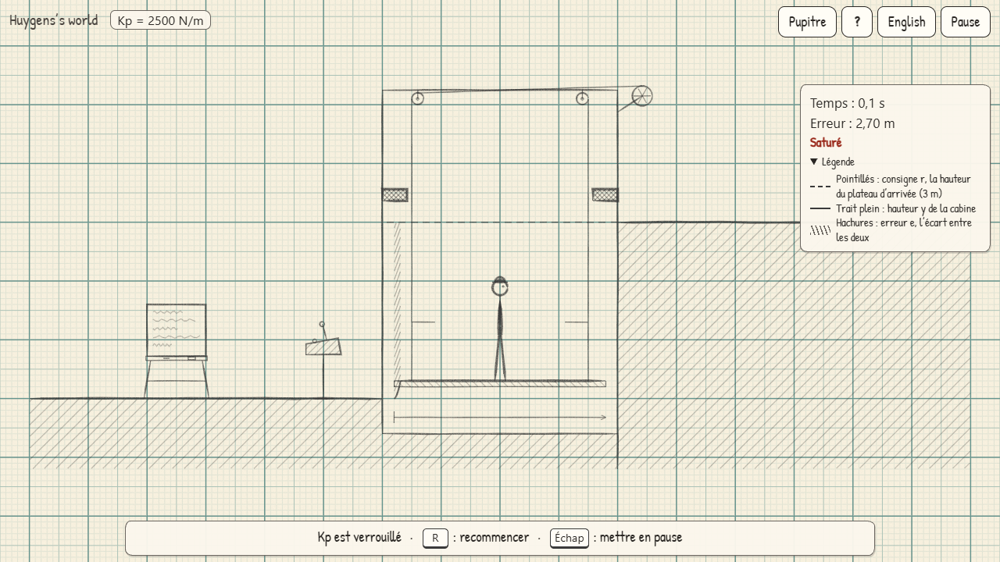

# Huygens’s world

_Dépôt `pid-game` · jeu web éducatif sur l'automatique et le contrôleur PID._



Un bonhomme bâton dessiné au crayon traverse un monde de papier millimétré ; chaque obstacle est un système dont le joueur règle le contrôleur. Titre provisoire « Huygens’s world », en hommage à Christiaan Huygens.

_English version below._

## Comment jouer

1. Marchez jusqu'à la console avec **→** (ou **D**), puis appuyez sur **E**.
2. Réglez le gain Kp avec **+** et **−**, puis lancez l'ascenseur avec **E** ou **Entrée**.
3. Kp trop faible : la cabine s'arrête trop bas ; trop fort : elle heurte la poutre. **R** pour réessayer, **?** pour l'aide.

## État actuel

**Le niveau 1 est jouable** dans un navigateur récent (WebGPU ou WebGL2), en français et en anglais. Les tâches T-000 à T-010 sont validées (2026-11-13).

- Validé :
  - socle outillé : npm, TypeScript, Vite, ESLint, Prettier, dependency-cruiser, Vitest, Playwright (T-002) ;
  - noyau de simulation `src/sim`, validé contre un oracle exact MATLAB hors du site (T-003 à T-005) ;
  - textes FR/EN `src/i18n` : 111 clés par langue (T-006, T-010) ;
  - logique du niveau 1 `src/game` (T-007) ;
  - rendu au crayon `src/render` : papier millimétré, décor, bonhomme, courbe y(t), jauge de force (T-008, T-009) ;
  - interface `src/ui` : bandeau d'aide, panneau Kp, issues, clavier, souris, tactile, accessibilité, police manuscrite (T-010) ;
  - 426 tests unitaires et 28 tests de bout en bout verts (les seconds exécutés par l'orchestrateur, voir [docs/tests.md](docs/tests.md)).
- Limites : WebGPU réel n'est exercé par aucun test automatique (les tests tournent en WebGL2 logiciel) ; commandes tactiles non essayées sur un vrai écran tactile.
- Prévu : intégration continue et publication sur GitHub Pages (T-011).

Le détail est dans [docs/CHANGELOG.md](docs/CHANGELOG.md).

## Prérequis

- Node.js **22.12.0 ou plus récent** (`engines` de `package.json`). Vitest 5.1.0 l'exige.
- `.nvmrc` contient `22` : avec nvm, vérifiez que la version obtenue est au moins 22.12.
- npm (testé avec npm 10.9.9 et Node v22.23.4).

## Installation et lancement

Pas à pas sous Windows : [tutoriel « Lancer le projet sur son PC »](docs/tutoriel-lancer-en-local.md).

```sh
npm ci
npm run dev
```

Ouvrez l'adresse affichée par Vite (par défaut `http://localhost:5173/pid-game/`). Sous PowerShell, si `npm` est refusé, utilisez `npm.cmd`.

`node_modules/` contient des binaires natifs propres au système. S'il a été installé sous Linux, relancez `npm ci` sous Windows (et inversement).

## Scripts principaux

| Commande           | Effet                                                              |
| ------------------ | ------------------------------------------------------------------ |
| `npm run dev`      | serveur de développement Vite                                      |
| `npm run check`    | typecheck, lint, tests puis build ; à lancer avant toute livraison |
| `npm run test`     | tests unitaires Vitest                                             |
| `npm run test:cov` | tests unitaires et couverture de `src/sim`                         |
| `npm run e2e`      | tests de bout en bout (après `npx playwright install chromium`)    |
| `npm run build`    | build de production dans `dist/` (base `/pid-game/`)               |

Liste complète : [docs/developpement.md](docs/developpement.md).

## Documentation

Index : [docs/README.md](docs/README.md). Pour commencer : [interface du joueur](docs/interface.md), [rendu au crayon](docs/rendu.md), [noyau de simulation](docs/simulation.md), [physique de l'ascenseur](docs/physique/ascenseur.md).

## Licence

MIT. Voir le fichier [LICENSE](LICENSE). Police Patrick Hand : SIL Open Font License 1.1 (`public/fonts/OFL.txt`).

---

# Huygens’s world (English)

_Repository `pid-game` · an educational web game about control theory and the PID controller._

A pencil-drawn stick figure walks across graph paper; each obstacle is a system whose controller the player tunes. Working title "Huygens’s world", a tribute to Christiaan Huygens.

## How to play

1. Walk to the console with **→** (or **D**), then press **E**.
2. Set the gain Kp with **+** and **−**, then launch the lift with **E** or **Enter**.
3. Kp too low: the lift stops short; too high: it hits the beam. **R** to try again, **?** for help.

## Current status

**Level 1 is playable** in a recent browser (WebGPU or WebGL2), in French and English. Tasks T-000 to T-010 are validated (2026-11-13).

- Validated: tooling (T-002); simulation core `src/sim`, checked against an exact MATLAB oracle outside the site (T-003 to T-005); French/English texts `src/i18n`, 111 keys per language (T-006, T-010); level 1 logic `src/game` (T-007); pencil rendering `src/render` (T-008, T-009); user interface `src/ui` with keyboard, mouse, touch and accessibility (T-010); 426 unit tests and 28 end-to-end tests passing (the latter run by the coordinator, see [docs/tests.md](docs/tests.md)).
- Limits: real WebGPU is not exercised by any automated test (tests run on software WebGL2); touch controls not tried on a real touch screen.
- Planned: CI and GitHub Pages deployment (T-011).

## Requirements

- Node.js **22.12.0 or later** (required by Vitest 5.1.0). `.nvmrc` says `22`: make sure you get at least 22.12.
- npm.

## Install and run

Step-by-step guide for Windows (in French): [docs/tutoriel-lancer-en-local.md](docs/tutoriel-lancer-en-local.md).

```sh
npm ci
npm run dev       # Vite dev server, then open http://localhost:5173/pid-game/
npm run check     # typecheck, lint, test, build
npm run test:cov  # unit tests with coverage of src/sim
```

On Windows PowerShell, if `npm` is blocked by the execution policy, use `npm.cmd`. End-to-end tests: `npx playwright install chromium`, then `npm run e2e`.

`node_modules/` contains platform-specific binaries: reinstall with `npm ci` when switching between Linux and Windows.

## Documentation

Technical documentation is in French: [docs/README.md](docs/README.md).

## License

MIT. See the [LICENSE](LICENSE) file. Patrick Hand font: SIL Open Font License 1.1.
