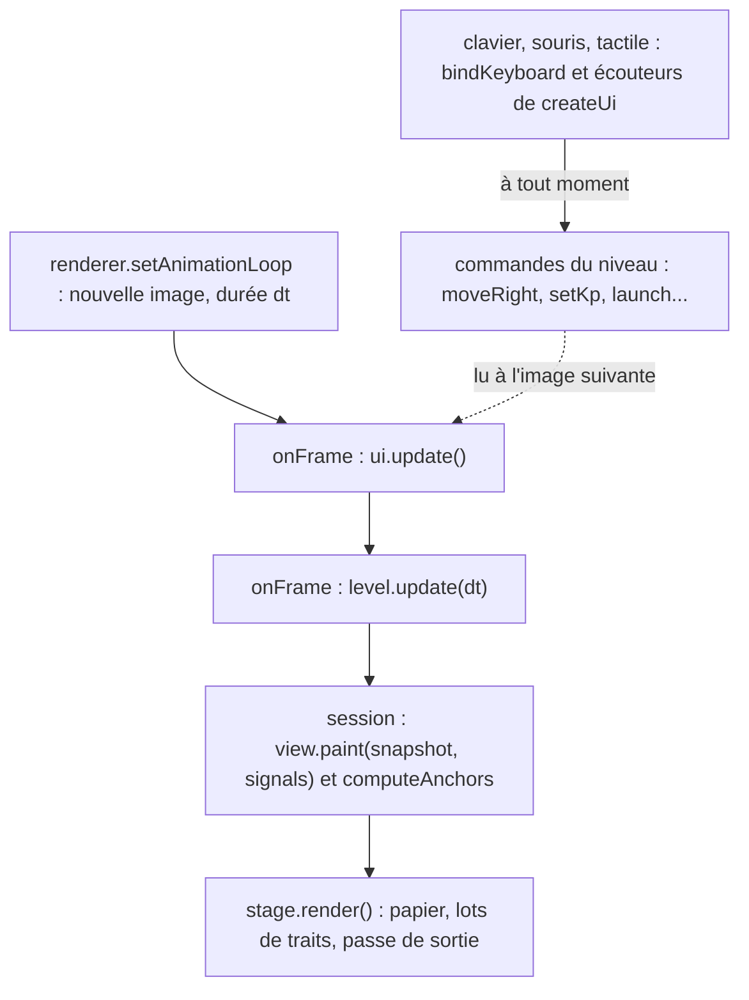
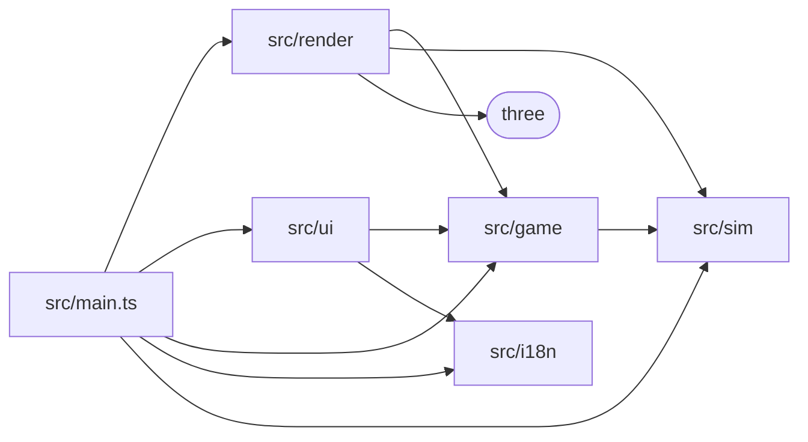

# Architecture

À quoi sert cette page : présenter les modules du code, qui a le droit d'importer qui, le déroulement d'une image et les garde-fous automatiques. État au commit `566a8a3` (2026-11-13) : tous les modules sont validés et le niveau 1 est jouable dans un navigateur.

## Modules

| Module | Rôle | État |
|---|---|---|
| `src/sim/` | noyau de simulation pur : pas fixe, déterministe, sans rendu ni DOM | **validé** (T-003, T-004, T-004b, T-005). Voir [simulation.md](simulation.md) |
| `src/game/` | logique de niveau : phases, victoire et échec, bonhomme, événements | **validé** (T-007). Voir [jeu.md](jeu.md) |
| `src/i18n/` | textes FR/EN, interpolation, formatage, détection de langue | **validé** (T-006, clés ajoutées en T-010). Voir [i18n-accessibilite.md](i18n-accessibilite.md) |
| `src/render/` | rendu three.js (`three/webgpu`, repli WebGL2) : papier, traits de crayon, bonhomme, courbe, jauge | **validé** (T-008, T-009). Voir [rendu.md](rendu.md) |
| `src/ui/` | interface DOM accessible : bandeau d'aide, panneau Kp, mesures, issues, touches, annonces | **validé** (T-010). Voir [interface.md](interface.md) |
| `src/main.ts` | point de composition : seul fichier qui connaît tous les modules | **validé** (T-010), voir ci-dessous |

Fichiers :

```text
src/sim/     index.ts  types.ts  clock.ts  integrators.ts  saturation.ts  signals.ts  loop.ts
             controllers/p.ts  plants/elevator.ts
src/i18n/    index.ts  catalogs.ts  params.ts  interpolate.ts  format.ts  detect.ts  translator.ts
             locales/fr.json  locales/en.json
src/game/    index.ts  constants.ts  kp.ts  outcome.ts  walker.ts  events.ts  level.ts
src/render/  index.ts  bootstrap.ts  session.ts  stage.ts  camera.ts  options.ts  paper.ts
             pencil-style.ts  pencil-material.ts  stroke-batch.ts  noise.ts  patterns.ts
             walker-pose.ts  curve.ts  gauge.ts  level-display.ts  level-painter.ts  level-view.ts
src/ui/      index.ts  overlay.ts  view-model.ts  layout.ts  hints.ts  keys.ts  input.ts
             announce.ts  ui.css
src/main.ts
public/      favicon.svg  fonts/ (Patrick Hand, OFL.txt)
```

### Ce que fait `src/main.ts`

1. Crée le traducteur (`detectLocale(location.search, navigator.languages)`), écrit `<html lang>`, le titre du document et le nom accessible du canvas.
2. Crée le niveau (`createLevel1()`).
3. Démarre le rendu (`startRendering`) avec le choix lu dans `?renderer=`. En cas d'échec, affiche la page de repli traduite et s'arrête.
4. Crée l'interface (`createUi`) et branche le clavier (`bindKeyboard`).
5. À chaque changement de taille, calcule la géométrie de l'écran pour l'interface (`UiGeometry`) à partir du cadrage du rendu, et y joint les ancres de la session (`session.anchors()`) : l'interface reçoit des nombres, sans importer le rendu.
6. Écrit dans `document.body.dataset` le backend (`backend`), et, après la première image, `drawCalls` et `triangles`.

**Crochet de test** : seulement avec `?e2e=1` dans l'URL, `window.__huygens` expose les commandes du niveau, une copie de l'instantané, une avance déterministe du temps (`advance(secondes)`, par images fixes de 1/60 s) et les compteurs de rendu. Dans ce mode, le temps réel ne fait plus avancer le niveau. Sans `?e2e=1`, `window.__huygens` n'existe pas (test e2e (h) de `level.spec.ts`).

## Flux d'une image



Ordre réel (`src/main.ts`, `src/render/session.ts`) :

1. Les commandes du joueur arrivent par des écouteurs d'événements, entre deux images. Chaque commande est appliquée tout de suite au niveau, puis l'interface est mise à jour.
2. À chaque image, la boucle de three appelle `onFrame(dt)` : `main.ts` met d'abord à jour l'interface (`ui.update()`, avec les ancres de l'image précédente : une image de retard, invisible pour des étiquettes), puis fait avancer le niveau (`level.update(dt)`, horloge à pas fixe du noyau).
3. La session repeint les lots de traits d'après l'instantané (interpolé par `alpha`), recalcule les ancres et dessine.

L'interface est donc mise à jour **avant** le niveau dans une image : les textes reflètent l'état de la fin de l'image précédente.

## Qui peut importer qui

Tableau tiré de `.dependency-cruiser.cjs` (section `forbidden`). « oui » = aucune règle ne l'interdit.

| Depuis ↓ / vers → | `sim` | `game` | `i18n` | `render` | `ui` | `three` | autre paquet npm |
|---|---|---|---|---|---|---|---|
| `src/sim/` | oui | non | non | non | non | non | non |
| `src/game/` | oui | oui | non | non | non | non | non |
| `src/i18n/` | non | non | oui | non | non | non | non |
| `src/render/` | oui | oui | non | oui | non | oui | oui |
| `src/ui/` | non | oui | oui | non | oui | non | oui |
| `src/main.ts` | oui | oui | oui | oui | oui | non | oui |

Règles en vigueur (8) :

| Règle | Ce qu'elle interdit |
|---|---|
| `sim-is-pure` | tout import depuis `src/sim/` vers autre chose que `src/sim/` (paquets npm compris) |
| `i18n-is-pure` | tout import depuis `src/i18n/` vers autre chose que `src/i18n/` |
| `game-no-render` | tout import depuis `src/game/` vers autre chose que `src/game/` ou `src/sim/` |
| `render-deps` | `src/render/` → `src/ui/` ou `src/i18n/` |
| `ui-deps` | `src/ui/` → `src/sim/` ou `src/render/` |
| `three-only-in-render` | import de `three` hors de `src/render/` |
| `no-circular` | toute dépendance circulaire |
| `not-to-unresolvable` | tout import que l'outil ne sait pas résoudre |



Flèche = « peut importer ». `sim` et `i18n` n'importent rien hors d'eux-mêmes.

### Exemption de `src/main.ts` levée (réserve E2)

Jusqu'à T-007, la règle `three-only-in-render` exemptait `src/main.ts`, dont le bouchon importait `three/webgpu` (réserve E2 du log T-002). T-008 a déplacé tout l'usage de three dans `src/render/` et retiré l'exemption : la règle porte maintenant sur `pathNot: '^src/render/'`. Le point de composition n'importe plus three.

## Les trois garde-fous du noyau pur

Ils protègent `src/sim/` (et, pour le deuxième, `src/game/`). Les sorties ci-dessous ont été reproduites le 2026-11-12 dans une copie du dépôt hors du dossier projet, avec un fichier `src/sim/_viol.ts` contenant :

```ts
import { Vector3 } from 'three';
export const v = new Vector3(Math.random(), Date.now(), 0);
export const w = document.title;
```

L'orchestrateur a fait le même essai pendant la validation de T-002 (log T-002 : « depcruise code 2, eslint 2 erreurs, tsc sim en erreur »).

### 1. dependency-cruiser : pas d'import interdit

- Fichier : `.dependency-cruiser.cjs`.
- Commande : `npm run lint:arch` (aussi lancée en dernier par `npm run lint`).
- Règles touchées : `sim-is-pure`, `three-only-in-render`.
- Sortie (code de sortie 2) :

```text
  error three-only-in-render: src/sim/_viol.ts → node_modules/three/build/three.module.js
  error sim-is-pure: src/sim/_viol.ts → node_modules/three/build/three.module.js

x 2 dependency violations (2 errors, 0 warnings). 6 modules, 4 dependencies cruised.
```

(Chemin vers `node_modules` raccourci : la copie pointait vers le `node_modules` du projet.)

Sur le dépôt réel, au commit `566a8a3` (code de sortie 0, mesure sur une extraction propre `git archive 566a8a3`) :

```text
✔ no dependency violations found (55 modules, 143 dependencies cruised)
```

Les 55 modules : 53 fichiers de `src/` (`src/render` 18, `src/sim` 9, `src/i18n` 9 dont 2 JSON, `src/ui` 9 dont `ui.css`, `src/game` 7, `src/main.ts`) et 2 fichiers de three (`three/build/three.webgpu.js` et `three/build/three.tsl.js`), importés par `src/render`. Évolution de la même commande : 21 modules à `c00e678`, 28 à `7bcd9ce`, 35 à la fin de T-008 (log T-008), 55 à `566a8a3`. La sortie du test de violation ci-dessus (6 modules) date de la copie du socle T-002.

Limite : la commande analyse seulement `src/`. Les fichiers de `tests/` ne sont pas contrôlés.

### 2. TypeScript sans DOM

- Fichier : `tsconfig.sim.json`. Il étend `tsconfig.json`, couvre `src/sim/**/*.ts` et `src/game/**/*.ts`, et remplace `lib` par `["ES2023"]` (sans `DOM`) et `types` par `[]`.
- Commande : `npm run typecheck` (deuxième passe, `tsc -p tsconfig.sim.json --noEmit`).
- Effet : `window`, `document` ou `performance` n'existent pas pour le compilateur dans ces dossiers.
- Sortie pour `document` (code de sortie 2) :

```text
src/sim/_viol.ts(3,18): error TS2584: Cannot find name 'document'. Do you need to change your target library? Try changing the 'lib' compiler option to include 'dom'.
```

L'import de `three` dans le même fichier provoque en plus 452 autres erreurs (376 dans `@types/three`, 76 dans `@types/webxr`, surtout `TS2304` : types DOM introuvables ; 453 erreurs au total) : c'est un deuxième signal du même problème.

### 3. ESLint : ni aléa ni horloge

- Fichier : `eslint.config.js`, bloc `files: ['src/sim/**/*.ts']`.
- Règles : `no-restricted-properties` sur `Math.random` et `Date.now` ; `no-restricted-globals` sur `Date` et `performance`.
- Commande : `npm run lint` (`eslint . --max-warnings 0`).
- Sortie (code de sortie 1) :

```text
  2:30  error  'Math.random' is restricted from being used. sim/ doit être déterministe : utiliser un PRNG à graine explicite  no-restricted-properties
  2:45  error  Unexpected use of 'Date'. sim/ ne lit jamais l'horloge : le temps est fourni par l'appelant                     no-restricted-globals
  2:45  error  'Date.now' is restricted from being used. sim/ ne lit jamais l'horloge : le temps est fourni par l'appelant     no-restricted-properties

✖ 3 problems (3 errors, 0 warnings)
```

Ces règles ne s'appliquent pas à `src/game/`, conformément à la spec T-001 §3. Pour `src/game/`, un test (`tests/game/units.test.ts`) lit les sources et refuse `Math.random`, `Date`, `performance`, `window` et `document`, et tout import hors de `src/game` et `src/sim`.

Justification de ces choix : [ADR-003](decisions/ADR-003-noyau-pur.md).

## Écarts entre la configuration et la spec T-001 §3

La configuration fait foi. Écarts relevés :

- La spec cite 4 règles dependency-cruiser ; la configuration en a 8 (ajout de `i18n-is-pure`, `render-deps`, `ui-deps`, `not-to-unresolvable`).
- La spec dit `ui → game, i18n` ; la configuration autorise aussi `ui` à importer des paquets npm autres que `three`.
- La spec dit « tout import de `three` hors `render/` » est interdit : c'est le cas depuis T-008 ; l'exemption de `src/main.ts` (réserve E2) est levée.

## Prévu

- Intégration continue et publication sur GitHub Pages (`.github/workflows/`) : Prévu (T-011).
