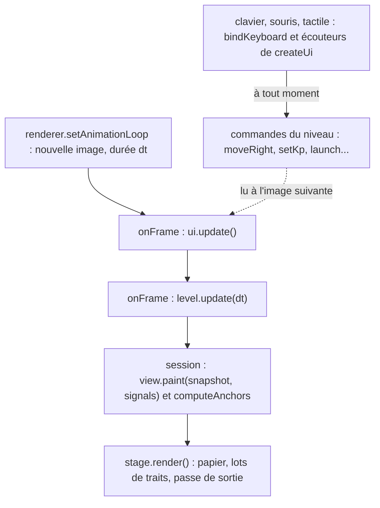
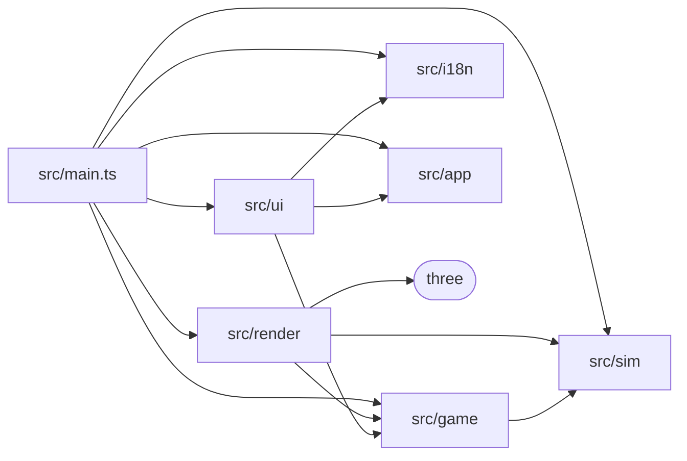

# Architecture

À quoi sert cette page : présenter les modules du code, qui a le droit d'importer qui, le déroulement d'une image et les garde-fous automatiques. État au commit `119519b` : tous les modules sont validés, le jeu s'ouvre sur un écran titre puis un menu, et deux niveaux sont jouables dans un navigateur (le niveau 2 « La mémoire » est venu avec T-021b).

## Modules

| Module | Rôle | État |
|---|---|---|
| `src/sim/` | noyau de simulation pur : pas fixe, déterministe, sans rendu ni DOM | **validé** (T-003, T-004, T-004b, T-005). Voir [simulation.md](simulation.md) |
| `src/app/` | état d'application pur : machine d'écrans (titre, menu, niveau) et catalogue des niveaux | **validé** (T-017abc). Voir ci-dessous et [ADR-015](decisions/ADR-015-etat-application-machine-ecrans.md) |
| `src/game/` | logique de niveau : phases, victoire et échec, bonhomme, événements ; machine commune aux niveaux 1 et 2 | **validé** (T-007 ; T-020 pour les valeurs du niveau 1 ; T-021b pour le niveau 2). Voir [jeu.md](jeu.md) |
| `src/i18n/` | textes FR/EN, interpolation, formatage, détection de langue | **validé** (T-006, clés ajoutées en T-010). Voir [i18n-accessibilite.md](i18n-accessibilite.md) |
| `src/render/` | rendu three.js (`three/webgpu`, repli WebGL2) : papier, traits de crayon, bonhomme, courbe, jauge | **validé** (T-008, T-009 ; échecs en cours de route : T-014). Voir [rendu.md](rendu.md) |
| `src/ui/` | interface DOM accessible : bandeau d'aide, panneau de réglage, mesures, issues, touches, annonces ; écrans titre et menu | **validé** (T-010 ; T-017d pour les écrans). Voir [interface.md](interface.md) |
| `src/main.ts` | point de composition : seul fichier qui connaît tous les modules ; monte et démonte les écrans | **validé** (T-010, T-017e), voir ci-dessous |

Fichiers :

```text
src/sim/     index.ts  types.ts  clock.ts  integrators.ts  saturation.ts  signals.ts  loop.ts
             controllers/p.ts  controllers/pi.ts  plants/elevator.ts
src/i18n/    index.ts  catalogs.ts  params.ts  interpolate.ts  format.ts  detect.ts  translator.ts
             locales/fr.json  locales/en.json
src/app/     index.ts  screens.ts  levels.ts
src/game/    index.ts  constants.ts  kp.ts  outcome.ts  walker.ts  events.ts  elevator-level.ts
             level.ts  level2.ts
src/render/  index.ts  bootstrap.ts  session.ts  stage.ts  camera.ts  options.ts  paper.ts
             pencil-style.ts  pencil-material.ts  stroke-batch.ts  noise.ts  patterns.ts
             walker-pose.ts  curve.ts  gauge.ts  level-display.ts  level-painter.ts  level-view.ts
src/ui/      index.ts  overlay.ts  view-model.ts  layout.ts  hints.ts  keys.ts  input.ts
             announce.ts  help.ts  screens.ts  screens-model.ts  screen-keys.ts  ui.css  screens.css
src/main.ts
public/      favicon.svg  fonts/ (Patrick Hand, OFL.txt)
```

### Ce que fait `src/main.ts`

1. Crée le traducteur (`detectLocale(location.search, navigator.languages)`) et tient à jour `<html lang>` et le titre du document par un abonnement au traducteur (c'était le rôle de l'interface du niveau avant T-017) ; donne au canvas son nom accessible.
2. Démarre le rendu **une seule fois** (`startRendering`, papier seul) avec le choix lu dans `?renderer=` et un rappel `onFailure`. Si le démarrage échoue, affiche la page de repli traduite et s'arrête, sans passer par le titre. Si le rendu échoue plus tard (perte du contexte GPU, exception dans une image) ou si le montage d'un écran lève une exception, `handleFailure` démonte l'écran courant (`unmountCurrent`) et affiche une page de repli d'échec (voir [rendu.md](rendu.md#échecs-en-cours-de-route-t-014)).
3. Crée la machine d'application (`createAppMachine(LEVELS)`, `src/app`) et monte l'écran de son état : à chaque changement, il démonte l'écran précédent puis monte le suivant.
   - **titre** : `createTitleScreen` (bouton « Jouer » → `machine.play()`) ; canvas `aria-hidden` ;
   - **menu** : `createMenuScreen` (un niveau → `machine.openLevel(id)`, « Retour » ou Échap → `machine.back()`) ; le focus revient sur le niveau qu'on vient de quitter ;
   - **niveau** : crée un niveau **neuf** (`createLevel1()` ou `createLevel2()`), l'attache au rendu (`session.attachLevel`), crée l'interface (`createUi`, avec l'action « Menu » → `machine.leaveLevel()`), branche le clavier (`bindKeyboard`) et la géométrie de l'écran. Au démontage : retrait dans l'ordre inverse (clavier, `ResizeObserver`, écouteur `resize`, `ui.destroy()`, conteneur `#ui`, `session.detachLevel()`), chaque retrait étant indépendant des autres.
4. Géométrie de l'écran pour l'interface (`UiGeometry`) : calculée à partir du cadrage du rendu, recalculée sur `resize` **et** par un `ResizeObserver` sur le canvas (K18, corrigé par T-017e), avec les ancres de la session (`session.anchors()`, dont `gaugeMax` et `gaugeWeight`) : l'interface reçoit des nombres, sans importer le rendu.
5. Écrit dans `document.body.dataset` le backend (`backend`), et, après la première image, `drawCalls` et `triangles`.

**Crochet de test** : seulement avec `?e2e=1` dans l'URL, `window.__huygens` expose la machine d'application (`app` : `state`, `play`, `openLevel`, `back`, `leaveLevel`), les commandes du niveau courant (`commands`, dont `setKp` et `setKi` : chacune renvoie `'ignored'` si le niveau ne règle pas cette grandeur, ou hors niveau), une copie de l'instantané, une avance déterministe du temps (`advance(secondes)`, par images fixes de 1/60 s), les compteurs de rendu, `detachLevel()` et `attachLevel()` (essai du cycle de vie de la vue) et `crashNextFrame()`, qui provoque une exception à l'image suivante (essai de la page de repli d'erreur). Dans ce mode, le temps réel ne fait plus avancer le niveau. Le paramètre `&screen=title|menu|level1|level2` choisit l'écran de départ (défaut `level1` : les e2e d'avant T-017 restent valables sans réécriture) ; il est ignoré sans `?e2e=1`. Sans `?e2e=1`, `window.__huygens` n'existe pas (test e2e (h) de `level.spec.ts`) et le jeu s'ouvre sur le titre : les e2e qui n'utilisent pas `e2e=1` (par exemple `ui.spec.ts`) cliquent désormais « Jouer » puis le premier niveau.

## L'état d'application (`src/app`, T-017abc)

`src/app` est un module **pur** (règle `app-is-pure`, test `tests/app/units.test.ts`) qui tient l'écran courant. Il ne connaît que des identifiants de niveau (chaînes), ni textes, ni DOM, ni rendu. Exports (`src/app/index.ts`) : `LEVELS`, `createAppMachine`, et les types `LevelEntry`, `ScreenId`, `AppState`, `AppResult`, `AppListener`, `AppMachine`.

- Catalogue (`levels.ts`) : `LEVELS` = `level1` et `level2`, tous deux jouables, dans l'ordre du menu. Les titres sont dans les catalogues i18n (`src/ui/screens-model.ts` associe un identifiant à une clé).
- Machine (`screens.ts`) : état `{ screen: 'title' | 'menu' | 'level', levelId }` (`levelId` n'est non nul que dans un niveau) ; commandes `play`, `openLevel(id)`, `back`, `leaveLevel`, qui renvoient `'ok'`, `'ignored'` (commande sans objet dans l'écran courant, état inchangé) ou `'invalid'` (identifiant inconnu ou non jouable) et ne lèvent jamais d'exception ; `subscribe(listener)` renvoie le désabonnement. Une commande reçue pendant une notification est exécutée après elle, dans l'ordre.

| Depuis | Commande | Vers |
|---|---|---|
| `title` | `play` | `menu` |
| `menu` | `openLevel(id)` jouable | `level` |
| `menu` | `back` | `title` |
| `level` | `leaveLevel` | `menu` |

Échap n'est pas une commande de la machine dans un niveau : il garde son rôle de pause ou de fermeture du réglage ([interface.md](interface.md#touches-qui-dépendent-de-la-phase)). La pause et l'aide restent locales au niveau et à son interface. Justification et options écartées : [ADR-015](decisions/ADR-015-etat-application-machine-ecrans.md). Tests : `tests/app/machine.test.ts` (20 tests) et `tests/app/units.test.ts` (1).

## Flux d'une image



Ordre réel (`src/main.ts`, `src/render/session.ts`) :

1. Les commandes du joueur arrivent par des écouteurs d'événements, entre deux images. Chaque commande est appliquée tout de suite au niveau, puis l'interface est mise à jour.
2. À chaque image, la boucle de three appelle `onFrame(dt)` : `main.ts` met d'abord à jour l'interface (`ui.update()`, avec les ancres de l'image précédente : une image de retard, invisible pour des étiquettes), puis fait avancer le niveau (`level.update(dt)`, horloge à pas fixe du noyau).
3. La session repeint les lots de traits d'après l'instantané (interpolé par `alpha`), recalcule les ancres et dessine.

L'interface est donc mise à jour **avant** le niveau dans une image : les textes reflètent l'état de la fin de l'image précédente (K10, toujours ouvert). Sur le titre et le menu, il n'y a pas de niveau : `onFrame` ne fait rien et la session ne dessine que le papier.

## Qui peut importer qui

Tableau tiré de `.dependency-cruiser.cjs` (section `forbidden`). « oui » = aucune règle ne l'interdit.

| Depuis ↓ / vers → | `sim` | `game` | `i18n` | `app` | `render` | `ui` | `three` | autre paquet npm |
|---|---|---|---|---|---|---|---|---|
| `src/sim/` | oui | non | non | non | non | non | non | non |
| `src/game/` | oui | oui | non | non | non | non | non | non |
| `src/i18n/` | non | non | oui | non | non | non | non | non |
| `src/app/` | non | non | non | oui | non | non | non | non |
| `src/render/` | oui | oui | non | non | oui | non | oui | oui |
| `src/ui/` | non | oui | oui | oui | non | oui | non | oui |
| `src/main.ts` | oui | oui | oui | oui | oui | oui | non | oui |

Règles en vigueur (9 depuis T-017a) :

| Règle | Ce qu'elle interdit |
|---|---|
| `sim-is-pure` | tout import depuis `src/sim/` vers autre chose que `src/sim/` (paquets npm compris) |
| `i18n-is-pure` | tout import depuis `src/i18n/` vers autre chose que `src/i18n/` |
| `app-is-pure` | tout import depuis `src/app/` vers autre chose que `src/app/` (la machine ne connaît que des identifiants de niveau : elle n'importe ni `game` ni `i18n`) |
| `game-no-render` | tout import depuis `src/game/` vers autre chose que `src/game/` ou `src/sim/` |
| `render-deps` | `src/render/` → `src/ui/`, `src/i18n/` ou `src/app/` (étendue à `app` par T-017a) |
| `ui-deps` | `src/ui/` → `src/sim/` ou `src/render/` |
| `three-only-in-render` | import de `three` hors de `src/render/` |
| `no-circular` | toute dépendance circulaire |
| `not-to-unresolvable` | tout import que l'outil ne sait pas résoudre |



Flèche = « peut importer ». `sim`, `i18n` et `app` n'importent rien hors d'eux-mêmes.

### Exemption de `src/main.ts` levée (réserve E2)

Jusqu'à T-007, la règle `three-only-in-render` exemptait `src/main.ts`, dont le bouchon importait `three/webgpu` (réserve E2 du log T-002). T-008 a déplacé tout l'usage de three dans `src/render/` et retiré l'exemption : la règle porte maintenant sur `pathNot: '^src/render/'`. Le point de composition n'importe plus three.

## Les trois garde-fous du noyau pur

Ils protègent `src/sim/` (et, pour le deuxième, `src/game/` et `src/app/`). Les sorties ci-dessous ont été reproduites le 2026-11-12 dans une copie du dépôt hors du dossier projet, avec un fichier `src/sim/_viol.ts` contenant :

```ts
import { Vector3 } from 'three';
export const v = new Vector3(Math.random(), Date.now(), 0);
export const w = document.title;
```

L'orchestrateur a fait le même essai pendant la validation de T-002 (log T-002 : « depcruise code 2, eslint 2 erreurs, tsc sim en erreur »).

### 1. dependency-cruiser : pas d'import interdit

- Fichier : `.dependency-cruiser.cjs`.
- Commande : `npm run lint:arch` (aussi lancée en dernier par `npm run lint`).
- Règles touchées : `sim-is-pure`, `three-only-in-render`.
- Sortie (code de sortie 2) :

```text
  error three-only-in-render: src/sim/_viol.ts → node_modules/three/build/three.module.js
  error sim-is-pure: src/sim/_viol.ts → node_modules/three/build/three.module.js

x 2 dependency violations (2 errors, 0 warnings). 6 modules, 4 dependencies cruised.
```

(Chemin vers `node_modules` raccourci : la copie pointait vers le `node_modules` du projet.)

Sur le dépôt réel, au commit `119519b` (`npm.cmd run lint:arch`, arbre propre, relevé par le rédacteur) :

```text
✔ no dependency violations found (67 modules, 178 dependencies cruised)
```

Les 67 modules : 65 fichiers de `src/` (`src/render` 19, `src/sim` 10, `src/i18n` 9 dont 2 JSON, `src/ui` 14 dont `ui.css` et `screens.css`, `src/game` 9, `src/app` 3, `src/main.ts`) et 2 fichiers de three (`three/build/three.webgpu.js` et `three/build/three.tsl.js`), importés par `src/render`. Évolution de la même commande : 21 modules à `c00e678`, 28 à `7bcd9ce`, 35 à la fin de T-008 (log T-008), 55 à `566a8a3`, 57 à `13e8b7e` (T-014 et T-015 ont ajouté `src/render/failure.ts` et `src/ui/help.ts`), 67 à `119519b` (T-017 : `src/app` 3 fichiers, `src/ui/screens.ts`, `screens-model.ts`, `screen-keys.ts`, `screens.css` ; T-021a : `src/sim/controllers/pi.ts` ; T-021b : `src/game/elevator-level.ts` et `level2.ts`). La sortie du test de violation ci-dessus (6 modules) date de la copie du socle T-002.

Limite : la commande analyse seulement `src/`. Les fichiers de `tests/` ne sont pas contrôlés.

### 2. TypeScript sans DOM

- Fichier : `tsconfig.sim.json`. Il étend `tsconfig.json`, couvre `src/sim/**/*.ts`, `src/game/**/*.ts` et `src/app/**/*.ts` (ajouté par T-017a), et remplace `lib` par `["ES2023"]` (sans `DOM`) et `types` par `[]`.
- Commande : `npm run typecheck` (deuxième passe, `tsc -p tsconfig.sim.json --noEmit`).
- Effet : `window`, `document` ou `performance` n'existent pas pour le compilateur dans ces dossiers.
- Sortie pour `document` (code de sortie 2) :

```text
src/sim/_viol.ts(3,18): error TS2584: Cannot find name 'document'. Do you need to change your target library? Try changing the 'lib' compiler option to include 'dom'.
```

L'import de `three` dans le même fichier provoque en plus 452 autres erreurs (376 dans `@types/three`, 76 dans `@types/webxr`, surtout `TS2304` : types DOM introuvables ; 453 erreurs au total) : c'est un deuxième signal du même problème.

### 3. ESLint : ni aléa ni horloge

- Fichier : `eslint.config.js`, bloc `files: ['src/sim/**/*.ts']`.
- Règles : `no-restricted-properties` sur `Math.random` et `Date.now` ; `no-restricted-globals` sur `Date` et `performance`.
- Commande : `npm run lint` (`eslint . --max-warnings 0`).
- Sortie (code de sortie 1) :

```text
  2:30  error  'Math.random' is restricted from being used. sim/ doit être déterministe : utiliser un PRNG à graine explicite  no-restricted-properties
  2:45  error  Unexpected use of 'Date'. sim/ ne lit jamais l'horloge : le temps est fourni par l'appelant                     no-restricted-globals
  2:45  error  'Date.now' is restricted from being used. sim/ ne lit jamais l'horloge : le temps est fourni par l'appelant     no-restricted-properties

✖ 3 problems (3 errors, 0 warnings)
```

Ces règles ne s'appliquent pas à `src/game/`, conformément à la spec T-001 §3. Pour `src/game/`, un test (`tests/game/units.test.ts`) lit les sources et refuse `Math.random`, `Date`, `performance`, `window` et `document`, et tout import hors de `src/game` et `src/sim` ; pour `src/app/`, `tests/app/units.test.ts` fait de même (aucun import hors de `src/app`).

Justification de ces choix : [ADR-003](decisions/ADR-003-noyau-pur.md).

## Écarts entre la configuration et la spec T-001 §3

La configuration fait foi. Écarts relevés :

- La spec cite 4 règles dependency-cruiser ; la configuration en a 9 (ajout de `i18n-is-pure`, `render-deps`, `ui-deps`, `not-to-unresolvable`, et `app-is-pure` par T-017a).
- La spec dit `ui → game, i18n` ; la configuration autorise aussi `ui` à importer des paquets npm autres que `three`.
- La spec dit « tout import de `three` hors `render/` » est interdit : c'est le cas depuis T-008 ; l'exemption de `src/main.ts` (réserve E2) est levée.

## Intégration continue et publication

`.github/workflows/ci.yml` lance `npm run check` et les tests e2e à chaque push sur `main` et à chaque pull request : les garde-fous ci-dessus (typecheck, lint, dependency-cruiser) y tournent donc aussi. `.github/workflows/deploy.yml` publie `dist/` sur GitHub Pages, sur déclenchement manuel seulement (T-011, [ADR-013](decisions/ADR-013-ci-et-pages-manuel.md)). Détails : [tests.md](tests.md#intégration-continue) et [developpement.md](developpement.md#déploiement-sur-github-pages).
