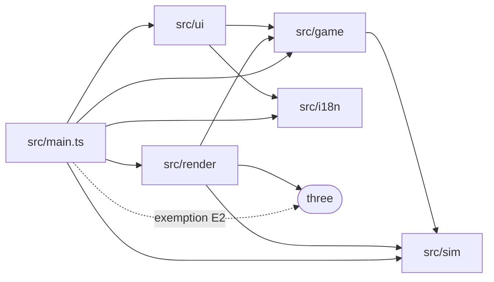

# Architecture

État au 2026-11-12, après T-002. Le code source validé se limite à des bouchons ; l'architecture est surtout portée par les règles automatiques décrites ici.

La tâche T-003 (noyau : horloge, saturation, RK4, enregistreur) est en cours et modifie `src/sim/`, `tests/sim/`, `package.json` et `vitest.config.ts`. Ces changements ne sont pas validés et ne sont pas décrits ici.

## Modules

| Module | Rôle | État |
|---|---|---|
| `src/sim/` | noyau de simulation pur : pas fixe, déterministe, sans rendu ni DOM | bouchon : `index.ts` exporte `SIM_DT = 1 / 120` (s). Contenu Prévu (T-003, T-004) |
| `src/game/` | logique de niveau : état, victoire et échec, bonhomme | Prévu (T-007) ; dossier absent |
| `src/i18n/` | chargeur de textes et locales FR/EN | Prévu (T-006) ; dossier absent |
| `src/render/` | rendu three.js (`three/webgpu`, repli WebGL2) | bouchon : `index.ts` exporte `parseRendererChoice(search)`, qui renvoie `'webgl'` si l'URL contient `?renderer=webgl`, sinon `'auto'`. Contenu Prévu (T-008, T-009) |
| `src/ui/` | interface DOM accessible : panneau Kp, boutons, messages | Prévu (T-010) ; dossier absent |
| `src/main.ts` | point de composition : seul fichier qui connaît tous les modules | bouchon, voir ci-dessous |

### Ce que fait `src/main.ts` aujourd'hui

- Il cherche le `<canvas id="scene">` de `index.html` et écrit `SIM_DT` dans son attribut `data-sim-dt`.
- Au premier `pointerdown` sur le canvas, il crée un `WebGPURenderer` (import `three/webgpu`), avec `forceWebGL: true` si l'URL contient `?renderer=webgl`, puis appelle `await renderer.init()`.
- Il écrit le backend obtenu dans `document.body.dataset.backend` (`'webgl'` ou `'webgpu'`).
- Rien n'est rendu. Ce comportement n'a pas été exécuté dans un navigateur (réserve E9 du log T-002) : vérification Prévu (T-008).

## Qui peut importer qui

Tableau tiré de `.dependency-cruiser.cjs` (section `forbidden`). « oui » = aucune règle ne l'interdit.

| Depuis ↓ / vers → | `sim` | `game` | `i18n` | `render` | `ui` | `three` | autre paquet npm |
|---|---|---|---|---|---|---|---|
| `src/sim/` | oui | non | non | non | non | non | non |
| `src/game/` | oui | oui | non | non | non | non | non |
| `src/i18n/` | non | non | oui | non | non | non | non |
| `src/render/` | oui | oui | non | oui | non | oui | oui |
| `src/ui/` | non | oui | oui | non | oui | non | oui |
| `src/main.ts` | oui | oui | oui | oui | oui | oui (exemption, voir plus bas) | oui |

Règles en vigueur (8) :

| Règle | Ce qu'elle interdit |
|---|---|
| `sim-is-pure` | tout import depuis `src/sim/` vers autre chose que `src/sim/` (paquets npm compris) |
| `i18n-is-pure` | tout import depuis `src/i18n/` vers autre chose que `src/i18n/` |
| `game-no-render` | tout import depuis `src/game/` vers autre chose que `src/game/` ou `src/sim/` |
| `render-deps` | `src/render/` → `src/ui/` ou `src/i18n/` |
| `ui-deps` | `src/ui/` → `src/sim/` ou `src/render/` |
| `three-only-in-render` | import de `three` hors de `src/render/` et de `src/main.ts` |
| `no-circular` | toute dépendance circulaire |
| `not-to-unresolvable` | tout import que l'outil ne sait pas résoudre |



Flèche = « peut importer ». `sim` et `i18n` n'importent rien hors d'eux-mêmes.

### Exemption temporaire de `src/main.ts` (réserve E2)

La règle `three-only-in-render` exclut `src/main.ts` (`pathNot: '^src/(render/|main\\.ts$)'`), car le bouchon actuel importe `three/webgpu` directement. Le log T-002 classe ce point en réserve E2. Prévu (T-008) : l'import passe dans `src/render/` et l'exemption est retirée.

## Les trois garde-fous du noyau pur

Ils protègent `src/sim/` (et, pour le deuxième, `src/game/`). Les sorties ci-dessous ont été reproduites le 2026-11-12 dans une copie du dépôt hors du dossier projet, avec un fichier `src/sim/_viol.ts` contenant :

```ts
import { Vector3 } from 'three';
export const v = new Vector3(Math.random(), Date.now(), 0);
export const w = document.title;
```

L'orchestrateur a fait le même essai pendant la validation de T-002 (log T-002 : « depcruise code 2, eslint 2 erreurs, tsc sim en erreur »).

### 1. dependency-cruiser : pas d'import interdit

- Fichier : `.dependency-cruiser.cjs`.
- Commande : `npm run lint:arch` (aussi lancée en dernier par `npm run lint`).
- Règles touchées : `sim-is-pure`, `three-only-in-render`.
- Sortie (code de sortie 2) :

```text
  error three-only-in-render: src/sim/_viol.ts → node_modules/three/build/three.module.js
  error sim-is-pure: src/sim/_viol.ts → node_modules/three/build/three.module.js

x 2 dependency violations (2 errors, 0 warnings). 6 modules, 4 dependencies cruised.
```

(Chemin vers `node_modules` raccourci : la copie pointait vers le `node_modules` du projet.)

Limite : la commande analyse seulement `src/`. Les fichiers de `tests/` ne sont pas contrôlés.

### 2. TypeScript sans DOM

- Fichier : `tsconfig.sim.json`. Il étend `tsconfig.json`, couvre `src/sim/**/*.ts` et `src/game/**/*.ts`, et remplace `lib` par `["ES2023"]` (sans `DOM`) et `types` par `[]`.
- Commande : `npm run typecheck` (deuxième passe, `tsc -p tsconfig.sim.json --noEmit`).
- Effet : `window`, `document` ou `performance` n'existent pas pour le compilateur dans ces dossiers.
- Sortie pour `document` (code de sortie 2) :

```text
src/sim/_viol.ts(3,18): error TS2584: Cannot find name 'document'. Do you need to change your target library? Try changing the 'lib' compiler option to include 'dom'.
```

L'import de `three` dans le même fichier provoque en plus 452 autres erreurs (376 dans `@types/three`, 76 dans `@types/webxr`, surtout `TS2304` : types DOM introuvables ; 453 erreurs au total) : c'est un deuxième signal du même problème.

### 3. ESLint : ni aléa ni horloge

- Fichier : `eslint.config.js`, bloc `files: ['src/sim/**/*.ts']`.
- Règles : `no-restricted-properties` sur `Math.random` et `Date.now` ; `no-restricted-globals` sur `Date` et `performance`.
- Commande : `npm run lint` (`eslint . --max-warnings 0`).
- Sortie (code de sortie 1) :

```text
  2:30  error  'Math.random' is restricted from being used. sim/ doit être déterministe : utiliser un PRNG à graine explicite  no-restricted-properties
  2:45  error  Unexpected use of 'Date'. sim/ ne lit jamais l'horloge : le temps est fourni par l'appelant                     no-restricted-globals
  2:45  error  'Date.now' is restricted from being used. sim/ ne lit jamais l'horloge : le temps est fourni par l'appelant     no-restricted-properties

✖ 3 problems (3 errors, 0 warnings)
```

Ces règles ne s'appliquent pas à `src/game/`, conformément à la spec T-001 §3.

Justification de ces choix : [ADR-003](decisions/ADR-003-noyau-pur.md).

## Écarts entre la configuration et la spec T-001 §3

La configuration fait foi. Écarts relevés :

- La spec cite 4 règles dependency-cruiser ; la configuration en a 8 (ajout de `i18n-is-pure`, `render-deps`, `ui-deps`, `not-to-unresolvable`).
- La spec dit `ui → game, i18n` ; la configuration autorise aussi `ui` à importer des paquets npm autres que `three`.
- La spec dit « tout import de `three` hors `render/` » est interdit ; la configuration exempte `src/main.ts` (réserve E2).

## Prévu

- Flux d'une image (horloge à pas fixe, interpolation du rendu) : Prévu (T-003, T-008), décrit dans la spec T-001 §4.
- Arborescence complète (`src/game`, `src/i18n`, `src/ui`, `tests/e2e`, `.github/workflows`) : Prévu (T-006 à T-011).
