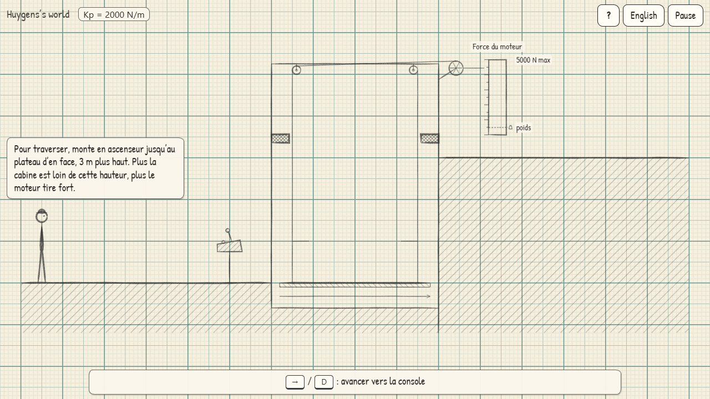
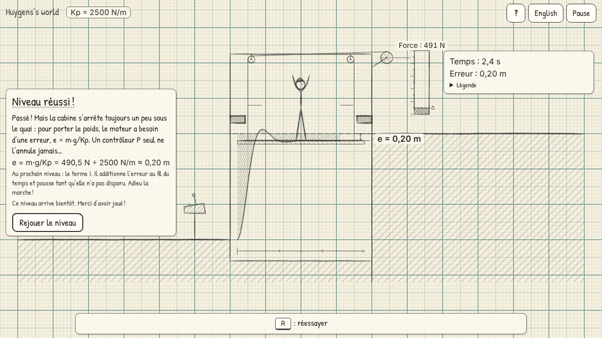
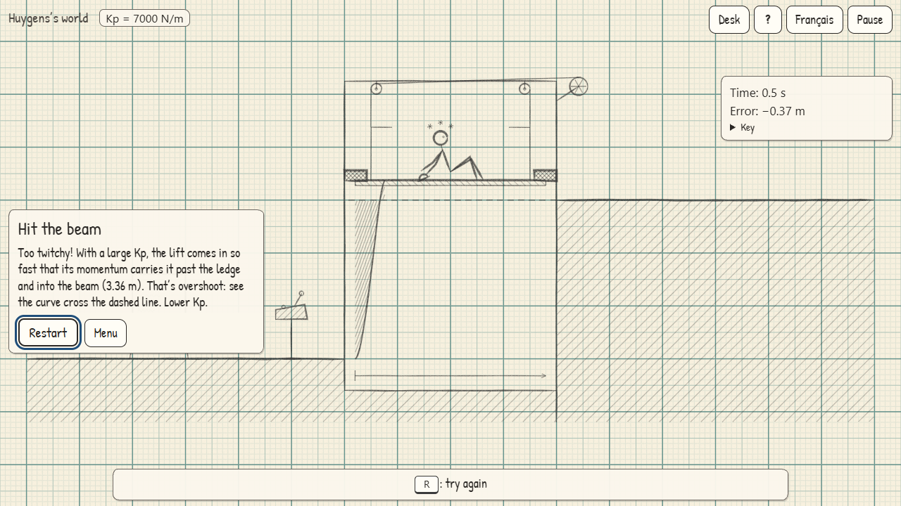
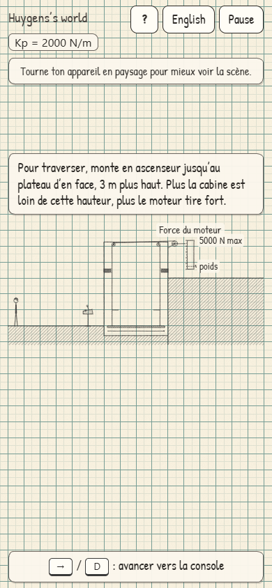

# Interface du joueur (`src/ui`)

À quoi sert cette page : décrire ce que le joueur voit et ce qu'il peut faire, phase par phase : textes, panneau de réglage, touches, accessibilité, disposition à l'écran, police. Elle décrit le commit `566a8a3` (interface validée en T-010). Le dessin de la scène est dans [rendu.md](rendu.md), les règles du niveau dans [jeu.md](jeu.md).

## Principe

L'interface est faite d'éléments HTML posés **par-dessus** le canvas (`src/ui/overlay.ts`, styles `ui.css`). Les textes restent du vrai texte : lisibles par un lecteur d'écran, traduits par `src/i18n`, nets à toute taille.

Le DOM est construit une fois. À chaque image, `ui.update()` :

1. reconstruit le **modèle de vue** (`view-model.ts`, pur) : « instantané du niveau + langue + état de l'interface → ce qu'il faut afficher » ;
2. consomme les événements du niveau (`level.drainEvents`) pour la région `aria-live` ;
3. calcule la **disposition** (`layout.ts`, pur) à partir de la géométrie de l'écran ;
4. n'écrit dans le DOM que ce qui a changé (comparaison avant écriture).

Le modèle de vue est un objet unique réécrit en place ; un texte n'est recalculé que si ce dont il dépend a changé (langue, phase, valeur arrondie à l'affichage). En régime établi, rien n'est écrit. « Aucune allocation par image » est établi par construction, pas mesuré (réserve du log T-010).

**Règle d'architecture** : `src/ui` n'importe que `src/game` et `src/i18n` (règle `ui-deps` de dependency-cruiser). Il n'importe ni `src/render` ni `src/sim`. Les positions à l'écran dont il a besoin (console, tête du bonhomme, jauge, cote) sont calculées par le rendu et transmises par `src/main.ts` sous forme de données (`UiGeometry`).

## Ce que voit le joueur, phase par phase

En permanence, la barre du haut montre le titre « Huygens’s world », l'**étiquette permanente** « Kp = 1000 N/m » (valeur courante), et trois boutons : « ? » (aide des commandes), la langue (« English » / « Français ») et « Pause ». En bas, le **bandeau d'aide** dit quelle action est possible maintenant et avec quelle touche.

### Approche

Une bulle rappelle l'objectif ; le bandeau indique d'avancer vers la console. Arrivé à la console, la bulle invite à l'utiliser.

### Réglage

Le panneau Kp s'ouvre à gauche du bonhomme et de la console, sans les couvrir. Il contient : la valeur en grand (« 2500 N/m »), les boutons − et +, un curseur de 0 à 8000 par pas de 100, un champ numérique, l'aide de Kp, la plage et le bouton « Lancer ».

### Trajet

Le panneau reste visible mais verrouillé (« Kp est verrouillé pendant le trajet. ») et propose « Recommencer ». À droite de la cage, les **mesures** du trajet : temps, erreur, et la force posée au-dessus de la jauge (« Force : 4200 N »). La **légende** des tracés (pointillés : consigne ; trait plein : hauteur ; hachures : erreur ; jauge) est dépliée pendant le premier trajet seulement, puis repliée ; le joueur peut la déplier lui-même.

Voir la capture en tête de [rendu.md](rendu.md).

### Issue

Un panneau donne le titre de l'issue, un message qui explique le mécanisme physique, et le bouton « Rejouer le niveau ». À la victoire, la cote chiffrée « e = 0,20 m » (erreur **mesurée**) est posée à côté de la marche, et le panneau donne la formule avec l'erreur **théorique** m·g/Kp, puis l'annonce du terme I.

### Pause

« Échap » ou le bouton « Pause » figent le jeu ; le bandeau indique comment reprendre.

## Bandeau d'aide contextuel

`chooseHint` (fichier `hints.ts`) choisit le bandeau d'après l'instantané ; `hintLine` produit son contenu dans la langue courante. Les touches sont dessinées comme des touches de clavier (`<kbd>`). Textes exacts vérifiés par `tests/ui/view-model.test.ts` :

| Bandeau | Quand | Français | Anglais |
|---|---|---|---|
| `walk` | approche, loin de la console | → / D : avancer vers la console | → / D: walk to the console |
| `use` | approche, à la console | E : utiliser la console | E: use the console |
| `tune` | réglage | + / − : régler Kp · Page préc. / Page suiv. : pas de 1000 · E ou Entrée : lancer | + / −: set Kp · Page Up / Page Down: steps of 1000 · E or Enter: launch |
| `trip` | trajet | Kp est verrouillé · R : recommencer · Échap : mettre en pause | Kp is locked · R: restart · Esc: pause |
| `outcome` | issue | R : réessayer | R: try again |
| `paused` | pause | Jeu en pause. · Échap : reprendre | Game paused. · Esc: resume |
| `help` | aide des commandes ouverte | Échap : fermer l’aide | Esc: close the help |

En français, l'espace avant « : » est une espace insécable (U+00A0), comme partout dans les textes (voir [i18n-accessibilite.md](i18n-accessibilite.md#règles-typographiques-des-textes)).

## Touches

Traduction touche → intention par la fonction pure `keyToIntent` (`src/ui/keys.ts`), exécutée par `bindKeyboard` (`input.ts`). Vérifiée par `tests/ui/keys.test.ts` (33 tests, dont 27 touches × 20 combinaisons de phase et de focus) et par les scénarios e2e au clavier réel.

Règles générales :

- la **marche** se lit sur la position physique de la touche (`code`) : Q/D sur un clavier AZERTY, A/D sur un clavier QWERTY ; `+` et `−` se lisent sur le caractère produit (`key`) ;
- avec Ctrl, Alt ou ⌘ enfoncée, aucune touche n'agit : les raccourcis du navigateur restent intacts ;
- une touche du jeu n'est jamais répétée par l'appui long pour E, Entrée, Espace et R ;
- toute touche du jeu, et les touches qui feraient défiler la page, sont bloquées (`preventDefault`).

### Table des touches

Le focus est sur la page (aucun contrôle sélectionné). Colonne « Intention » : valeur renvoyée par `keyToIntent`.

| Touche | `code` | `key` | Intention | Effet |
|---|---|---|---|---|
| ← | `ArrowLeft` | `ArrowLeft` | `walkLeft` | marcher à gauche tant que la touche est enfoncée (approche) |
| → | `ArrowRight` | `ArrowRight` | `walkRight` | marcher à droite tant que la touche est enfoncée (approche) |
| Q (AZERTY), A (QWERTY) | `KeyA` | `q` | `walkLeft` | marcher à gauche |
| D | `KeyD` | `d` | `walkRight` | marcher à droite |
| + | `Equal` | `+` | `kpUp` | Kp + 100 N/m |
| = | `Equal` | `=` | `kpUp` | Kp + 100 N/m (même touche que + sans Maj) |
| + du pavé numérique | `NumpadAdd` | `+` | `kpUp` | Kp + 100 N/m |
| - | `Minus` | `-` | `kpDown` | Kp − 100 N/m |
| − (U+2212) | `Minus` | `−` | `kpDown` | Kp − 100 N/m |
| - du pavé numérique | `NumpadSubtract` | `-` | `kpDown` | Kp − 100 N/m |
| Page préc. | `PageUp` | `PageUp` | `kpUpBig` | Kp + 1000 N/m |
| Page suiv. | `PageDown` | `PageDown` | `kpDownBig` | Kp − 1000 N/m |
| R | `KeyR` | `r` | `restart` | recommencer (trajet ou issue) |
| ↑ | `ArrowUp` | `ArrowUp` | `block` | rien (empêche le défilement) |
| ↓ | `ArrowDown` | `ArrowDown` | `block` | rien (empêche le défilement) |
| Début | `Home` | `Home` | `block` | rien (empêche le défilement) |
| Fin | `End` | `End` | `block` | rien (empêche le défilement) |

Les touches de Kp n'agissent qu'en approche et en réglage ; ailleurs, le niveau répond `locked` (Kp verrouillé, décision D9). La touche R n'agit que pendant le trajet et à l'issue.

### Touches qui dépendent de la phase

| Touche | `code` | Approche | Réglage | Trajet | Issue | Pause |
|---|---|---|---|---|---|---|
| E | `KeyE` | `interact` | `launch` | `block` | `block` | `block` |
| Entrée | `Enter` | `interact` | `launch` | `block` | `block` | `block` |
| Entrée du pavé numérique | `NumpadEnter` | `interact` | `launch` | `block` | `block` | `block` |
| Espace | `Space` | `interact` | `launch` | `block` | `block` | `block` |
| Échap | `Escape` | `pause` | `pause` | `pause` | `pause` | `resume` |

- `interact` en approche ouvre le réglage si le bonhomme est à la console, sinon ne fait rien.
- **E lance le trajet en phase de réglage.** Dans `src/game`, `interact()` en réglage referme le panneau ; le clavier ne l'utilise pas ainsi. Aucune touche ne referme le panneau sans lancer (réserve du log T-010).
- Échap, quand l'aide des commandes est ouverte, la referme (`closeHelp`), sans mettre en pause, quelle que soit la phase.

### Selon le focus

| Focus | Comportement |
|---|---|
| champ numérique de Kp | tout est natif (saisie libre), sauf Échap |
| bouton, lien, résumé de légende | Entrée et Espace activent le contrôle (natif) ; E garde son rôle de jeu |
| curseur de Kp | les flèches règlent la valeur (natif) ; Q/A et D font toujours marcher |

### Perte de focus

Quand la fenêtre perd le focus ou que l'onglet est masqué : la marche s'arrête et, pendant un trajet, le jeu se met en pause. En approche, il n'y a pas de pause (tests e2e (f) et (f bis)).

### Souris et tactile

- **Souris** : clic sur le pupitre ou le pied de la console (en approche) = utiliser la console. Tous les boutons et le curseur du panneau sont cliquables.
- **Tactile** (écran à pointeur grossier, `pointer: coarse`) : boutons ◀ et ▶ de 56 × 56 px (marcher tant que le doigt appuie) et un bouton « Action » qui ouvre la console, lance, recommence ou reprend selon la phase. Ces boutons n'ont pas été essayés sur un vrai écran tactile (réserve du log T-010).

## Aide des commandes « ? »

Le bouton « ? » ouvre une fenêtre d'aide (`role="dialog"`) qui liste les commandes au clavier, à la souris et au tactile (clés `controls.help.`). À l'ouverture, le focus va sur « Fermer l’aide ». Échap ou « Fermer l’aide » la referme. Le focus revient au bouton « ? » seulement s'il était dans l'aide au moment de la fermeture ; sinon il reste où il était (`setHelp`, `src/ui/overlay.ts`). Relevé par la validation T-012 (§F, affirmation 7).

## Langue

Le bouton de langue affiche le nom de l'autre langue, dans cette langue (« English » quand le jeu est en français), avec l'attribut `lang` correspondant. Un clic change tous les textes à la volée, met à jour `<html lang>`, et conserve Kp et la phase (test e2e (c)). Langue initiale : voir [i18n-accessibilite.md](i18n-accessibilite.md#détection-de-la-langue).

## Annonces pour lecteurs d'écran

Une région `aria-live="polite"` (`role="status"`) annonce une phrase par événement du niveau (`announcementFor`, fichier `announce.ts`) :

| Événement | Annonce (clé) |
|---|---|
| ouverture du réglage | `hud.status.ready` |
| lancement | `hud.status.launch` avec Kp |
| première saturation (une fois par trajet) | `level1.saturation` |
| issue | `hud.status.win`, `hud.status.fail.step`, `hud.status.fail.noLift` ou `hud.status.fail.bonk`, avec l'erreur finale à 2 décimales |
| recommencer | `hud.status.reset` |
| pause, reprise | `hud.status.paused`, `hud.status.resumed` |
| fermeture du réglage | rien |

Chaque événement est consommé une seule fois. Le canvas porte `role="img"` et un nom traduit (`a11y.canvas`). Détail : [i18n-accessibilite.md](i18n-accessibilite.md#partie-2--accessibilité-validé-t-010).

## Petit écran en portrait

Sur un écran en portrait de moins de 700 px de large, une invite propose de tourner l'appareil (`app.rotateHint`), et la disposition passe en « bandes » (voir plus bas). À 390 px de large, la scène est petite (17 m dans la largeur). L'étiquette permanente de Kp y est en partie masquée par l'invite (réserve du log T-010).

## Disposition

`computeLayout(geometry, out)` (fichier `layout.ts`) est une fonction pure. À partir de la géométrie de l'écran en pixels CSS, elle place chaque panneau dans une boîte dont il ne sort jamais (largeur fixée, hauteur maximale avec défilement interne).

**Zones protégées** : aucun panneau ne coupe

- la **cage** (colonne x ∈ [0 ; 4] m sur toute la hauteur de la zone de jeu) : rien ne masque l'ascenseur ni la courbe ;
- la **console** (boîte de ± 0,35 m autour du pupitre) ;
- le **bonhomme** quand il est sur le quai (± 0,3 m autour de sa tête).

Deux modes :

| Mode | Quand | Placement |
|---|---|---|
| `sides` (paysage) | au moins 240 px libres de chaque côté de la cage | réglage, bulle et issue à gauche de la cage (à gauche du bonhomme et de la console, sinon au-dessus d'eux) ; mesures et aide à droite |
| `bands` (portrait) | côtés trop étroits | bulle et mesures dans la bande au-dessus de la scène ; réglage et issue dans la bande au-dessous |

Le bandeau d'aide est en bas de l'écran, sous la scène s'il y a au moins 56 px, sinon en bas à gauche de la cage.

Vérification : `tests/ui/layout.test.ts` contrôle 13 tailles d'écran (de 360 × 740 à 2560 × 720) ; le test e2e (i) mesure les boîtes réelles à 1280 × 720 et 390 × 844.

Clic sur la console : `isConsoleHit` accepte une zone de ± 0,6 m autour de la console, de 0,4 m au-dessus du pupitre à 1,1 m au-dessous (pied compris).

## Police

| Élément | Valeur |
|---|---|
| police | Patrick Hand, Patrick Wagesreiter, licence SIL Open Font License 1.1 (`public/fonts/OFL.txt`) |
| fichiers | `public/fonts/patrick-hand-latin-400-normal.woff2` (23 944 octets) et `patrick-hand-latin-ext-400-normal.woff2` (20 112 octets) |
| sous-ensembles | latin (U+0000-00FF, ponctuation U+2000-206F dont U+202F, signe moins U+2212…) et latin étendu, chargés selon les caractères présents (`unicode-range`) |
| chargement | auto-hébergée, `font-display: swap`, servie depuis `/pid-game/fonts/` (test e2e (h)) |
| repli | Segoe Print, Bradley Hand, Comic Sans MS, puis police système |
| chiffres | police système à chiffres tabulaires pour les valeurs (temps, erreur, force, Kp) |
| taille de base | 18 px |

Contrastes déclarés dans `ui.css` (sur le papier `#fbf7ec`) : texte ≈ 14:1, texte secondaire ≈ 9:1, rouge ≈ 7:1. Ils ne sont pas mesurés par un test.

## Exports de `src/ui/index.ts`

Principaux exports, groupés par fichier :

| Fichier | Exports |
|---|---|
| `overlay.ts` | `createUi(options) → Ui` ; types `Ui`, `UiOptions` |
| `input.ts` | `bindKeyboard(level, ui, window)` (renvoie la fonction qui retire les écouteurs), `focusTargetOf` |
| `keys.ts` | `keyToIntent`, `kpDeltaOf`, `walkSideOf`, `KP_SMALL_STEP` (100), `KP_BIG_STEP` (1000) ; types `KeyInput`, `KeyIntent`, `FocusTarget` |
| `hints.ts` | `chooseHint`, `hintLine`, `hintText`, `KEY_SYMBOLS`, `KEY_SEPARATOR` ; types `HintId`, `HintItem`, `HintLine`, `HintSegment` |
| `view-model.ts` | `createViewModelBuilder`, `staticTexts`, `effectivePhase` ; types `ViewModel`, `ViewModelBuilder`, `StaticTexts`, `UiState` |
| `layout.ts` | `computeLayout`, `createLayout`, `consoleRect`, `walkerRect`, `walkerOnLedge`, `isConsoleHit`, `intersects`, `boxExtent` ; types `UiGeometry`, `UiLayout`, `PanelBox`, `ScreenRect`, `ScreenXY` |
| `announce.ts` | `announcementFor`, `formatError`, `formatKp`, `ERROR_DIGITS` |

Constantes de disposition exportées par `layout.ts` (pixels CSS, sauf mention) :

| Constante | Valeur | Rôle |
|---|---|---|
| `MARGIN` | 12 | marge autour des panneaux |
| `TOP_BAR` | 56 | hauteur réservée à la barre du haut |
| `ROTATE_BAR` | 44 | hauteur réservée à l'invite de rotation sous la barre du haut, en portrait |
| `BANNER_RESERVE` | 76 | hauteur réservée au bandeau d'aide |
| `MIN_SIDE` | 240 | largeur libre minimale de chaque côté de la cage pour la disposition « côtés » |
| `MIN_BANNER_BAND` | 56 | hauteur minimale sous la scène pour y poser le bandeau |
| `MIN_PANEL_BESIDE` | 280 | largeur minimale d'un panneau posé à gauche du bonhomme et de la console (sinon il est posé au-dessus) |
| `WALKER_HALF_WIDTH` | 0,3 m | demi-largeur de la boîte protégée du bonhomme |
| `CONSOLE_HALF_BOX` | 0,35 m | demi-largeur de la boîte protégée de la console |
| `CONSOLE_BOX_ABOVE` | 0,35 m | hauteur de la boîte protégée au-dessus du pupitre |
| `CONSOLE_HIT_HALF_WIDTH` | 0,6 m | demi-largeur de la zone de clic de la console |
| `CONSOLE_HIT_ABOVE` | 0,4 m | zone de clic au-dessus du pupitre |
| `CONSOLE_HIT_BELOW` | 1,1 m | zone de clic sous le pupitre (pied compris) |
| `MAX_WIDTH` | bandeau 960, bulle 320, panneau 360, issue 440, mesures 320, aide 480 | largeur maximale de chaque panneau |

Justification des choix : [ADR-011](decisions/ADR-011-interface-dom.md).
