# Interface du joueur (`src/ui`)

À quoi sert cette page : décrire ce que le joueur voit et ce qu'il peut faire, phase par phase : textes, panneau de réglage, touches, accessibilité, disposition à l'écran, police. Elle décrit le commit `3810193`, lot A de la v0.3 « salle de contrôle » (branche `v0.3-salle-de-controle`, non fusionnée : T-036 bouton « Niveau suivant », T-037 poste, embarquement et sortie, T-038 rendu des poses, T-039 panneau de réglage stable, annonce de lancement différée et bouton « Action » sans effet à l'issue, T-040 captures refaites). Le reste vient de l'état `02119f7` (interface validée en T-010, corrigée par P-005, T-014, T-015, puis étendue par T-017 : écrans titre et menu, bouton « Menu », destruction de l'interface du niveau ; T-019 : étiquettes de la jauge ; T-021b : niveau 2 ; T-022 : trajet de 10 s, Kp par défaut 2000, annonce « trop court » du niveau 2 ; T-024 : jauge du terme intégral I au niveau 2 ; T-026 à T-033 : correctifs de la chasse aux bugs de la v0.2, voir [CHANGELOG.md](CHANGELOG.md)). T-025 a régénéré les captures périmées par T-022 (K35 corrigé), T-040 celles que le lot A avait périmées (K49) ; celle qui montre encore une ancienne valeur (t010-05) le dit dans sa légende. Le dessin de la scène est dans [rendu.md](rendu.md), les règles du niveau dans [jeu.md](jeu.md).

## Principe

L'interface est faite d'éléments HTML posés **par-dessus** le canvas (`src/ui/overlay.ts`, styles `ui.css`). Les textes restent du vrai texte : lisibles par un lecteur d'écran, traduits par `src/i18n`, nets à toute taille.

Le DOM du niveau est construit une fois par entrée dans un niveau : `createUi` le monte, `ui.destroy()` le démonte (écouteurs du document, du canvas et du traducteur retirés, conteneur vidé, canvas masqué aux lecteurs d'écran). Depuis T-017, `main.ts` crée une interface neuve à chaque entrée depuis le menu et la détruit au retour ([ADR-011](decisions/ADR-011-interface-dom.md), [ADR-015](decisions/ADR-015-etat-application-machine-ecrans.md)). À chaque image, `ui.update()` :

1. reconstruit le **modèle de vue** (`view-model.ts`, pur) : « instantané du niveau + langue + état de l'interface → ce qu'il faut afficher » ;
2. consomme les événements du niveau (`level.drainEvents`) pour la région `aria-live` ;
3. calcule la **disposition** (`layout.ts`, pur) à partir de la géométrie de l'écran ;
4. n'écrit dans le DOM que ce qui a changé (comparaison avant écriture).

Le modèle de vue est un objet unique réécrit en place ; un texte n'est recalculé que si ce dont il dépend a changé (langue, phase, valeur arrondie à l'affichage). En régime établi, rien n'est écrit. « Aucune allocation par image » est établi par construction, pas mesuré (réserve du log T-010).

**Règle d'architecture** : `src/ui` n'importe que `src/game`, `src/i18n` et (types seulement : `ScreenId`, `LevelEntry`) `src/app` (règle `ui-deps` de dependency-cruiser ; aucune règle n'interdit `ui → app`). Il n'importe ni `src/render` ni `src/sim`. Les positions à l'écran dont il a besoin (console, tête du bonhomme, jauge, cote) sont calculées par le rendu et transmises par `src/main.ts` sous forme de données (`UiGeometry`).

## Écrans titre et menu (T-017)

Depuis T-017, le jeu s'ouvre sur un **écran titre**, puis un **menu des niveaux**, avant le niveau (machine d'écrans : [architecture.md](architecture.md#ce-que-fait-srcmaints), [ADR-015](decisions/ADR-015-etat-application-machine-ecrans.md)). Les deux écrans sont du DOM posé sur le canvas, qui n'affiche que le papier millimétré ; code : `src/ui/screens.ts` (DOM), `screens-model.ts` (textes, pur), `screen-keys.ts` (touches, pur), `screens.css`. Chaque écran est un `<main>` nommé par son titre, monté dans un conteneur `#screens` ; `destroy()` retire le DOM, les écouteurs et l'abonnement au traducteur (idempotent).

| Écran | Contenu | Focus à l'arrivée |
|---|---|---|
| titre | titre « Huygens’s world », sous-titre (`app.tagline`), bouton « Jouer » / « Play », bouton de langue, pied de page avec la mention de copyright et le nom de la licence | « Jouer » |
| menu | titre « Niveaux » / « Levels », liste de boutons « Niveau 1 : le vide » et « Niveau 2 : la mémoire », bouton « Retour » / « Back » | le premier niveau jouable, ou, **seulement quand on revient d'un niveau**, celui qu'on vient de quitter (depuis le titre, le focus va toujours sur « Niveau 1 » : A-05, T-029) |

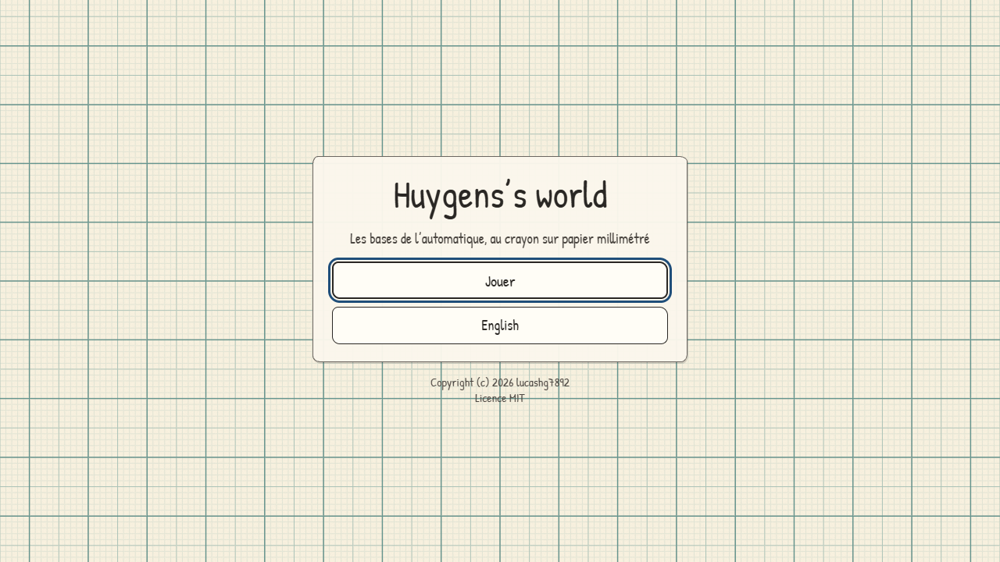

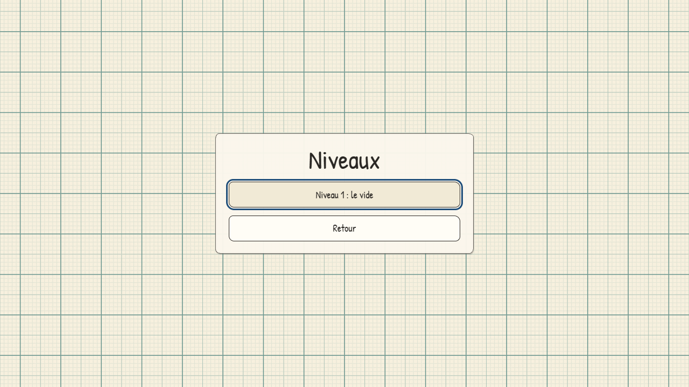

**Copyright.** La ligne affichée est « Copyright (c) 2026 lucashg7892 » (`title.copyright`, identique en français et en anglais) suivie de « Licence MIT » ou « MIT License » (`title.license`). `tests/i18n/license.test.ts` (5 tests) la compare au fichier `LICENSE` : ligne unique de copyright, année et titulaire, première ligne de la licence, aucune autre clé ne porte de notice. Elle n'est affichée que sur le titre. Depuis T-032 (K27 corrigé), elle est posée sur un fond de papier opaque (`.ui-screen-legal` dans `screens.css` : `background: #fbf7ec`, coins arrondis de 6 px, marge intérieure `0.3em 1em`) : la grille du canvas ne la traverse plus. Captures `t017-titre-fr` et `t017-titre-portrait` refaites par T-033.

**Touches** (`screenKeyToIntent`, 18 tests dans `tests/ui/screen-keys.test.ts`) :

| Écran | Touche | Intention |
|---|---|---|
| titre | Entrée, Espace | natif (activation du bouton focalisé) ; avec `repeat` : `block` (A-01) |
| titre | Échap | rien |
| menu | ↑ / ↓ | `focusPrev` / `focusNext` entre les niveaux jouables puis « Retour », sans bouclage (`block` aux extrémités, `focusFirst` ou `focusLast` si le focus est ailleurs) |
| menu | Échap | `back` : retour au titre (ignoré en répétition) |
| titre, menu | Tab, Maj+Tab | natif |
| menu | Entrée, Espace | natif ; avec `repeat` : `block` (A-01) |
| niveau | — | `none` : ces écrans n'ont aucun rôle dans un niveau (son clavier est `keys.ts`) ; Entrée ou Espace avec `repeat` : `none` aussi |

Avec Ctrl, Alt ou ⌘ enfoncée, aucune intention. Le titre écoute lui aussi le clavier du document, seulement pour bloquer la répétition d'Entrée et d'Espace.

**Une intention, un écran (A-01, T-027).** Une double activation ne doit pas traverser deux écrans. Deux gardes :

- **clic** : les boutons de navigation (« Jouer », langue, niveaux du menu, « Retour ») passent par `Disposables.onNavigate` (`screens.ts`), qui ignore un clic dont `event.detail > 1` (deuxième clic d'un double-clic ou d'un double tape, qui tomberait sur l'écran suivant). Un clic au clavier ou synthétique (`element.click()`, lecteur d'écran) a `detail` 0 et passe ;
- **touche maintenue** : Entrée ou Espace avec `repeat` est bloquée (`preventDefault`) par `screenKeyToIntent` sur le titre et le menu, et par `keyToIntent` sur un bouton du niveau (« Menu », « Rejouer »...) : sans cela le navigateur synthétise un clic à chaque répétition. La première frappe reste native. Échap maintenue (A-03) ne produit qu'une intention : la répétition est bloquée.

Tests : e2e (j) et (k) de `screens.spec.ts` (7 tests), unitaires de `keys.test.ts` et `screen-keys.test.ts`.

**Cartes très basses (A-09, T-029).** `.ui-screen` centre son contenu par `justify-content: safe center` : quand la carte est plus haute que l'écran, elle s'aligne en haut et défile, au lieu de déborder des deux côtés (e2e `mineurs-t029.spec.ts`, 800 × 200). Le clavier du niveau (`bindKeyboard`) n'est monté que dans un niveau.

**Accessibilité.** Tous les contrôles sont de vrais boutons (clic, toucher, Entrée et Espace identiques), de 44 px au moins (`min-height` 48 px dans `screens.css` ; l'e2e (h) de `screens.spec.ts` vérifie au moins 44 px à 390 × 844 et 360 × 740). À l'arrivée sur un écran, une phrase est écrite dans une région `aria-live="polite"` de l'écran, après un délai de 100 ms pour qu'elle soit lue : « Écran titre » (`menu.announce.title`) ou « Menu des niveaux » (`menu.announce.menu`). Le canvas est `aria-hidden="true"` sur le titre et le menu ; `createUi` retire cet attribut à l'entrée dans un niveau et `ui.destroy()` le remet. `<html lang>` et le titre du document sont tenus par `main.ts` (abonnement au traducteur), plus par l'interface du niveau. Ces écrans n'ont aucune animation ni transition. Le bouton de langue du titre réutilise `Translator.setLocale` ; la langue choisie est conservée au menu, dans le niveau et au retour (e2e (e)). En portrait, les écrans sont des colonnes qui défilent verticalement (`max-height: 100dvh`) et n'ont pas l'invite de rotation. Un essai avec un vrai lecteur d'écran n'a pas été fait ; le tactile n'a pas été essayé sur un appareil réel (K9).

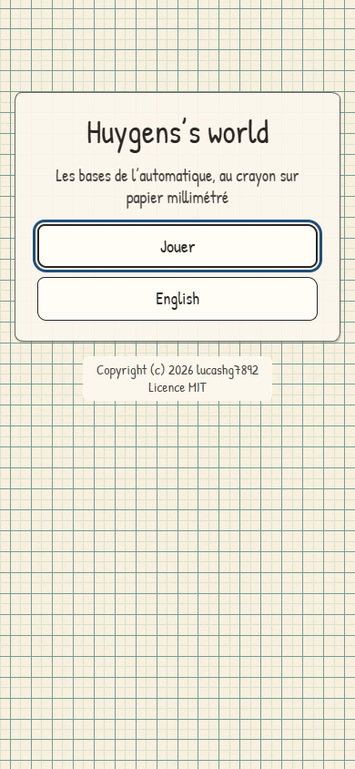

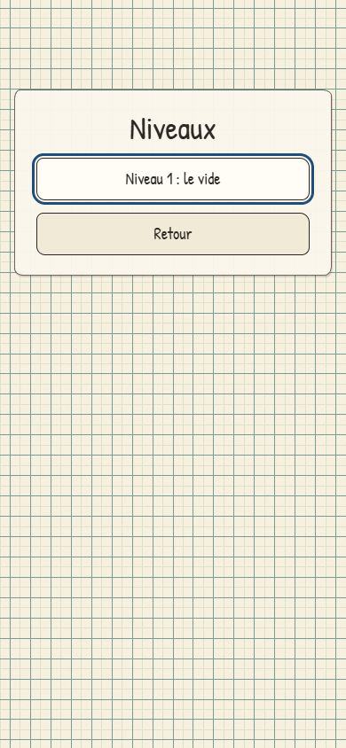

Sans GPU, la page de repli remplace tout, avant le titre (e2e `?renderer=none` de `screens.spec.ts`). Un échec du rendu pendant le titre ou le menu démonte l'écran et affiche la page de repli d'échec (e2e (g)).

## Ce que voit le joueur, phase par phase

En permanence, la barre du haut montre le titre « Huygens’s world », l'**étiquette permanente** « Kp = 2000 N/m » (valeur courante au chargement ; 500 de T-020 à T-021b, 1000 avant ; au niveau 2 : « Kp = 2500 · Ki = 2000 »), et trois boutons : « ? » (aide des commandes), la langue (« English » / « Français ») et « Pause ». Quand le jeu est en pause, un quatrième bouton, « Menu », apparaît à côté (voir plus bas). En bas, le **bandeau d'aide** dit quelle action est possible maintenant et avec quelle touche. Depuis T-019, la jauge de force porte aussi des étiquettes permanentes (voir [plus bas](#étiquettes-de-la-jauge-de-force-t-019)).

### Approche

Une bulle rappelle l'objectif ; le bandeau dit partout « E : régler l'ascenseur » (`hud.hint.use`) : depuis T-037, E ouvre le réglage de n'importe où sur le quai, sans avoir à marcher jusqu'à la console. Arrivé dans la zone de la console, la bulle invite à l'utiliser. Depuis T-019, la bulle d'ouverture (`level1.goal`) dit : « Pour traverser, monte en ascenseur jusqu’au plateau d’en face, 3 m plus haut. Plus la cabine est loin de cette hauteur, plus le moteur tire fort. » Le mot « quai » est remplacé par « plateau d'arrivée » dans les textes français du niveau (les nombres de ces textes suivent T-020 : 0,5 m et 3,36 m).

### Réglage

Le panneau Kp s'ouvre **tout de suite** à l'appui sur E (depuis n'importe où sur le quai), à gauche du bonhomme et de la console, sans les couvrir. Le bonhomme rejoint à 1,5 m/s son poste, à gauche du pupitre (−1,55 m), tourné vers lui, main sur le levier ; E, Entrée ou Espace pendant cette marche lancent le trajet depuis là où il est. Depuis T-039 (R3), la **taille et la position du panneau ne changent plus** pendant la marche vers le poste ni au lancement : la disposition place son obstacle sur le bonhomme au poste, pas sur sa position en direct (voir « Disposition »), et la ligne « verrouillé » reste toujours réservée (classe `is-idle`, invisible tant que le réglage est libre ; effet de bord : un blanc de 27 px au-dessus de « Lancer », K50). Il contient : la valeur en grand (« 2500 N/m »), les boutons − et +, un curseur de 0 à 8000 par pas de 100, un champ numérique, l'aide de Kp, la plage et le bouton « Lancer ». Le curseur part de Kp = 2000 N/m (`KP_DEFAULT`, dans la fenêtre de réussite depuis T-022 : lancer sans régler gagne).

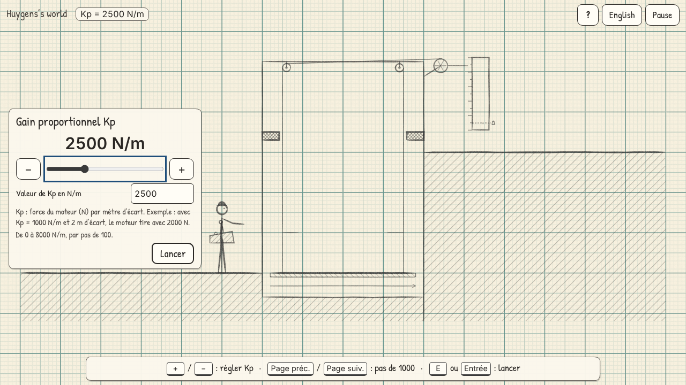

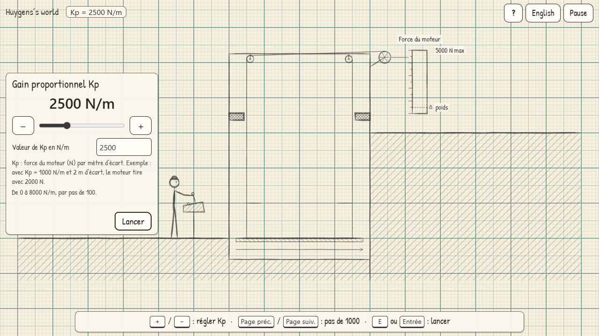

### Embarquement (T-037)

À « Lancer », le bonhomme marche du poste jusqu'au centre de la cabine (284 pas, 2,37 s depuis le poste) ; le trajet ne démarre qu'à son arrivée. Le panneau reste ouvert, verrouillé (« Kp est verrouillé pendant le trajet. ») avec « Recommencer » (`panelRestart` est visible en `boarding` et en `trip`) ; les mesures du trajet ne sont pas encore affichées. Le bandeau passe à `skip` : « E ou Entrée : passer · R : recommencer · Échap : mettre en pause ». E, Entrée ou Espace (ou « Action » au tactile) passent l'embarquement : le bonhomme est placé dans la cabine et le trajet part. Une touche maintenue (`repeat`) ne passe pas l'embarquement.

### Trajet

Le panneau reste visible mais verrouillé (« Kp est verrouillé pendant le trajet. ») et propose « Recommencer ». À droite de la cage, les **mesures** du trajet : temps, erreur, et la force posée au-dessus de la jauge (« Force : 4200 N »). Les nombres négatifs portent le vrai signe moins U+2212, jamais le trait d'union ASCII (« −0,03 m », « Force : −102 N » ; `formatNumber`, voir [i18n-accessibilite.md](i18n-accessibilite.md#règles-typographiques-des-textes)). La **légende** des tracés (pointillés : consigne ; trait plein : hauteur ; hachures : erreur ; jauge) est dépliée pendant le premier trajet seulement, puis repliée ; le joueur peut la déplier lui-même.

Voir la capture en tête de [rendu.md](rendu.md).

### Sortie (T-037)

Après une **victoire** (avec animations), le jeu ne montre pas l'issue tout de suite : la cabine est figée, le bonhomme sort sur le plancher, franchit le pas (0,2 m) puis avance sur le plateau d'arrivée (208 pas, 1,73 s). Les mesures du trajet (temps, erreur, légende, jauge) restent affichées et le panneau de réglage se ferme ; le panneau d'issue n'apparaît qu'à l'arrivée, et l'annonce d'issue part alors. Même bandeau `skip` et même touche que pour l'embarquement. Les échecs affichent leur issue aussitôt, comme avant. Avec « mouvement réduit », il n'y a pas de sortie : l'issue s'affiche au pas de victoire, bonhomme dans la cabine.

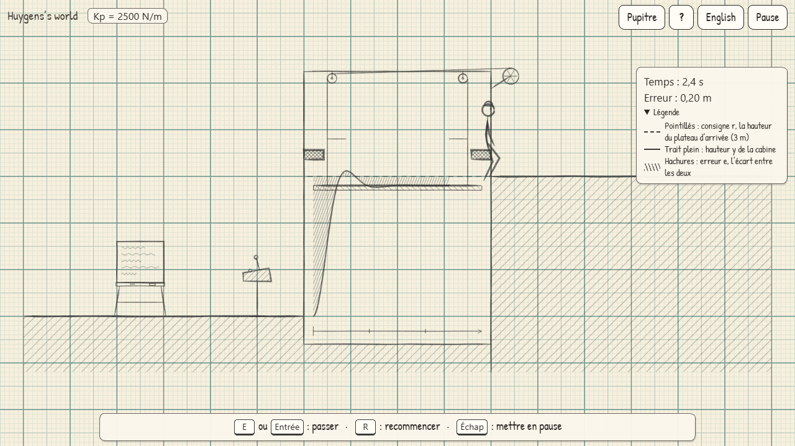

Pendant la saturation du moteur (Kp = 4500 N/m, 0,1 s après le lancement), la jauge est rouge et le mot « Saturé » est affiché (`hud.saturated`) ; la région `aria-live` annonce `level1.saturation`.

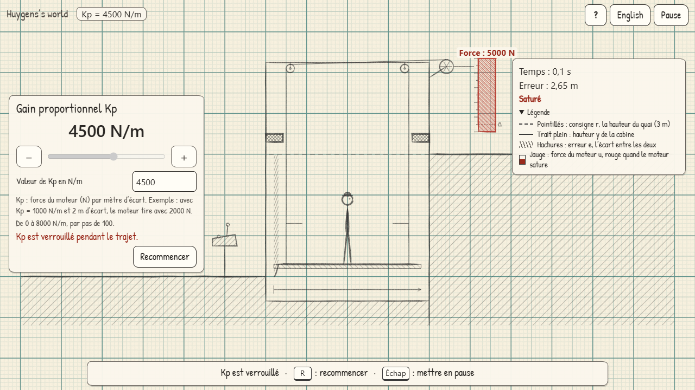

### Issue

Un panneau donne le titre de l'issue, un message qui explique le mécanisme physique, et des boutons : « Rejouer le niveau » et « Menu », plus, **à la réussite du niveau 1 seulement**, « Niveau suivant » (T-036, D33). Depuis T-028 (A-02), les boutons vivent dans un **pied collant** (`div.ui-outcome-actions`, `position: sticky` en bas du panneau, fond de papier opaque) : si le message défile dans le panneau, les boutons restent dans la partie visible. En mode bandes, quand la bande sous la scène fait moins de `MIN_OUTCOME_ROOM` (120 px), le panneau se pose en bas, au-dessus du bandeau, sur `OUTCOME_FALLBACK_HEIGHT` (150 px) de haut au plus (titre, message qui défile, boutons collés) : « Rejouer » et « Menu » sont visibles et cliquables de 1024 × 600 à 667 × 375 (test écrit avant « Niveau suivant »), aux deux niveaux, à la victoire et au choc (e2e (r) de `ui.spec.ts`, 16 tests). Au plus bas (667 × 375), ce panneau recouvre le bas de la cage : défaut K39. À la victoire, la cote chiffrée « e = 0,20 m » (erreur **mesurée**) est posée à côté de la marche, et le panneau donne la formule avec l'erreur **théorique** m·g/Kp, puis l'annonce du terme I.

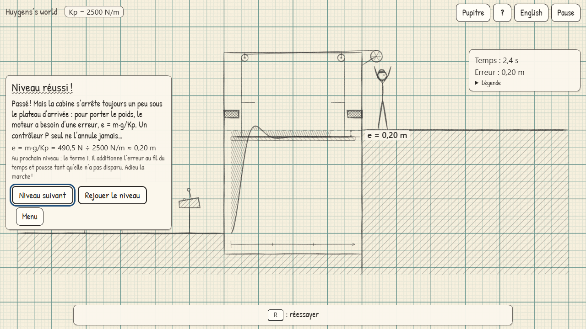

**Bouton « Niveau suivant » (T-036).** Il porte la clé `controls.nextLevel` (« Niveau suivant » / « Next level ») et précède « Rejouer le niveau » (classe `ui-next`, marge de droite 0,5 em ; les boutons passent à la ligne si la place manque). Il existe seulement si `main.ts` fournit l'option `onNext` à `createUi`, c'est-à-dire si `nextLevelId(levelId)` n'est pas `null` : au niveau 1 (suivant : niveau 2), pas au niveau 2, dernier niveau. Il n'est visible qu'à la réussite (`vm.outcome === 'win'`) : jamais après un échec. À l'apparition de l'issue de réussite, le focus est sur lui (sinon sur « Rejouer ») ; il est désactivé en pause, et le focus qui y était passe alors au bouton « Pause » ; un double-clic n'agit qu'une fois (garde A-01 : `event.detail > 1` ignoré) ; il est inerte tant que l'aide est ouverte (`commandsBlocked`). Il appelle `machine.nextLevel()` : un niveau 2 neuf remplace le niveau 1 ([ADR-015](decisions/ADR-015-etat-application-machine-ecrans.md#évolution-v03-lot-a-2026-11-15--la-commande-nextlevel)). Le message « Le niveau 2 t'attend dans le menu : merci d'avoir joué ! » (`level1.comingSoon`) est supprimé. Défaut K47 : à 1280 × 720 et en portrait, « Menu » passe à la ligne sous les deux autres boutons avec sa marge gauche (léger décalage) ; en paysage bas (844 × 390), le panneau défile et seuls le titre et les boutons sont visibles.

### Pause

« Échap » (hors phase de réglage) ou le bouton « Pause » figent le jeu ; le bandeau indique comment reprendre. En phase de réglage, « Échap » ferme le panneau de Kp au lieu de mettre en pause. Le bouton « Pause » change de libellé (« Reprendre ») sans attribut `aria-pressed`. Si le panneau d'issue est ouvert, les boutons « Rejouer le niveau » et « Niveau suivant » sont désactivés tant que le jeu est en pause (B-04, T-029 : `enable(outcomeButton, !vm.paused)` ; T-036 pour « Niveau suivant ») ; si le focus était sur l'un d'eux, il passe au bouton « Pause ». La reprise le réactive. En pause, le bouton « Menu » (clé `controls.menu`, identique en français et en anglais) est visible dans la barre du haut.

### Bouton « Menu » (T-017e)

Le bouton « Menu » ramène au menu des niveaux, **sans confirmation** : le niveau est jeté (pas de reprise au retour). Il existe seulement quand `main.ts` fournit l'action `onMenu` à `createUi`, et il est visible à deux endroits : dans la barre du haut **en pause**, et dans le **panneau d'issue**, à côté de « Rejouer ». Tant que l'aide est ouverte, il ne fait rien (garde `commandsBlocked`, voir « Aide des commandes »). Aucune touche n'est liée à ce bouton : Échap garde son rôle (fermer le réglage, ou pause).

En portrait étroit (≤ 700 px), pour que les quatre boutons de la barre du haut (« ? », langue, « Menu », « Reprendre ») tiennent en pause, le titre et l'étiquette Kp de la barre sont masqués par CSS (classe `is-paused`) : choix « le plus simple » de T-017e, à valider côté design (K26).

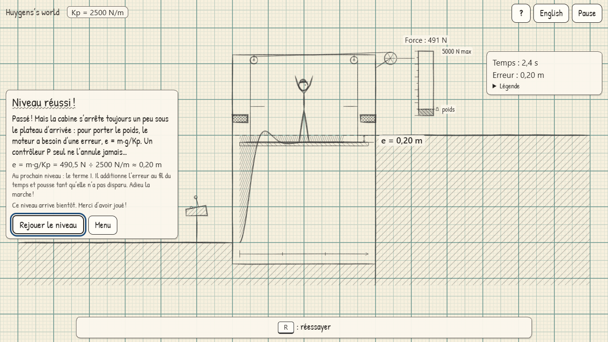

## Étiquettes de la jauge de force (T-019)

À droite de la cage, la jauge de force porte des étiquettes **permanentes**, dès l'approche. Elles sont posées par `src/ui` (classes `ui-gauge-title` et `ui-gauge-tag`), aux ancres calculées par le rendu (`forceGauge`, `gaugeMax`, `gaugeWeight`, voir [rendu.md](rendu.md#interpolation-et-ancres-pour-linterface)) :

| Étiquette | Français | Anglais | Clé |
|---|---|---|---|
| légende, au-dessus du cadre | Force du moteur | Motor force | `hud.gauge.title` |
| haut de l'échelle | 5000 N max | 5000 N max | `hud.gauge.max` (paramètre `{n}`, `ELEVATOR_MAX_FORCE` formaté) |
| repère du poids m·g | poids | weight | `hud.gauge.weight` |

Dès le lancement du trajet, la légende cède la place à « Force : … N » (`ui-force`) ; « 5000 N max » et « poids » restent. Les trois étiquettes sont `aria-hidden` (le panneau des mesures et le nom de la jauge disent déjà la même chose) et cachées tant que la géométrie manque. La disposition leur réserve `GAUGE_LABELS_ROOM` = 84 px à droite de la jauge (les mesures se posent au-delà) et, en portrait, `GAUGE_TITLE_BAND` = 18 px au-dessus de la scène : la bulle et les mesures s'arrêtent plus haut (`layout.ts`, `tests/ui/layout.test.ts`).

## Jauge du terme intégral I, niveau 2 (T-024)

Au niveau 2 seulement (`level.snapshot.levelId === 'level2'`, constante `hasIntegral` de `createUi`), une seconde jauge se dresse à droite de la jauge de force. Elle a la même échelle (0 à 5000 N), le même repère du poids m·g et se remplit à |I| (valeur absolue du terme intégral, `iTerm` du snapshot) ; le dessin est décrit dans [rendu.md](rendu.md#jauge-du-terme-intégral-niveau-2). Côté interface, `src/ui` ajoute :

| Élément | Français | Anglais | Clé |
|---|---|---|---|
| légende au-dessus du cadre (approche, réglage) | Terme intégral I | Integral term I | `hud.igauge.title` |
| valeur pendant le trajet et à l'issue | I : 331 N | I: 331 N | `hud.igauge.value` (paramètre `{i}`) |
| ligne des mesures, pour les lecteurs d'écran seulement | Terme I : 331 N | I term: 331 N | `hud.readout.iTerm` (paramètre `{i}`) |
| ligne de la légende des mesures | Jauge I : la mémoire du terme intégral, comparée au poids m·g (à l’équilibre, I vaut m·g = 490,5 N) | I gauge: the memory of the integral term, compared with the weight m·g (at equilibrium, I equals m·g = 490.5 N) | `level2.legend.integral` |

- Dès le lancement, « Terme intégral I » cède la place à « I : … N » (comme « Force du moteur » à « Force : … N »), posé à l'ancre `iGauge` (étiquettes `aria-hidden`, comme celles de la jauge de force) ; la valeur reste affichée à l'issue. La valeur est arrondie au newton, signée par le vrai signe moins, mémoïsée par le modèle de vue (`integral` et `integralReadout` de `ViewModel`, `view-model.ts`).
- La ligne « Terme I : … N » du panneau de mesures est une `p` de classe `ui-sr` (invisible à l'écran, lue par les lecteurs d'écran) ; elle est cachée au niveau 1. La ligne de légende `ui-legend-integral` a une pastille hachurée (45°) cernée de gris ; elle n'existe qu'au niveau 2 (cinq lignes de légende au lieu de quatre).
- Les étiquettes « 5000 N max » et « poids » passent **à droite de la jauge I** au niveau 2 (`GAUGE_I_LABEL_X`, voir [rendu.md](rendu.md#interpolation-et-ancres-pour-linterface)). Le niveau 1 est inchangé : ni étiquette, ni trait dans la bande de la jauge I (test e2e (k) de `level2.spec.ts`).
- Disposition (`layout.ts`) : l'étiquette de la jauge I est posée une rangée (`GAUGE_TITLE_ROW` = 22 px) au-dessus de celle de la force, car les deux se chevaucheraient sinon. En portrait, la bande réservée au-dessus de la scène s'allonge de `GAUGE_TITLE_ROW` + `GAUGE_TITLE_LIFT` (6 px) au niveau 2, et la cote chiffrée descend de `DIMENSION_NUDGE` = 6 px. Deux défauts du niveau 1 en portrait restent ouverts (K36 : le titre « Force du moteur » touche « 5000 N max » d'environ 4 px ; K37 : la cote « e = 0,00 m » touche « poids » de 3 px) ; K38 : au niveau 2 en paysage, l'étiquette « Terme intégral I » monte à environ 54 px, presque la barre du haut (56 px), et le panneau de mesures n'a plus qu'environ 180 px de large.

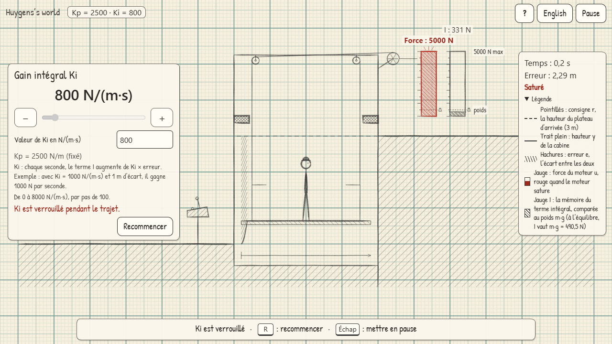

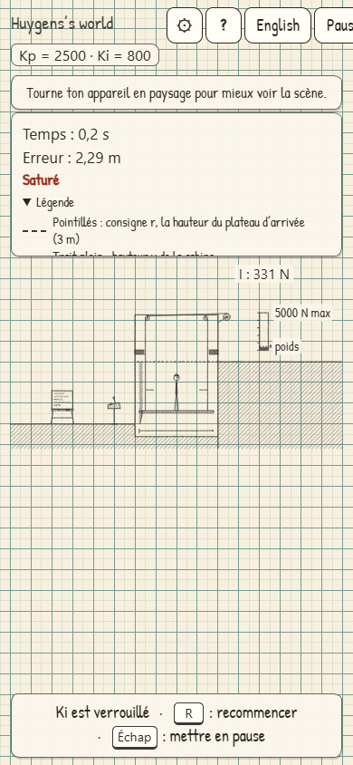

## Niveau 2 : La mémoire (T-021b)

Le niveau 2 réutilise la même interface : `createUi` lit `level.tuning` (`param`, `min`, `max`, `step`) et `level.snapshot.levelId` pour choisir les textes et la grandeur réglée. Ce qui change :

- **Panneau de réglage** : il règle **Ki** de 0 à 8000 N/(m·s) par pas de 100 (curseur, champ numérique, − et +), avec la valeur en grand (« 2000 N/(m·s) » au chargement ; 500 jusqu'à T-021b) ; une ligne « Kp = 2500 N/m (fixé) » rappelle que Kp n'est pas réglable (`level2.kp.fixed`) ; aide `level2.ki.help` (« chaque seconde, le terme I augmente de Ki × erreur ») ; plage `level2.ki.range` ; verrou `level2.ki.locked`.
- **Étiquette de la barre du haut** : « Kp = 2500 · Ki = 2000 » (`hud.ki.tag`, sans unités ; Ki = 500 jusqu'à T-021b).
- **Touches** : les mêmes qu'au niveau 1 (`+`, `−`, Page préc., Page suiv.), qui appellent `level.adjustTuning` ; le bandeau dit « régler Ki » (`hud.hint.tuneKi`) puis « Ki est verrouillé » (`hud.hint.lockedKi`) pendant le trajet ; l'aide des commandes cite Ki (`controls.help.ki`, `controls.help.pauseKi`, `controls.help.touchKi`).
- **Annonces** : `hud.status.readyKi`, `hud.status.launchKi` (Kp et Ki), `level2.saturation` à la première saturation, `hud.status.winKi`, `hud.status.fail.stepKi` (T-022 : « Échec : au bout de 10 s, la cabine est encore {e} m sous le plateau d’arrivée, plus loin que les 0,1 m permis. », à la place de `hud.status.fail.step` du niveau 1), `hud.status.fail.slow` (« … n’a pas fini de se stabiliser en 10 s »), `hud.status.resetKi`.
- **Issues** : « Niveau réussi ! » (`level2.win`), « Trop court » (`level2.failTitle.step`, avec l'erreur), « Trop lent » (`level2.failTitle.slow`), « Choc contre la poutre » (`level2.failTitle.bonk`, qui explique le windup : « Trop de mémoire ! … Baisse Ki. »). Le teaser du niveau 1 et le bouton « Niveau suivant » ne s'affichent qu'au niveau 1 (le niveau 2 est le dernier du catalogue).
- **Jauge du terme intégral I** (T-024, K30) : voir [la section précédente](#jauge-du-terme-intégral-i-niveau-2-t-024).
- **Pas encore là** : les annotations détaillées du windup, la loupe de la bande de tolérance et la courbe I(t) (K31, reportés).

Textes de T-022 : `level2.goal` annonce la tolérance (« la cabine doit s’arrêter à 0,1 m près et Kp seul n’y suffit pas »), `level2.fail.step` et `level2.fail.slow` parlent de 10 s (et de 0,1 m pour le premier), `level2.win` dit que le terme I « amène la cabine pile au plateau d’arrivée » (l'ancienne phrase « plus Ki est grand, plus la cabine s'arrête près » n'est pas monotone).

Les captures de T-021b, régénérées par T-025 (K35 corrigé) avec le Ki par défaut de 2000 (le menu n'a pas changé) :

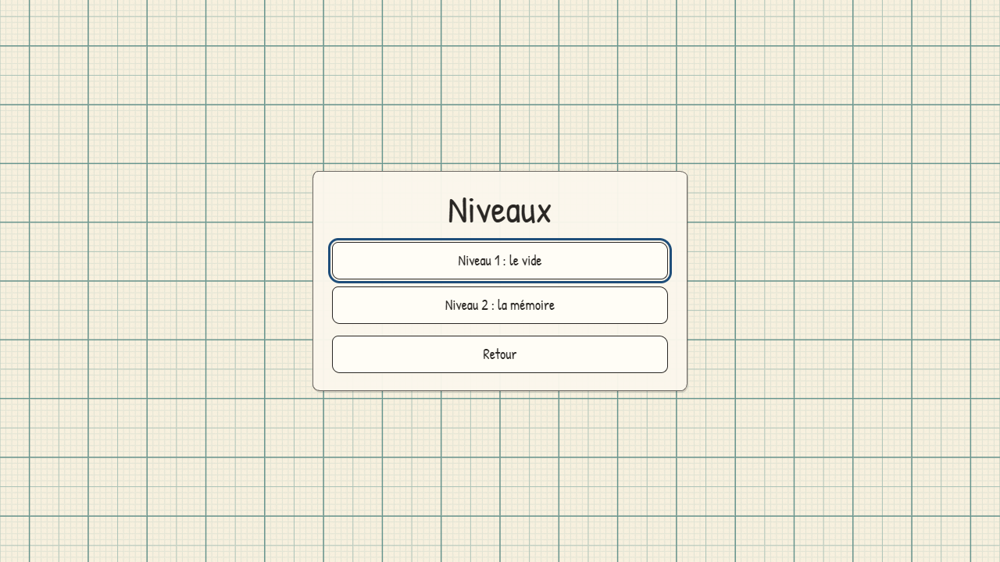

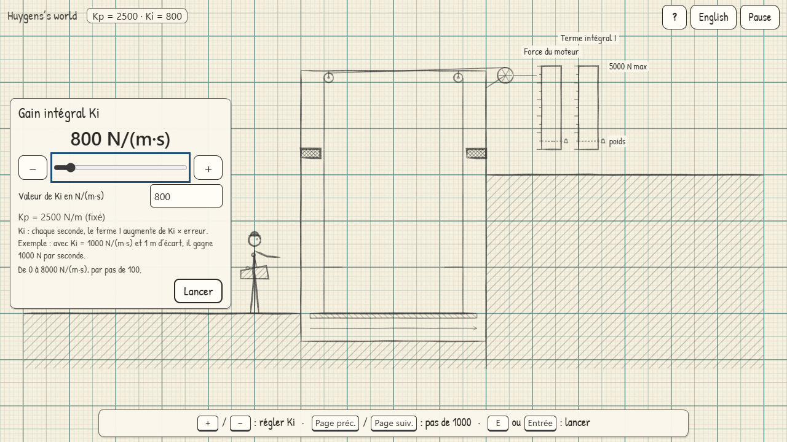

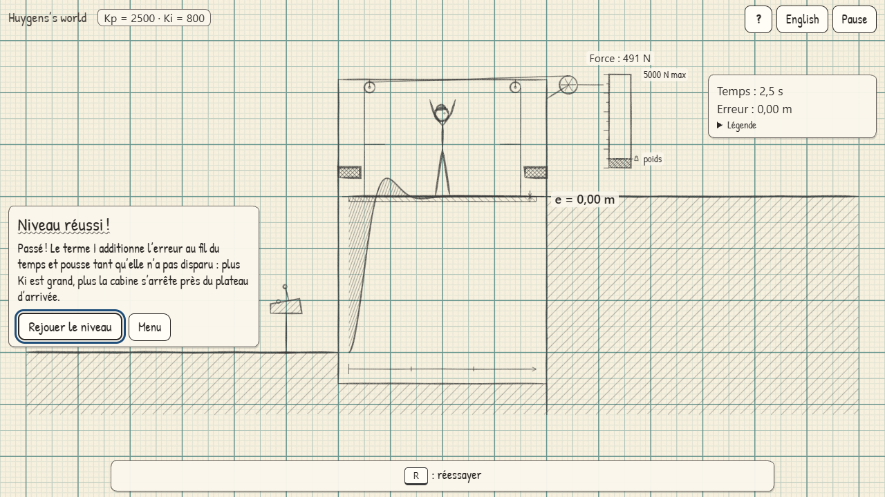

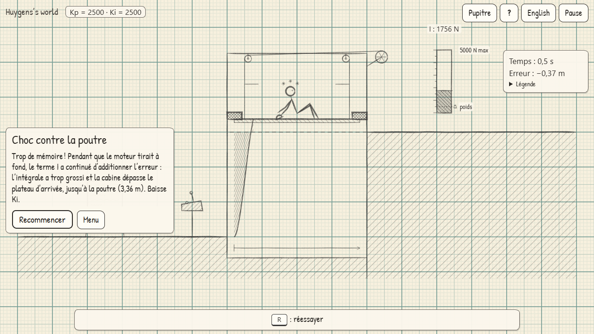

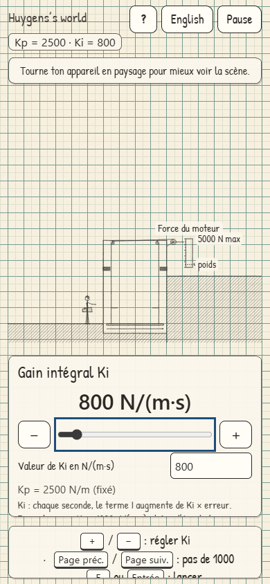

Les captures de T-022 montrent l'issue « Trop court » des deux niveaux après 10 s, avec l'interface visible :

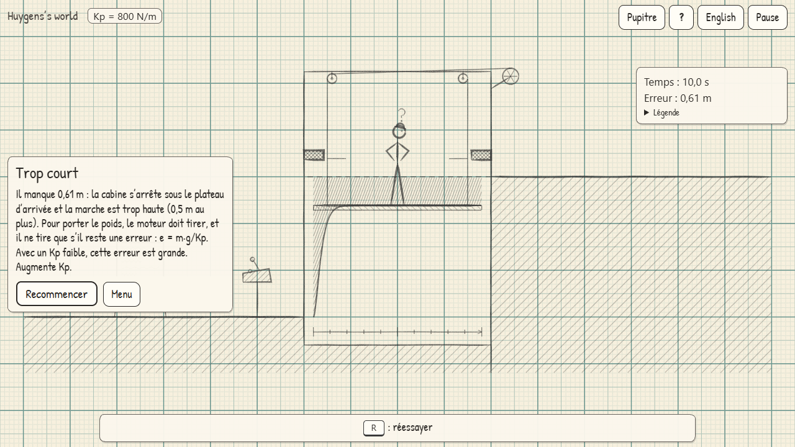

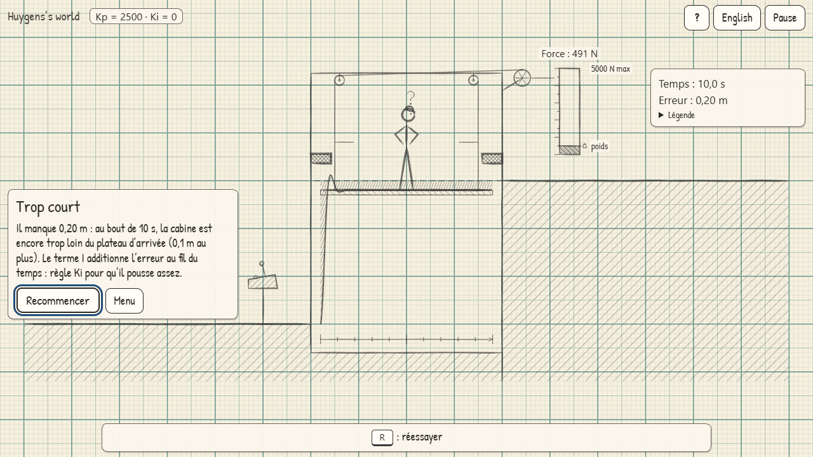

K32 est corrigé depuis T-022 : la tolérance du niveau 2 est de 0,10 m, et le P seul (Ki = 0) s'arrête à 0,196 m, donc échoue ; voir [jeu.md](jeu.md#niveau-2--arbitre-et-fin-de-temps). Reste K34 : sur la grille de 100, « Trop lent » n'arrive jamais.

## Bandeau d'aide contextuel

`chooseHint` (fichier `hints.ts`) choisit le bandeau d'après l'instantané ; `hintLine` produit son contenu dans la langue courante. Les touches sont dessinées comme des touches de clavier (`<kbd>`). Depuis T-037, `walk` n'existe plus (le bandeau `use` vaut partout en approche) et `skip` s'ajoute. Textes exacts vérifiés par `tests/ui/view-model.test.ts` (niveau 1 ; au niveau 2, `hintLine` cite Ki : « régler Ki », « Ki est verrouillé », vérifié par `tests/ui/level2-view-model.test.ts`) :

| Bandeau | Quand | Français | Anglais |
|---|---|---|---|
| `use` | approche, n'importe où sur le quai | E : régler l’ascenseur | E: set up the lift |
| `tune` | réglage | + / − : régler Kp · Page préc. / Page suiv. : pas de 1000 · E ou Entrée : lancer | + / −: set Kp · Page Up / Page Down: steps of 1000 · E or Enter: launch |
| `skip` | embarquement ou sortie | E ou Entrée : passer · R : recommencer · Échap : mettre en pause | E or Enter: skip · R: restart · Esc: pause |
| `trip` | trajet | Kp est verrouillé · R : recommencer · Échap : mettre en pause | Kp is locked · R: restart · Esc: pause |
| `outcome` | issue | R : réessayer | R: try again |
| `paused` | pause | Jeu en pause. · Échap : reprendre | Game paused. · Esc: resume |
| `help` | aide des commandes ouverte | Échap : fermer l’aide | Esc: close the help |

En français, l'espace avant « : » est une espace insécable (U+00A0), comme partout dans les textes (voir [i18n-accessibilite.md](i18n-accessibilite.md#règles-typographiques-des-textes)).

## Touches

Traduction touche → intention par la fonction pure `keyToIntent` (`src/ui/keys.ts`), exécutée par `bindKeyboard` (`input.ts`). Vérifiée par `tests/ui/keys.test.ts` (37 tests, dont 27 touches × 28 combinaisons de phase et de focus : 7 phases × 4 cibles de focus, 20 combinaisons avant T-037) et par les scénarios e2e au clavier réel.

Règles générales :

- la **marche** se lit sur la position physique de la touche (`code`) : Q/D sur un clavier AZERTY, A/D sur un clavier QWERTY ; `+` et `−` se lisent sur le caractère produit (`key`) ;
- avec Ctrl, Alt ou ⌘ enfoncée, aucune touche n'agit : les raccourcis du navigateur restent intacts ;
- une touche du jeu n'est jamais répétée par l'appui long pour E, Entrée, Espace et R ; Échap maintenue ne produit qu'une intention (A-03) ;
- **aide ouverte** (B-01, T-026) : `keyToIntent` réutilise `commandsBlocked(helpOpen)` de `help.ts` : aucune commande du jeu ne passe (ni E, R, Entrée, Espace, marche, Kp), les touches de défilement restent bloquées, seuls Échap (qui ferme l'aide), Tab et le comportement natif des boutons de l'aide (Entrée, Espace) passent. Avant T-026, le clavier commandait encore le niveau derrière l'aide (la garde K24 ne couvrait que la souris) ;
- toute touche du jeu, et les touches qui feraient défiler la page, sont bloquées (`preventDefault`).

### Table des touches

Le focus est sur la page (aucun contrôle sélectionné). Colonne « Intention » : valeur renvoyée par `keyToIntent`.

| Touche | `code` | `key` | Intention | Effet |
|---|---|---|---|---|
| ← | `ArrowLeft` | `ArrowLeft` | `walkLeft` | marcher à gauche tant que la touche est enfoncée (approche) |
| → | `ArrowRight` | `ArrowRight` | `walkRight` | marcher à droite tant que la touche est enfoncée (approche) |
| Q (AZERTY), A (QWERTY) | `KeyA` | `q` | `walkLeft` | marcher à gauche |
| D | `KeyD` | `d` | `walkRight` | marcher à droite |
| + | `Equal` | `+` | `kpUp` | Kp + 100 N/m |
| = | `Equal` | `=` | `kpUp` | Kp + 100 N/m (même touche que + sans Maj) |
| + du pavé numérique | `NumpadAdd` | `+` | `kpUp` | Kp + 100 N/m |
| - | `Minus` | `-` | `kpDown` | Kp − 100 N/m |
| − (U+2212) | `Minus` | `−` | `kpDown` | Kp − 100 N/m |
| - du pavé numérique | `NumpadSubtract` | `-` | `kpDown` | Kp − 100 N/m |
| Page préc. | `PageUp` | `PageUp` | `kpUpBig` | Kp + 1000 N/m |
| Page suiv. | `PageDown` | `PageDown` | `kpDownBig` | Kp − 1000 N/m |
| R | `KeyR` | `r` | `restart` | recommencer (embarquement, trajet, sortie ou issue) |
| ↑ | `ArrowUp` | `ArrowUp` | `block` | rien (empêche le défilement) |
| ↓ | `ArrowDown` | `ArrowDown` | `block` | rien (empêche le défilement) |
| Début | `Home` | `Home` | `block` | rien (empêche le défilement) |
| Fin | `End` | `End` | `block` | rien (empêche le défilement) |

Les touches de Kp n'agissent qu'en approche et en réglage ; ailleurs, le niveau répond `locked` (Kp verrouillé, décision D9). Au niveau 2, les mêmes touches règlent Ki (`bindKeyboard` appelle `level.adjustTuning`, qui agit sur la grandeur du niveau : ± 100 et ± 1000 N/(m·s)). La touche R n'agit que pendant l'embarquement, le trajet, la sortie et à l'issue.

### Touches qui dépendent de la phase

| Touche | `code` | Approche | Réglage | Embarquement | Trajet | Sortie | Issue | Pause |
|---|---|---|---|---|---|---|---|---|
| E | `KeyE` | `interact` | `launch` | `skip` | `block` | `skip` | `block` | `block` |
| Entrée | `Enter` | `interact` | `launch` | `skip` | `block` | `skip` | `block` | `block` |
| Entrée du pavé numérique | `NumpadEnter` | `interact` | `launch` | `skip` | `block` | `skip` | `block` | `block` |
| Espace | `Space` | `interact` | `launch` | `skip` | `block` | `skip` | `block` | `block` |
| Échap | `Escape` | `pause` | `closeTuning` | `pause` | `pause` | `pause` | `pause` | `resume` |

- `interact` en approche ouvre le réglage **de n'importe où sur le quai** (D31) ; le bonhomme marche alors vers son poste.
- `skip` (embarquement et sortie, T-037) appelle `level.skipAnimation()` : le bonhomme est placé dans la cabine (le trajet part) ou sur le plateau (l'issue s'affiche). Avec `repeat`, E, Entrée et Espace sont bloquées : la touche de lancement maintenue ne passe pas l'embarquement.
- **E lance le trajet en phase de réglage.** Échap, lui, referme le panneau sans lancer : l'intention `closeTuning` appelle `level.interact()`, qui en réglage referme le panneau (événement `tuningClosed`). Avant P-005, aucune touche ne le faisait (K3).
- Échap, quand l'aide des commandes est ouverte, la referme (`closeHelp`), sans mettre en pause ni fermer le réglage, quelle que soit la phase.

### Selon le focus

| Focus | Comportement |
|---|---|
| champ numérique de Kp (ou de Ki) | tout est natif (saisie libre), sauf Échap : il annule la saisie (le champ retrouve la valeur courante, B-03, T-029) puis, comme ailleurs, ferme le réglage |
| bouton, lien, résumé de légende | Entrée et Espace activent le contrôle (natif) ; E garde son rôle de jeu |
| curseur de Kp | les flèches règlent la valeur (natif) ; Q/A et D font toujours marcher |

### Perte de focus

Quand la fenêtre perd le focus ou que l'onglet est masqué : la marche s'arrête et, quand le jeu avance seul (embarquement, trajet, sortie : `isRunningPhase`), il se met en pause. En approche et en réglage, il n'y a pas de pause (tests e2e (f) et (f bis)).

### Souris et tactile

- **Souris** : clic sur le pupitre ou le pied de la console (en approche) = ouvrir le réglage. Tous les boutons et le curseur du panneau sont cliquables.
- **Tactile** (écran à pointeur grossier, `pointer: coarse`) : boutons ◀ et ▶ de 56 × 56 px (marcher tant que le doigt appuie) et un bouton « Action » qui ouvre le réglage (approche), lance (réglage), passe l'embarquement ou la sortie, ou reprend (pause) selon la phase. À l'issue, « Action » n'a **aucun effet** (T-039, R5) : « Rejouer », « Recommencer », « Niveau suivant » et « Menu » servent à cela ; un second appui pendant la sortie ne fait plus perdre l'issue (avant T-039, il la passait puis recommençait). Ces boutons n'ont pas été essayés sur un vrai écran tactile (réserve du log T-010).

## Aide des commandes « ? »

Le bouton « ? » ouvre une fenêtre d'aide (`role="dialog"`, `aria-modal="true"`) qui liste les commandes au clavier, à la souris et au tactile (clés `controls.help.`). Depuis T-015 (`setHelp`, `src/ui/overlay.ts` ; règles pures dans `src/ui/help.ts`) :

- **pause** : ouvrir l'aide quand le jeu avance seul (embarquement, trajet, sortie : `isRunningPhase`, T-037) met le jeu en pause ; la fermer reprend le jeu seulement si c'est l'aide qui avait mis en pause (`helpPauseDecision`). Une pause demandée par le joueur avant l'ouverture n'est pas levée par la fermeture. Hors de ces phases, l'aide ne change pas la phase ;
- **focus** : à l'ouverture, le focus va sur « Fermer l’aide » ; Tab et Maj+Tab restent dans l'aide (`trapFocusIndex`) ; à la fermeture, le focus revient à l'élément qui l'avait à l'ouverture, ou, à défaut (élément disparu, désactivé ou masqué), au bouton « ? » ;
- Échap ou « Fermer l’aide » la referme ; tant qu'elle est ouverte, le clavier ne commande plus le jeu (B-01, T-026, voir « Touches ») ;
- l'aide compte **8 lignes** (`helpLines` de `staticTexts`) : déplacement, interaction, passer l'animation, réglage de Kp ou de Ki, recommencer, Échap, souris, tactile. Depuis T-037, le texte d'interaction dit « E, Entrée ou Espace : régler l’ascenseur de n’importe où sur le quai, puis lancer » (`controls.help.interact`) et une ligne neuve « E, Entrée ou Espace pendant l’embarquement ou la sortie : passer l’animation » (`controls.help.skip`) ; la ligne tactile dit encore « Action pour utiliser la console et lancer » (`controls.help.touch`, `controls.help.touchKi`, B-08, T-029), sans citer « passer » : écart du texte tactile, non corrigé ;
- la couche de l'aide est au-dessus des mesures du trajet (`z-index: 2` sur `.ui-help`).

Corrigés par T-017abc : **K23** (le papier de l'aide est opaque, les mesures du trajet ne transparaissent plus ; e2e (p)) et **K24** (tant que l'aide est ouverte, les commandes du niveau sont suspendues : « Pause » / « Reprendre », « Menu », le réglage, le champ numérique, le clic sur la console et le bouton tactile « Action » n'agissent pas ; seule la fermeture de l'aide agit, qui reprend le jeu par `helpPauseDecision` si l'aide l'avait mis en pause ; règle pure `commandsBlocked(helpOpen)` de `src/ui/help.ts` ; e2e (o)).

À l'apparition du panneau d'issue, le focus est porté sur « Niveau suivant » à la réussite du niveau 1, sur « Rejouer le niveau » sinon ; quand le panneau se ferme, le focus qui s'y trouvait est rendu au document (`releaseFocus`).

## Langue

Le bouton de langue affiche le nom de l'autre langue, dans cette langue (« English » quand le jeu est en français), avec l'attribut `lang` correspondant. Un clic change tous les textes à la volée, met à jour `<html lang>`, et conserve Kp et la phase (test e2e (c)). Langue initiale : voir [i18n-accessibilite.md](i18n-accessibilite.md#détection-de-la-langue).

## Annonces pour lecteurs d'écran

Une région `aria-live="polite"` (`role="status"`) annonce une phrase par événement du niveau (`announcementFor`, fichier `announce.ts`) :

| Événement | Annonce (clé) |
|---|---|
| ouverture du réglage | `hud.status.ready` (niveau 2 : `hud.status.readyKi`) |
| lancement | `hud.status.launch` avec Kp (niveau 2 : `hud.status.launchKi` avec Kp et Ki), **différée** jusqu'au départ réel du trajet (voir plus bas) |
| première saturation (une fois par trajet) | `level1.saturation` (niveau 2 : `level2.saturation`) |
| issue (à l'arrivée sur le plateau pour une victoire animée) | `hud.status.win`, `hud.status.fail.step`, `hud.status.fail.noLift` ou `hud.status.fail.bonk`, avec l'erreur finale à 2 décimales ; au niveau 2, `hud.status.winKi`, `hud.status.fail.stepKi` et `hud.status.fail.slow` |
| recommencer | `hud.status.reset` (niveau 2 : `hud.status.resetKi`) |
| pause, reprise | `hud.status.paused`, `hud.status.resumed` |
| fermeture du réglage | rien |

**Annonce de lancement différée (T-039, R4).** L'événement `launch` est émis au début de l'embarquement, environ 2,4 s avant que la consigne change vraiment : l'annonce « la consigne passe de 0 à 3 m » serait partie trop tôt. `announce.ts` fournit trois fonctions pures : `createLaunchGate()` (porte `{ pending }`), `admitEvent(gate, event, phase)` (renvoie `false` et met la porte en attente pour un `launch` reçu avant le départ du trajet ; un `reset`, un `tuningOpened` ou un `tuningClosed` annulent l'attente) et `releaseLaunch(gate, phase)` (vrai une seule fois, quand la phase devient `trip`, `exit` ou `outcome`). `createUi` annonce alors la phrase à partir d'un événement `launch` préalloué. Sans animations, le trajet part dans la même image : annonce immédiate. Ces fonctions ne sont pas exportées par `src/ui/index.ts`. Tests : `tests/ui/announce.test.ts` (4 → 9 tests) et e2e R4 de `t039-interface.spec.ts`. Les captures et les tests e2e n'ont pas été passés à un lecteur d'écran.

Chaque événement est consommé une seule fois. Le canvas porte `role="img"` et un nom traduit (`a11y.canvas`). Détail : [i18n-accessibilite.md](i18n-accessibilite.md#partie-2--accessibilité-validé-t-010).

## Petit écran en portrait

Sur un écran en portrait de moins de 700 px de large, une invite propose de tourner l'appareil (`app.rotateHint`), et la disposition passe en « bandes » (voir plus bas). À 390 px de large, la scène est petite (17 m dans la largeur). Depuis P-005, la barre du haut y mesure 76 px (`TOP_BAR_PORTRAIT` : le titre et l'étiquette de Kp passent sur deux lignes, mesuré à 390 px de large) et l'invite de rotation est posée plus bas (`.ui-rotate { top: 80px }`, hauteur réservée `ROTATE_BAR` = 48) : l'étiquette de Kp n'est plus masquée (K2). La capture ci-dessous date de T-010 et montre l'ancienne disposition. En trajet, à 390 px, le panneau de mesures et le panneau de réglage sont rognés en bas (défilement interne) et la dernière ligne de la légende (« Jauge ») n'est pas visible sans défiler (K25, vu sur les captures de T-019) ; au niveau 2, le panneau de réglage défile en interne (231 px visibles pour 341 px de contenu) et « Lancer » n'est pas visible sans défiler : la touche Entrée et le bouton « Action » restent (K33). Ces défauts s'ajoutent à K5 (scène minuscule).

## Disposition

`computeLayout(geometry, out)` (fichier `layout.ts`) est une fonction pure. À partir de la géométrie de l'écran en pixels CSS, elle place chaque panneau dans une boîte dont il ne sort jamais (largeur fixée, hauteur maximale avec défilement interne).

**Zones protégées** : aucun panneau ne coupe

- la **cage** (colonne x ∈ [0 ; 4] m sur toute la hauteur de la zone de jeu) : rien ne masque l'ascenseur ni la courbe ;
- la **console** (boîte de ± 0,35 m autour du pupitre) ;
- le **bonhomme** quand il est sur le quai (± 0,3 m autour de sa tête). Tant que le panneau de réglage est ouvert (phases `tuning`, `boarding` et `trip`), `computeLayout(g, out, pinWalkerAtPost)` épingle cet obstacle au poste du bonhomme (`CONSOLE_POST_X` ; hauteur `WALKER_STAND_HEIGHT` = 1,8 m) au lieu de sa position en direct : le panneau ne bouge pas pendant la marche (T-039, R3 ; test `layout.test.ts`, 38 → 40 tests). Conséquence (K50) : le panneau reste épinglé à cette position pendant le trajet.

Deux modes :

| Mode | Quand | Placement |
|---|---|---|
| `sides` (paysage) | au moins 240 px libres de chaque côté de la cage | réglage, bulle et issue à gauche de la cage (à gauche du bonhomme et de la console, sinon au-dessus d'eux) ; mesures et aide à droite |
| `bands` (portrait) | côtés trop étroits | bulle et mesures dans la bande au-dessus de la scène ; réglage et issue dans la bande au-dessous ; si la bande sous la scène fait moins de `MIN_OUTCOME_ROOM` (120 px), l'issue se pose en bas, au-dessus du bandeau, sur `OUTCOME_FALLBACK_HEIGHT` (150 px) au plus (T-028) |

Le bandeau d'aide est en bas de l'écran, sous la scène s'il y a au moins 56 px, sinon en bas à gauche de la cage.

Vérification : `tests/ui/layout.test.ts` contrôle 13 tailles d'écran (de 360 × 740 à 2560 × 720) ; le test e2e (i) mesure les boîtes réelles à 1280 × 720 et 390 × 844.

Clic sur la console : `isConsoleHit` accepte une zone de ± 0,6 m autour de la console, de 0,4 m au-dessus du pupitre à 1,1 m au-dessous (pied compris).

## Police

| Élément | Valeur |
|---|---|
| police | Patrick Hand, Patrick Wagesreiter, licence SIL Open Font License 1.1 (`public/fonts/OFL.txt`) |
| fichiers | `public/fonts/patrick-hand-latin-400-normal.woff2` (23 944 octets) et `patrick-hand-latin-ext-400-normal.woff2` (20 112 octets) |
| sous-ensembles | latin (U+0000-00FF, ponctuation U+2000-206F dont U+202F, signe moins U+2212…) et latin étendu, chargés selon les caractères présents (`unicode-range`) |
| chargement | auto-hébergée, `font-display: swap`, servie depuis `/pid-game/fonts/` (test e2e (h)) |
| repli | Segoe Print, Bradley Hand, Comic Sans MS, puis police système |
| chiffres | police système à chiffres tabulaires pour les valeurs (temps, erreur, force, Kp) |
| taille de base | 18 px |

Contrastes déclarés dans `ui.css` (sur le papier `#fbf7ec`) : texte ≈ 14:1, texte secondaire ≈ 9:1, rouge ≈ 7:1. Ils ne sont pas mesurés par un test.

## Exports de `src/ui/index.ts`

Principaux exports, groupés par fichier :

| Fichier | Exports |
|---|---|
| `overlay.ts` | `createUi(options) → Ui` (`Ui` : `helpOpen`, `update`, `setHelp`, `destroy`) ; types `Ui`, `UiOptions` (dont `level: Level`, `onMenu?`, `onNext?`) |
| `input.ts` | `bindKeyboard(level: Level, ui, window)` (renvoie la fonction qui retire les écouteurs ; appelée au retour au menu), `focusTargetOf` |
| `keys.ts` | `keyToIntent`, `kpDeltaOf`, `walkSideOf`, `KP_SMALL_STEP` (100), `KP_BIG_STEP` (1000) ; types `KeyInput`, `KeyIntent`, `FocusTarget` |
| `hints.ts` | `chooseHint`, `hintLine`, `hintText`, `KEY_SYMBOLS`, `KEY_SEPARATOR` ; types `HintId` (`use`, `tune`, `skip`, `trip`, `outcome`, `paused`, `help`), `HintItem`, `HintLine`, `HintSegment` |
| `view-model.ts` | `createViewModelBuilder`, `staticTexts`, `effectivePhase` ; types `ViewModel`, `ViewModelBuilder`, `StaticTexts`, `UiState` |
| `layout.ts` | `computeLayout`, `createLayout`, `consoleRect`, `walkerRect`, `walkerOnLedge`, `isConsoleHit`, `intersects`, `boxExtent` ; types `UiGeometry`, `UiLayout`, `PanelBox`, `ScreenRect`, `ScreenXY` |
| `announce.ts` | `announcementFor`, `formatError`, `formatKp`, `ERROR_DIGITS` (le fichier exporte aussi `createLaunchGate`, `admitEvent`, `releaseLaunch` et le type `LaunchGate`, que `index.ts` ne réexporte pas) |
| `screens.ts` | `createTitleScreen`, `createMenuScreen` ; types `Screen`, `TitleScreenOptions`, `MenuScreenOptions` |
| `screens-model.ts` | `buildTitleView`, `buildMenuView`, `levelLabel`, `LEVEL_TITLE_KEYS` ; types `TitleView`, `MenuView`, `MenuEntryView` |
| `screen-keys.ts` | `screenKeyToIntent` ; types `ScreenKeyInput`, `ScreenKeyIntent` |

Constantes de disposition exportées par `layout.ts` (pixels CSS, sauf mention) :

| Constante | Valeur | Rôle |
|---|---|---|
| `MARGIN` | 12 | marge autour des panneaux |
| `TOP_BAR` | 56 | hauteur réservée à la barre du haut (paysage) |
| `TOP_BAR_PORTRAIT` | 76 | hauteur réservée à la barre du haut en portrait étroit (titre et Kp sur deux lignes) |
| `ROTATE_BAR` | 48 | hauteur réservée à l'invite de rotation sous la barre du haut, en portrait |
| `BANNER_RESERVE` | 76 | hauteur réservée au bandeau d'aide |
| `GAUGE_LABELS_ROOM` | 84 | largeur réservée aux étiquettes « 5000 N max » et « poids » à droite de la jauge (T-019 ; exportée par `layout.ts`, pas par `index.ts`) |
| `GAUGE_TITLE_BAND` | 18 | hauteur prise par la légende de la jauge au-dessus de la scène en portrait (T-019 ; idem) |
| `GAUGE_TITLE_ROW` | 22 | décalage vertical de l'étiquette de la jauge I au-dessus de celle de la force, au niveau 2 (T-024 ; idem) |
| `GAUGE_TITLE_LIFT` | 6 | relèvement des étiquettes de titre des jauges en portrait au niveau 2 (T-024 ; idem) |
| `DIMENSION_NUDGE` | 6 | descente de la cote chiffrée en portrait au niveau 2 (T-024 ; idem) |
| `MIN_SIDE` | 240 | largeur libre minimale de chaque côté de la cage pour la disposition « côtés » |
| `MIN_BANNER_BAND` | 56 | hauteur minimale sous la scène pour y poser le bandeau |
| `MIN_OUTCOME_ROOM` | 120 | hauteur minimale de la bande sous la scène pour y poser l'issue en mode bandes ; en dessous, repli au-dessus du bandeau (T-028) |
| `OUTCOME_FALLBACK_HEIGHT` | 150 | hauteur de l'issue en repli : titre, message qui défile, boutons collés (T-028) |
| `MIN_PANEL_BESIDE` | 280 | largeur minimale d'un panneau posé à gauche du bonhomme et de la console (sinon il est posé au-dessus) |
| `WALKER_HALF_WIDTH` | 0,3 m | demi-largeur de la boîte protégée du bonhomme |
| `WALKER_STAND_HEIGHT` | 1,8 m | hauteur du bonhomme debout, chapeau compris, pour l'obstacle épinglé au poste (T-039 ; exportée par `layout.ts`, pas par `index.ts`) |
| `CONSOLE_HALF_BOX` | 0,35 m | demi-largeur de la boîte protégée de la console |
| `CONSOLE_BOX_ABOVE` | 0,35 m | hauteur de la boîte protégée au-dessus du pupitre |
| `CONSOLE_HIT_HALF_WIDTH` | 0,6 m | demi-largeur de la zone de clic de la console |
| `CONSOLE_HIT_ABOVE` | 0,4 m | zone de clic au-dessus du pupitre |
| `CONSOLE_HIT_BELOW` | 1,1 m | zone de clic sous le pupitre (pied compris) |
| `MAX_WIDTH` | bandeau 960, bulle 320, panneau 360, issue 440, mesures 320, aide 480 | largeur maximale de chaque panneau |

Justification des choix : [ADR-011](decisions/ADR-011-interface-dom.md).
