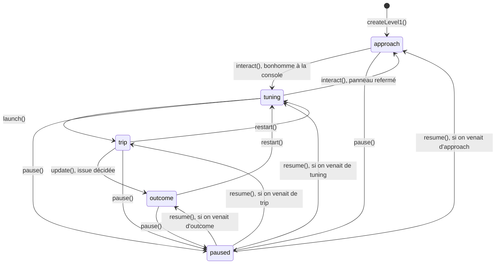

# Logique du niveau 1 (`src/game`)

À quoi sert cette page : expliquer comment le niveau 1 « Le vide » décide de ce qui se passe : phases, commandes du joueur, règles de victoire et d'échec, données transmises au rendu et à l'interface. Elle décrit le commit `7bcd9ce` (logique validée en T-007). La simulation sous-jacente est dans [simulation.md](simulation.md), la physique dans [physique/ascenseur.md](physique/ascenseur.md).

## Rôle de `src/game`

`src/game` transforme le noyau de simulation en niveau jouable, sans rien afficher. Il :

- fait marcher le bonhomme jusqu'à la console ;
- gère le réglage de Kp et son verrouillage ;
- lance le trajet et fait avancer la boucle de l'ascenseur du noyau ;
- juge l'issue (victoire, choc, marche trop haute, cabine au sol) ;
- publie un instantané (`LevelSnapshot`) et des événements pour le rendu et l'interface.

Le module est pur et déterministe. Il n'importe que `src/sim` (règle `game-no-render` de dependency-cruiser), n'utilise pas le DOM (`tsconfig.sim.json`), ni l'aléa, ni l'horloge murale. Pour ce dernier point, la règle ESLint du noyau ne couvre pas `src/game` ; c'est un test (`tests/game/units.test.ts`) qui lit les sources et refuse `Math.random`, `Date`, `performance`, `window` et `document`. Les textes et le formatage des nombres ne sont pas ici : ils viennent de `src/i18n`, côté interface.

Le module n'est pas encore branché : `src/main.ts` ne l'importe pas. Rendu et interface : Prévu (T-008 à T-010).

| Fichier | Contenu |
|---|---|
| `constants.ts` | règles d'issue, bornes de Kp, géométrie du décor |
| `kp.ts` | `quantizeKp` : arrondi de Kp sur la grille |
| `outcome.ts` | arbitre des issues (`createOutcomeJudge`, `classifyTimeout`) |
| `walker.ts` | marche du bonhomme sur le quai de départ |
| `events.ts` | file d'événements circulaire |
| `level.ts` | machine à états du niveau (`createLevel1`) |
| `index.ts` | point d'entrée public |

## Phases et transitions

Le niveau est une machine à états à cinq phases (`LevelPhase`). Il démarre en `approach`.



| Phase | Ce qui se passe à chaque pas | Kp |
|---|---|---|
| `approach` | le bonhomme marche selon son intention | modifiable |
| `tuning` | panneau Kp ouvert ; bonhomme figé devant la console | modifiable |
| `trip` | un pas de simulation de l'ascenseur, puis jugement de l'issue | verrouillé |
| `outcome` | rien : la cabine reste dans l'état du pas de l'issue | verrouillé |
| `paused` | rien ; l'horloge n'avance pas | verrouillé |

`restart()` ramène toujours au réglage (`tuning`), bonhomme devant la console, Kp conservé (arbitrage D-b de l'orchestrateur, log T-007, conforme à la spec §6.6).

## Commandes et résultats

Chaque commande renvoie un `CommandResult` :

- `accepted` : la commande a pris effet ;
- `ignored` : sans objet dans cette phase, rien n'a changé ;
- `locked` : Kp verrouillé ;
- `invalid` : valeur non finie refusée.

Aucune commande ne lève d'exception.

| Commande | `approach` | `tuning` | `trip` | `outcome` | `paused` |
|---|---|---|---|---|---|
| `moveLeft()`, `moveRight()`, `stop()` | accepted | ignored | ignored | ignored | ignored |
| `interact()` | accepted si le bonhomme est à la console, sinon ignored | accepted (referme le panneau) | ignored | ignored | ignored |
| `setKp(v)`, v fini | accepted | accepted | locked | locked | locked |
| `setKp(v)`, v NaN ou ±Infinity | invalid | invalid | locked | locked | locked |
| `adjustKp(d)` | comme `setKp(kp + d)` ; d non fini : invalid | idem | locked | locked | locked |
| `launch()` | ignored | accepted | ignored | ignored | ignored |
| `restart()` | ignored | ignored | accepted | accepted | ignored |
| `pause()` | accepted | accepted | accepted | accepted | ignored |
| `resume()` | ignored | ignored | ignored | ignored | accepted |

Le verrouillage est testé avant la validité : `setKp(NaN)` pendant le trajet renvoie `locked`.

`update(frameSeconds)` n'est pas une commande : c'est le battement du niveau, appelé à chaque image avec la durée de l'image en secondes. Il passe par l'horloge à pas fixe du noyau (durée bornée à 0,25 s, 8 pas au plus par image, voir [simulation.md](simulation.md#horloge-à-pas-fixe)) et exécute chaque pas selon la phase. En pause, il n'avance pas l'horloge : à la reprise, il n'y a aucun saut de temps.

## Règles d'issue

L'arbitre (`createOutcomeJudge`, fichier `outcome.ts`) est appelé une fois par pas de trajet, sur l'état de la cabine **après** le pas. Il teste dans cet ordre :

1. **Choc** (`bonk`) : y > `BEAM_HEIGHT` (3,30 m), comparaison stricte. Fin immédiate.
2. **Victoire** (`win`) : un compteur augmente à chaque pas où |r − y| ≤ `STEP_TOLERANCE` (0,25 m) **et** |ẏ| ≤ `SETTLE_SPEED_TOLERANCE` (0,10 m/s). Il repart de zéro dès qu'une condition tombe. La victoire est acquise au `WIN_HOLD_STEPS`e pas consécutif (120 pas = 1,0 s).
3. **Fin de temps** : quand le nombre de pas atteint `TRIP_MAX_STEPS` (1800 pas = 15 s), `classifyTimeout(kp)` tranche :
   - `noLift` (la cabine ne décolle pas) si Kp ≤ `NO_LIFT_KP_THRESHOLD` ;
   - `step` (marche trop haute) sinon.

Une victoire acquise exactement au pas 1800 l'emporte sur la fin de temps. Une valeur NaN rend les comparaisons fausses : ni victoire ni choc.

Le seuil `NO_LIFT_KP_THRESHOLD` est calculé, pas écrit en dur : m·g / r = 490,5 / 3 = 163,5 N/m (`CABIN_WEIGHT / LEVEL1_SETPOINT`). Justification physique : [physique/ascenseur.md](physique/ascenseur.md#seuil-de-décollage).

### Convention de pas

- L'issue est jugée sur l'état **après** le pas : x(n·dt), où n est le nombre de pas exécutés depuis le lancement, ce pas compris.
- `outcomeK` (instantané) et le champ `k` de l'événement `outcome` valent ce nombre n.
- `finalError` = r − y au pas de l'issue (m). Il est négatif pour un choc (la cabine est au-dessus du quai).

C'est la convention du validateur T-005 : ses pas d'issue sont identiques.

### Issues de 0 à 8000 N/m

Balayage par pas de 100 N/m (`tests/game/outcomes.test.ts`, lignes 51 à 70) :

| Kp (N/m) | Issue |
|---|---|
| 0 à 100 | `noLift` |
| 200 à 1900 | `step` |
| **2000 à 3800** | **`win`** |
| 3900 à 8000 | `bonk` |

Pas d'issue de référence. Colonnes « Source » : les lignes de `tests/game/outcomes.test.ts` ou de `orchestration/logs/T-007.md` qui figent ou ont vérifié la valeur. Les colonnes `finalError`, pas saturés et y au pas de l'issue viennent d'un script jetable du rédacteur, hors dépôt, qui joue le niveau par l'API publique (`runTrip` de `tests/game/helpers.ts`, images de 1/30 s) au commit `7bcd9ce`.

| Kp (N/m) | Issue | `outcomeK` | Temps (s) | `finalError` (m) | Pas saturés | Source |
|---|---|---|---|---|---|---|
| 100 | `noLift` | 1800 | 15,000 | 3,000000 | 0 | balayage (l. 59) ; log T-007 l. 10 |
| 150 (`initialKp`) | `noLift` | 1800 | 15,000 | 3,000000 | 0 | test l. 14 et 32 |
| 1500 | `step` | 1800 | 15,000 | 0,327000 | 0 | test l. 15, 33 et 85 |
| 1900 | `step` | 1800 | 15,000 | 0,258158 | 13 | log T-007 l. 10 |
| 2000 | `win` | 311 | 2,592 | 0,245379 | 15 | log T-007 l. 10 |
| 2500 | `win` | 291 | 2,425 | 0,196407 | 23 | test l. 16 et 27 ; 23 pas saturés : `events.test.ts` |
| 2700 | `win` | 289 | 2,408 | 0,181713 | 25 | log T-007 l. 11 |
| 3500 | `win` | 278 | 2,317 | 0,139649 | 30 | test l. 17 et 28 |
| 3800 | `win` | 273 | 2,275 | 0,128583 | 32 | test l. 29 et 41 à 49 ; log T-007 l. 10 |
| 3900 | `bonk` | 63 | 0,525 | −0,300670 | 32 | test l. 30 et 41 à 49 ; log T-007 l. 10 |
| 4500 | `bonk` | 58 | 0,483 | −0,306705 | 34 | test l. 18 et 31 |
| 8000 | `bonk` | 53 | 0,442 | −0,319872 | 40 | script du rédacteur ; même pas que T-005 §E |

Lecture :

- À la victoire, `finalError` est proche de l'erreur statique m·g/Kp (0,1962 m à 2500 N/m). Le test l'exige à 1e-3 m près pour Kp ∈ {2000, 2500, 3000, 3800} (`outcomes.test.ts`, l. 74 à 81).
- Pour un choc, le trajet s'arrête au premier pas au-dessus de 3,30 m : y vaut alors 3,300670 m à 3900 N/m. Le maximum que la cabine aurait atteint (3,301865 m, T-005) n'est jamais simulé.
- Les pas d'issue sont identiques à ceux de T-005 §E (2000 → 311, 2500 → 291, 3500 → 278, 3800 → 273, 3900 → 63, 4500 → 58, 8000 → 53).
- Ils ne dépendent pas de la cadence d'images : `tests/game/frames.test.ts` compare des images de 1/30, 1/60 et 1/144 s, des images irrégulières de 7 à 40 ms, et des images irrégulières avec un à-coup de 0,5 s toutes les 50 images. Issue, pas, erreur et trace sont identiques bit à bit pour Kp ∈ {1500, 2500, 3800, 3900}.

## L'instantané `LevelSnapshot`

`level.snapshot` (et la valeur renvoyée par `update`) est **un seul objet**, réécrit après chaque `update` et chaque commande acceptée. Les grandeurs de la cabine décrivent l'état x(k·dt) **après** le dernier pas exécuté.

| Champ | Type | Unité | Signification |
|---|---|---|---|
| `phase` | `LevelPhase` | — | phase courante |
| `resumePhase` | `LevelPhase \| null` | — | phase reprise par `resume()` ; `null` hors pause |
| `walkerX` | number | m | abscisse du bonhomme ; vaut `CABIN_CENTER_X` (2 m) pendant le trajet et l'issue |
| `walkerPrevX` | number | m | abscisse au pas précédent, pour l'interpolation |
| `walkerFacing` | `Facing` | — | −1 tourné à gauche, +1 à droite |
| `walkerMoving` | boolean | — | vrai si le bonhomme a une intention de marche (animation) |
| `walkerInCabin` | boolean | — | vrai pendant le trajet et l'issue (et la pause qui les suit) |
| `atConsole` | boolean | — | vrai si le bonhomme est dans la zone de la console (faux à bord) |
| `cabinY` | number | m | hauteur du plancher de la cabine après le dernier pas |
| `cabinPrevY` | number | m | hauteur au pas précédent, pour l'interpolation |
| `cabinVelocity` | number | m/s | vitesse verticale ẏ après le dernier pas |
| `alpha` | number | — | fraction de pas en attente dans l'horloge, dans [0, 1) |
| `kp` | number | N/m | gain courant |
| `r` | number | m | consigne : 0 avant le lancement, 3 pendant le trajet et l'issue |
| `e` | number | m | erreur r − `cabinY` |
| `uSat` | number | N | force appliquée au dernier pas, après saturation ; 0 hors trajet |
| `saturated` | boolean | — | vrai si la force du dernier pas a été écrêtée |
| `k` | number | pas | nombre de pas exécutés depuis le lancement ; 0 hors trajet |
| `t` | number | s | temps du trajet, k·dt |
| `outcome` | `TripOutcome \| null` | — | issue, ou `null` tant que le trajet n'est pas fini |
| `outcomeK` | `number \| null` | pas | pas de l'issue |
| `finalError` | `number \| null` | m | r − y au pas de l'issue |
| `theoreticalError` | number | m | erreur statique théorique m·g/Kp ; `Infinity` si Kp = 0 |
| `saturationSeen` | boolean | — | vrai dès le premier pas saturé du trajet |
| `saturatedSteps` | number | pas | nombre de pas saturés du trajet |
| `attempt` | number | — | numéro de l'essai, ≥ 1, augmenté par `restart()` |

État initial (test « démarre en approche ») : phase `approach`, bonhomme en x = −5,5 m tourné à droite, cabine au sol, Kp = 1000 N/m, essai 1.

## Événements

Les événements signalent les moments discrets que l'interface doit annoncer une seule fois (région `aria-live`, sons, animations : Prévu T-010). Ils passent par une file circulaire de `EVENT_QUEUE_CAPACITY` = 32 emplacements alloués une fois.

| Type | Émis quand | Champ `k` |
|---|---|---|
| `tuningOpened` | `interact()` à la console ouvre le panneau | 0 |
| `tuningClosed` | `interact()` en `tuning` referme le panneau | 0 |
| `launch` | `launch()` accepté | 0 |
| `firstSaturation` | premier pas saturé du trajet (au plus une fois par trajet) | pas où il survient |
| `outcome` | issue décidée ; champ `outcome` renseigné | `outcomeK` |
| `reset` | `restart()` accepté ; `attempt` vaut déjà le nouveau numéro | 0 |
| `pause`, `resume` | `pause()`, `resume()` acceptés | k courant du trajet |

Chaque `GameEvent` porte `type`, `k`, `outcome` (`null` sauf pour `outcome`) et `attempt`.

Consommation : `level.drainEvents(visitor)` retire les événements en attente, du plus ancien au plus récent, et passe chacun à `visitor`. Un événement n'est rendu **qu'une fois**. Un événement ajouté pendant la visite est rendu au prochain appel. Si plus de 32 événements s'accumulent sans être consommés, les plus anciens sont perdus ; la file brute (`createEventQueue`) les compte dans `dropped`, mais `Level1` n'expose pas ce compteur.

L'objet passé au visiteur est un emplacement réutilisé : copier les champs pour les garder (`{ ...event }`).

## Géométrie du niveau

Axe x horizontal en mètres, origine au bord du quai de départ, croissant vers la droite. Hauteurs en mètres, sol du quai de départ = 0. Valeurs de `src/game/constants.ts`.

```text
 hauteur (m)
   3,30                           ════════════  poutre (au-dessus de la cage)
   3,00                           │          │════════════════════════════  quai d'arrivée
                                  │   cage   │
                                  │  cabine  │
   0,00  ═════════════════════════│▄▄▄▄▄▄▄▄▄▄│
         quai de départ           │  3,6 m   │
 x (m)  −6   −5,5        −1       0    2     4                            10
              spawn    console         centre
```

| Constante | Valeur | Unité | Rôle |
|---|---|---|---|
| `LEVEL_MIN_X` | −6 | m | bord gauche du décor |
| `LEVEL_MAX_X` | 10 | m | bord droit du décor |
| `START_LEDGE_MIN_X` | −6 | m | bord gauche du quai de départ |
| `START_LEDGE_MAX_X` | 0 | m | bord droit du quai de départ, au bord du vide |
| `START_LEDGE_HEIGHT` | 0 | m | hauteur du quai de départ |
| `VOID_WIDTH` | 4 | m | largeur du vide, occupé par la cage |
| `VOID_MIN_X` | 0 | m | bord gauche du vide et de la cage |
| `VOID_MAX_X` | 4 | m | bord droit du vide et de la cage |
| `CABIN_WIDTH` | 3,6 | m | largeur du plancher de la cabine |
| `CABIN_CENTER_X` | 2 | m | centre de la cabine ; position du bonhomme à bord |
| `ARRIVAL_LEDGE_MIN_X` | 4 | m | bord gauche du quai d'arrivée |
| `ARRIVAL_LEDGE_MAX_X` | 10 | m | bord droit du quai d'arrivée |
| `ARRIVAL_LEDGE_HEIGHT` | 3 | m | hauteur du quai d'arrivée, égale à la consigne |
| `CONSOLE_X` | −1 | m | abscisse de la console |
| `CONSOLE_REACH` | 0,75 | m | demi-largeur de la zone de la console : \|x − (−1)\| ≤ 0,75 |
| `WALKER_SPAWN_X` | −5,5 | m | apparition du bonhomme |
| `WALKER_MIN_X` | −5,5 | m | borne gauche de la marche |
| `WALKER_MAX_X` | −0,3 | m | borne droite de la marche, avant le vide |
| `WALKER_SPEED` | 1,5 | m/s | vitesse de marche, sans inertie |
| `BEAM_HEIGHT` | 3,3 | m | hauteur de la poutre |
| `STEP_TOLERANCE` | 0,25 | m | marche franchissable |
| `SETTLE_SPEED_TOLERANCE` | 0,1 | m/s | vitesse « arrêtée » |
| `WIN_HOLD_STEPS` | 120 | pas | durée de tenue pour gagner (1,0 s) |
| `TRIP_MAX_STEPS` | 1800 | pas | durée maximale d'un trajet (15 s) |
| `LEVEL1_SETPOINT` | 3 | m | consigne r (= `ELEVATOR_SETPOINT` du noyau) |
| `CABIN_WEIGHT` | 490,5 | N | m·g, calculé depuis `ELEVATOR_PARAMS` |
| `NO_LIFT_KP_THRESHOLD` | 163,5 | N/m | m·g / r, calculé |
| `KP_MIN` | 0 | N/m | Kp minimal |
| `KP_MAX` | 8000 | N/m | Kp maximal |
| `KP_STEP` | 100 | N/m | pas du réglage |
| `KP_DEFAULT` | 1000 | N/m | Kp au chargement |
| `EVENT_QUEUE_CAPACITY` | 32 | — | capacité de la file d'événements (`events.ts`) |

La zone de la console va donc de x = −1,75 à −0,25 m. Depuis l'apparition, le bonhomme l'atteint après 3,75 m de marche, soit 2,5 s.

## Réglage de Kp

- Bornes : [`KP_MIN` ; `KP_MAX`] = [0 ; 8000] N/m. Pas : 100 N/m. Défaut : 1000 N/m.
- `quantizeKp(v)` arrondit au multiple de 100 le plus proche (les demis vers +∞, comme `Math.round`), puis borne à [0 ; 8000]. −0 devient 0. Une valeur non finie donne `null`, que `setKp` traduit en `invalid`. Exemples testés : 49 → 0, 50 → 100, −49 → 0, 1234 → 1200, 7951 → 8000, 8049 → 8000, 1e300 → 8000.
- Une valeur hors bornes est ramenée à la borne et acceptée.
- Verrouillage : `locked` en `trip`, `outcome` et `paused` (décision D9 du registre : Kp verrouillé pendant le trajet).
- `adjustKp(delta)` applique les mêmes règles à `kp + delta` (touches ±100 et ±1000 de la spec §6 : Prévu T-010).
- Au lancement, une nouvelle boucle du noyau n'est créée que si Kp a changé depuis le trajet précédent ; sinon la boucle existante est remise à zéro.

**Option `initialKp`** (`Level1Options`) : réservée aux tests et à un futur bac à sable. Elle fixe le Kp de départ **sans** l'arrondir au pas de 100 : c'est la seule façon d'obtenir 150 N/m (test T5 de la spec). Elle doit être finie et dans [0 ; 8000], sinon `createLevel1` lève `RangeError`. Tout réglage ultérieur repasse sur la grille (arbitrage D-a, log T-007). L'autre option, `createLoop`, permet d'injecter une autre boucle fermée (tests).

## Contrats pour le rendu et l'interface

Contrats fixés par l'orchestrateur (log T-007) pour T-008 à T-010.

1. **Ne rien conserver.** `snapshot` est un objet unique réécrit ; l'objet des événements est un emplacement réutilisé. Lire, copier si besoin, ne jamais garder de référence ni modifier. Le niveau, lui, ne garde aucune référence vers l'échantillon ni l'état du noyau : il copie les nombres (test `allocation.test.ts` : muter l'échantillon après coup ne change pas l'instantané). C'est la règle 2 du [piège de `LoopSample`](simulation.md#le-piège-de-loopsample), appliquée.
2. **Interpoler.** Afficher la cabine à `lerp(cabinPrevY, cabinY, alpha)` et le bonhomme à `lerp(walkerPrevX, walkerX, alpha)`. Sans cela, l'image saccade quand la cadence d'écran n'est pas un multiple de 120 Hz.
3. **Courbes.** `level.signals` (capacité 1800) contient r, y, e et uSat **avant** chaque pas, à l'instant k·dt, selon la convention du noyau : pour un trajet terminé au pas n, il contient y(0) à y((n − 1)·dt). La valeur au pas de l'issue est dans `snapshot.cabinY`. L'enregistreur est vidé au lancement et à `restart()`.
4. **Animations.** L'embarquement du bonhomme et sa sortie après la victoire sont laissés au rendu : la logique le place directement au centre de la cabine au lancement.
5. **Une seule annonce.** La saturation s'annonce sur l'événement `firstSaturation`, pas sur `snapshot.saturated` (qui change à chaque pas).

Exemple d'usage (illustration ; la vraie boucle d'affichage est Prévu T-008, T-010) :

```ts
const level = createLevel1();
function frame(dtSeconds: number): void {
  const s = level.update(dtSeconds);
  const y = s.cabinPrevY + (s.cabinY - s.cabinPrevY) * s.alpha; // hauteur à afficher
  level.drainEvents((e) => announce(e.type, e.outcome)); // une annonce par événement
  draw(y, s);
}
```

## Exports de `src/game/index.ts`

Liste complète au commit `7bcd9ce`, vérifiée par script : 39 valeurs et 13 types. `index.ts` réexporte toutes les constantes de `constants.ts` (`export *`) ; leurs valeurs sont dans le tableau de la géométrie ci-dessus, sauf `EVENT_QUEUE_CAPACITY`, qui vient de `events.ts`.

### Constantes

`LEVEL1_SETPOINT`, `BEAM_HEIGHT`, `STEP_TOLERANCE`, `SETTLE_SPEED_TOLERANCE`, `WIN_HOLD_STEPS`, `TRIP_MAX_STEPS`, `CABIN_WEIGHT`, `NO_LIFT_KP_THRESHOLD`, `KP_MIN`, `KP_MAX`, `KP_STEP`, `KP_DEFAULT`, `LEVEL_MIN_X`, `LEVEL_MAX_X`, `START_LEDGE_MIN_X`, `START_LEDGE_MAX_X`, `START_LEDGE_HEIGHT`, `VOID_WIDTH`, `VOID_MIN_X`, `VOID_MAX_X`, `CABIN_WIDTH`, `CABIN_CENTER_X`, `ARRIVAL_LEDGE_MIN_X`, `ARRIVAL_LEDGE_MAX_X`, `ARRIVAL_LEDGE_HEIGHT`, `CONSOLE_X`, `CONSOLE_REACH`, `WALKER_SPAWN_X`, `WALKER_MIN_X`, `WALKER_MAX_X`, `WALKER_SPEED`, `EVENT_QUEUE_CAPACITY`.

### Fonctions et fabriques

| Nom | Signature courte | Rôle | Erreurs |
|---|---|---|---|
| `createLevel1` | `(options?: Level1Options) → Level1` | crée le niveau en phase `approach` | `RangeError` si `initialKp` n'est pas fini ou sort de [0 ; 8000] |
| `quantizeKp` | `(value) → number \| null` | arrondit Kp sur la grille | aucune ; `null` si la valeur n'est pas finie |
| `createOutcomeJudge` | `(setpoint = LEVEL1_SETPOINT) → OutcomeJudge` | arbitre des issues, sans allocation | aucune |
| `classifyTimeout` | `(kp) → 'noLift' \| 'step'` | issue à la fin du temps | aucune |
| `createWalker` | `() → Walker` | bonhomme à l'apparition, tourné à droite, à l'arrêt | aucune |
| `isAtConsole` | `(x) → boolean` | \|x − `CONSOLE_X`\| ≤ `CONSOLE_REACH` | aucune |
| `createEventQueue` | `() → EventQueue` | file circulaire de 32 événements | aucune |

### Types

| Nom | Contenu |
|---|---|
| `Level1` | `snapshot`, `signals`, `update`, `moveLeft`, `moveRight`, `stop`, `interact`, `setKp`, `adjustKp`, `launch`, `restart`, `pause`, `resume`, `drainEvents` |
| `Level1Options` | `createLoop?`, `initialKp?` |
| `LevelPhase` | `'approach' \| 'tuning' \| 'trip' \| 'outcome' \| 'paused'` |
| `LevelSnapshot` | voir le tableau de l'instantané |
| `CommandResult` | `'accepted' \| 'ignored' \| 'locked' \| 'invalid'` |
| `TripOutcome` | `'win' \| 'noLift' \| 'step' \| 'bonk'` |
| `OutcomeJudge` | `holdSteps`, `reset()`, `evaluate(n, y, v, kp)` |
| `Walker` | `x`, `prevX`, `facing`, `intent`, `atConsole`, `setIntent`, `step(dt)`, `hold()`, `place(x, facing)` |
| `WalkIntent` | `'left' \| 'right' \| 'none'` |
| `Facing` | `-1 \| 1` |
| `GameEvent` | `type`, `k`, `outcome`, `attempt` |
| `GameEventType` | les 8 types d'événements |
| `EventQueue` | `length`, `dropped`, `push`, `drain` |

## Tests

62 tests dans `tests/game/` (6 fichiers), inventaire dans [tests.md](tests.md#logique-de-jeu-testsgame). Justification des choix : [ADR-009](decisions/ADR-009-machine-a-etats.md).
