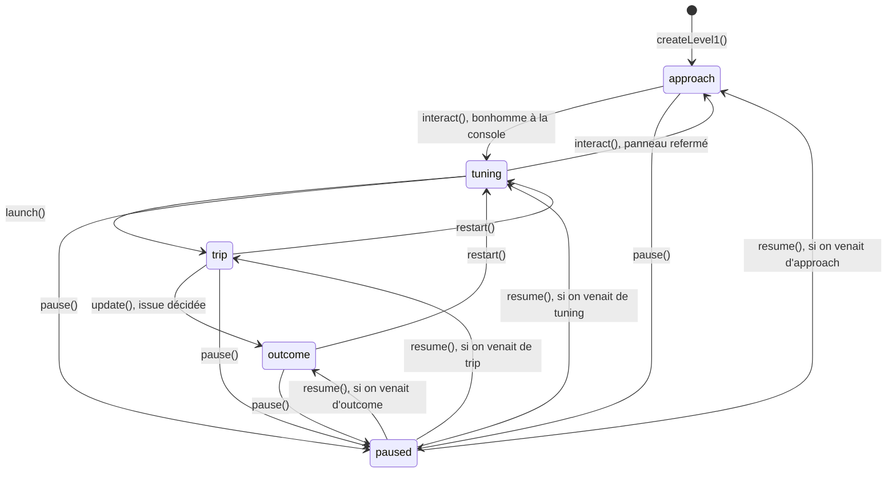

# Logique des niveaux (`src/game`)

À quoi sert cette page : expliquer comment les niveaux de l'ascenseur décident de ce qui se passe : phases, commandes du joueur, règles de victoire et d'échec, données transmises au rendu et à l'interface. Le niveau 1 « Le vide » (contrôleur P, Kp réglé) a été validé en T-007 (commit `6259ccc`) ; T-020 a fixé ses valeurs de jeu et T-021b a extrait sa machine à états dans un noyau commun, qui sert aussi au niveau 2 « La mémoire » (contrôleur PI, Kp fixé, Ki réglé). Cette page décrit l'état du commit `08908b6` (T-022 : trajet de 10 s, Kp par défaut 2000, tolérance du niveau 2 à 0,10 m). Ce que le joueur voit et les touches sont dans [interface.md](interface.md) ; le dessin dans [rendu.md](rendu.md). La simulation sous-jacente est dans [simulation.md](simulation.md), la physique dans [physique/ascenseur.md](physique/ascenseur.md).

## Rôle de `src/game`

`src/game` transforme le noyau de simulation en niveau jouable, sans rien afficher. Il :

- fait marcher le bonhomme jusqu'à la console ;
- gère le réglage (Kp au niveau 1, Ki au niveau 2) et son verrouillage ;
- lance le trajet et fait avancer la boucle de l'ascenseur du noyau ;
- juge l'issue (victoire, choc, marche trop haute, cabine au sol, et au niveau 2 « trop lent ») ;
- publie un instantané (`LevelSnapshot`) et des événements pour le rendu et l'interface.

Le module est pur et déterministe. Il n'importe que `src/sim` (règle `game-no-render` de dependency-cruiser), n'utilise pas le DOM (`tsconfig.sim.json`), ni l'aléa, ni l'horloge murale. Pour ce dernier point, la règle ESLint du noyau ne couvre pas `src/game` ; c'est un test (`tests/game/units.test.ts`) qui lit les sources et refuse `Math.random`, `Date`, `performance`, `window` et `document`. Les textes et le formatage des nombres ne sont pas ici : ils viennent de `src/i18n`, côté interface.

`src/main.ts` crée un niveau neuf à chaque entrée dans un niveau depuis le menu (`createLevel1()` ou `createLevel2()`, voir [architecture.md](architecture.md#ce-que-fait-srcmaints)), l'avance à chaque image (`level.update`), le passe au rendu (`src/render`) et à l'interface (`src/ui`), qui lui envoie les commandes du joueur (voir [architecture.md](architecture.md#flux-dune-image)). Au retour au menu, le niveau est jeté : rien n'est conservé d'un essai à l'autre.

| Fichier | Contenu |
|---|---|
| `constants.ts` | règles d'issue, bornes de Kp et de Ki, constantes du niveau 2, géométrie du décor |
| `kp.ts` | `quantizeGain` (arrondi sur une grille) et `quantizeKp` |
| `outcome.ts` | arbitres des issues (`createOutcomeJudge`, `createOutcomeJudge2`, `classifyTimeout`, `classifyTimeout2`) |
| `walker.ts` | marche du bonhomme sur le quai de départ |
| `events.ts` | file d'événements circulaire |
| `elevator-level.ts` | machine à états commune aux deux niveaux (`createElevatorLevel`), extraite de `level.ts` en T-021b |
| `level.ts` | niveau 1 : mince enveloppe de la machine commune (`createLevel1`) |
| `level2.ts` | niveau 2 : enveloppe avec le contrôleur PI (`createLevel2`) |
| `index.ts` | point d'entrée public |

## Phases et transitions

Le niveau est une machine à états à cinq phases (`LevelPhase`). Il démarre en `approach`.



| Phase | Ce qui se passe à chaque pas | Réglage (Kp, ou Ki au niveau 2) |
|---|---|---|
| `approach` | le bonhomme marche selon son intention | modifiable |
| `tuning` | panneau de réglage ouvert ; bonhomme figé devant la console | modifiable |
| `trip` | un pas de simulation de l'ascenseur, puis jugement de l'issue | verrouillé |
| `outcome` | rien : la cabine reste dans l'état du pas de l'issue | verrouillé |
| `paused` | rien ; l'horloge n'avance pas | verrouillé |

`restart()` ramène toujours au réglage (`tuning`), bonhomme devant la console, réglage conservé (arbitrage D-b de l'orchestrateur, log T-007, conforme à la spec §6.6).

## Commandes et résultats

Chaque commande renvoie un `CommandResult` :

- `accepted` : la commande a pris effet ;
- `ignored` : sans objet dans cette phase, rien n'a changé ;
- `locked` : réglage verrouillé ;
- `invalid` : valeur non finie refusée.

Aucune commande ne lève d'exception.

Les commandes de réglage s'appellent `setTuning(v)` et `adjustTuning(d)` sur le type commun `Level` ; l'interface et le clavier n'utilisent que celles-là. `createLevel1()` y ajoute les noms historiques `setKp(v)` et `adjustKp(d)`, `createLevel2()` les noms `setKi(v)` et `adjustKi(d)` (de simples renvois). Le tableau décrit le réglage sous le nom `setKp` ; il vaut à l'identique pour Ki au niveau 2.

| Commande | `approach` | `tuning` | `trip` | `outcome` | `paused` |
|---|---|---|---|---|---|
| `moveLeft()`, `moveRight()`, `stop()` | accepted | ignored | ignored | ignored | ignored |
| `interact()` | accepted si le bonhomme est à la console, sinon ignored | accepted (referme le panneau) | ignored | ignored | ignored |
| `setKp(v)`, v fini | accepted | accepted | locked | locked | locked |
| `setKp(v)`, v NaN ou ±Infinity | invalid | invalid | locked | locked | locked |
| `adjustKp(d)` | comme `setKp(kp + d)` ; d non fini : invalid | idem | locked | locked | locked |
| `launch()` | ignored | accepted | ignored | ignored | ignored |
| `restart()` | ignored | ignored | accepted | accepted | ignored |
| `pause()` | accepted | accepted | accepted | accepted | ignored |
| `resume()` | ignored | ignored | ignored | ignored | accepted |

Le verrouillage est testé avant la validité : `setKp(NaN)` pendant le trajet renvoie `locked`.

Ce tableau décrit l'API du niveau. Le clavier de l'interface n'appelle pas `interact()` pour E, Entrée et Espace en réglage : ces touches y lancent le trajet ; Échap referme le panneau par `interact()` (depuis P-005, voir [interface.md](interface.md#touches-qui-dépendent-de-la-phase)).

`update(frameSeconds)` n'est pas une commande : c'est le battement du niveau, appelé à chaque image avec la durée de l'image en secondes. Il passe par l'horloge à pas fixe du noyau (durée bornée à 0,25 s, 8 pas au plus par image, voir [simulation.md](simulation.md#horloge-à-pas-fixe)) et exécute chaque pas selon la phase. En pause, il n'avance pas l'horloge : à la reprise, il n'y a aucun saut de temps.

## Règles d'issue

L'arbitre du niveau 1 (`createOutcomeJudge`, fichier `outcome.ts`) est appelé une fois par pas de trajet, sur l'état de la cabine **après** le pas. Il teste dans cet ordre :

1. **Choc** (`bonk`) : y > `BEAM_HEIGHT` (3,3626 m), comparaison stricte. Fin immédiate.
2. **Victoire** (`win`) : un compteur augmente à chaque pas où |r − y| ≤ `STEP_TOLERANCE` (0,5 m) **et** |ẏ| ≤ `SETTLE_SPEED_TOLERANCE` (0,10 m/s). Il repart de zéro dès qu'une condition tombe. La victoire est acquise au `WIN_HOLD_STEPS`e pas consécutif (120 pas = 1,0 s).
3. **Fin de temps** : quand le nombre de pas atteint `TRIP_MAX_STEPS` (1200 pas = 10 s, pour les deux niveaux), `classifyTimeout(kp)` tranche :
   - `noLift` (la cabine ne décolle pas) si Kp ≤ `NO_LIFT_KP_THRESHOLD` ;
   - `step` (marche trop haute) sinon.

Une victoire acquise exactement au pas 1200 l'emporte sur la fin de temps. Une valeur NaN rend les comparaisons fausses : ni victoire ni choc.

Le seuil `NO_LIFT_KP_THRESHOLD` est calculé, pas écrit en dur : m·g / r = 490,5 / 3 = 163,5 N/m (`CABIN_WEIGHT / LEVEL1_SETPOINT`). Justification physique : [physique/ascenseur.md](physique/ascenseur.md#seuil-de-décollage).

**Valeurs de jeu du niveau 1 (T-020 puis T-022, décisions D24, D25, D27 et D28).** Elles ont changé le 2026-11-13. T-020 : `TRIP_MAX_STEPS` 1800 → 720 (15 s → 6 s, K6), `STEP_TOLERANCE` 0,25 → 0,5 m, `BEAM_HEIGHT` 3,3 → 3,3626 m, `KP_DEFAULT` 1000 → 500 ; la fenêtre de réussite passe de [2000 ; 3800] à [1000 ; 5000] N/m. T-022 : `TRIP_MAX_STEPS` 720 → 1200 (6 s → 10 s, D27) et `KP_DEFAULT` 500 → 2000 (D28) ; la fenêtre, la poutre et la tolérance ne bougent pas. Mesures de T-022 (log `orchestration/logs/T-022.md`, recoupées par le validateur et par l'orchestrateur ; remesurées à 1200 pas) :

- sur la grille de 100 N/m : `0-100 noLift | 200-900 step | 1000-5000 win | 5100-8000 bonk`, contiguë ;
- pics échantillonnés : 4900 → 3,357020 m ; 5000 → 3,360855 m ; 5100 → 3,364391 m ; 5200 → 3,367543 m ;
- marge sous la poutre à Kp = 5000 : 1,74 mm ; dépassement à 5100 : 1,79 mm ; marge de tolérance à Kp = 1000 : 9,5 mm (à 900, e = 0,545 m) ;
- victoire la plus lente : pas 301 (Kp = 4000 et 4100), soit 899 pas de marge avant 1200 (419 pas avant 720, jusqu'à T-020) ;
- écart noyau / solution exacte : 1,112e-7 m au pire (tolérances de test inchangées).

Le noyau `src/sim` n'a pas changé. Un Kp de 2000 au chargement est dans la fenêtre : lancer sans régler gagne (pas 262, erreur finale 0,245 m, mesuré par T-022). Jusqu'à T-021b, le défaut était hors de la fenêtre (500 : « trop court »). Le joueur qui veut voir un échec doit donc régler Kp.

### Niveau 2 : arbitre et fin de temps

`createOutcomeJudge2` applique les mêmes règles de choc et de victoire que le niveau 1, avec la tolérance propre au niveau, `LEVEL2_ARRIVAL_TOLERANCE` = 0,10 m (D29, T-022 ; jusqu'à T-021b, elle était égale à `STEP_TOLERANCE`, 0,5 m). La fin de temps (1200 pas, 10 s) est classée par `classifyTimeout2(y)` :

- `step` (trop court) si |r − y| > tolérance au dernier pas ;
- `slow` (trop lent à se stabiliser) sinon ;
- jamais `noLift`.

**K32 corrigé (D29, T-022).** À Kp = 2500, le P seul (Ki = 0) s'arrête à m·g/Kp = 0,196 m du plateau, au-delà des 0,10 m : Ki est nécessaire. (Avec l'ancienne tolérance de 0,5 m, Ki = 0 gagnait et `KI_DEFAULT` aussi : le niveau ne faisait pas ressentir l'utilité de Ki.) Mesures de T-022 (log `orchestration/logs/T-022.md`, 1200 pas, poutre 3,3626 m) :

- grille de Ki au pas de 100 : `0-100 step | 200-800 win | 900-8000 bonk`, aucun `slow` ;
- au pas de 10 (hors grille) : `0-120 step`, `130 slow`, `140-840 win`, `850+ bonk` ;
- victoire la plus lente : Ki = 200 au pas 733 sur la grille (marge 467 pas) ; Ki = 140 au pas 1185 hors grille ;
- marges de la borne de choc : 12,02 mm sous la poutre à Ki = 800 (pic 3,350580 m), 17,03 mm au-dessus à Ki = 900 (pic 3,379632 m) ; 0,384 mm à Ki = 840 (pic 3,362216 m) et 2,522 mm à Ki = 850 hors grille ;
- fenêtre de la grille insensible à une tolérance de 0,08 à 0,11 m et à un horizon de 1199 ou 1201 pas (validateur) ;
- `KI_DEFAULT` = 2000, hors de la fenêtre gagnante : un lancement sans réglage heurte la poutre (pas 57).

Pas d'issue de référence, mesurés au commit `08908b6` par un script jetable du rédacteur, hors dépôt (images de 1/30 s ; erreurs finales à 1e-6 m) :

| Ki (N/(m·s)) | Issue | `outcomeK` | `finalError` (m) | Pas saturés |
|---|---|---|---|---|
| 0 | `step` | 1200 | 0,196200 | 23 |
| 100 | `step` | 1200 | 0,116487 | 23 |
| 120 (hors grille) | `step` | 1200 | 0,104632 | 23 |
| 130 (hors grille) | `slow` | 1200 | 0,099123 | 23 |
| 140 (hors grille) | `win` | 1185 | 0,094543 | 23 |
| 200 | `win` | 733 | 0,092260 | 23 |
| 500 | `win` | 298 | 0,046204 | 24 |
| 800 | `win` | 298 | −0,002991 | 25 |
| 850 (hors grille) | `bonk` | 72 | −0,363562 | 25 |
| 900 | `bonk` | 69 | −0,365269 | 25 |
| 1000 | `bonk` | 66 | −0,365121 | 26 |
| 2000 (`KI_DEFAULT`) | `bonk` | 57 | −0,372257 | 29 |
| 8000 | `bonk` | 51 | −0,429002 | 50 |

Reste K34 : sur la grille de 100, `slow` n'arrive jamais (seul Ki = 130 le donne), donc `level2.fail.slow` et `hud.status.fail.slow` ne s'affichent à aucun joueur ; l'annonce « Il manque 0,10 m » apparaîtrait à Ki = 120 (e = 0,1046), valeur inatteignable au curseur. L'intégrale est mise à jour sans anti-windup : le windup se montre par l'échec (choc), voir [ADR-016](decisions/ADR-016-controleur-pi-sans-anti-windup.md). La marge de 0,384 mm à Ki = 840 est consignée en K29. Les mesures d'avant T-022 (tolérance 0,5 m, 720 pas : Ki gagnants [0 ; 800], chocs [900 ; 8000], aucune fin de temps) restent dans le log T-021a.

### Convention de pas

- L'issue est jugée sur l'état **après** le pas : x(n·dt), où n est le nombre de pas exécutés depuis le lancement, ce pas compris.
- `outcomeK` (instantané) et le champ `k` de l'événement `outcome` valent ce nombre n.
- `finalError` = r − y au pas de l'issue (m). Il est négatif pour un choc (la cabine est au-dessus du quai).

C'est la convention du validateur T-005 : ses pas d'issue sont identiques.

### Issues de 0 à 8000 N/m

Balayage par pas de 100 N/m (`tests/game/outcomes.test.ts`, test « balayage 0 → 8000 par pas de 100 », qui vérifie aussi la victoire la plus lente, 301 pas, et sa marge de 899 pas) :

| Kp (N/m) | Issue |
|---|---|
| 0 à 100 | `noLift` |
| 200 à 900 | `step` |
| **1000 à 5000** | **`win`** |
| 5100 à 8000 | `bonk` |

Pas d'issue de référence, mesurés au commit `08908b6` par un script jetable du rédacteur, hors dépôt, qui joue le niveau par l'API publique (comme `runTrip` de `tests/game/helpers.ts`, images de 1/30 s). Les lignes dont la source cite le test sont aussi figées par `tests/game/outcomes.test.ts` (CA-1, CA-2). Avant T-020, 3900 et 4500 se cognaient (pas 63 et 58) ; ils gagnent maintenant.

| Kp (N/m) | Issue | `outcomeK` | Temps (s) | `finalError` (m) | Pas saturés | Source |
|---|---|---|---|---|---|---|
| 100 | `noLift` | 1200 | 10,000 | 3,000000 | 0 | script ; test CA-2 |
| 150 (`initialKp`) | `noLift` | 1200 | 10,000 | 3,000000 | 0 | script ; tests CA-1 et CA-2 |
| 500 | `step` | 1200 | 10,000 | 0,981000 | 0 | script (0,981225 à 720 pas, jusqu'à T-021b) |
| 900 | `step` | 1200 | 10,000 | 0,545000 | 0 | script ; test CA-2 |
| 1000 | `win` | 267 | 2,225 | 0,489757 | 0 | script ; test CA-2 |
| 1500 | `win` | 280 | 2,333 | 0,326911 | 0 | script |
| 2000 (`KP_DEFAULT`) | `win` | 262 | 2,183 | 0,244680 | 15 | script ; test CA-2 et test du défaut (D28) |
| 2500 | `win` | 291 | 2,425 | 0,196407 | 23 | script ; test CA-2 |
| 3500 | `win` | 278 | 2,317 | 0,139649 | 30 | script ; test CA-2 |
| 3800 | `win` | 273 | 2,275 | 0,128583 | 32 | script ; test CA-2 |
| 3900 | `win` | 300 | 2,500 | 0,125988 | 32 | script |
| 4000 | `win` | 301 | 2,508 | 0,122867 | 32 | script ; test CA-2 (la plus lente) |
| 4500 | `win` | 298 | 2,483 | 0,109171 | 34 | script |
| 5000 | `win` | 293 | 2,442 | 0,098047 | 35 | script ; test CA-2 |
| 5100 | `bonk` | 61 | 0,508 | −0,364197 | 36 | script ; test CA-2 |
| 8000 | `bonk` | 55 | 0,458 | −0,373718 | 40 | script (à 7000 : pas 56, test CA-2) |

Lecture :

- À la victoire, `finalError` est proche de l'erreur statique m·g/Kp (0,1962 m à 2500 N/m). Le test l'exige à 1e-3 m près pour Kp ∈ {2000, 2500, 3000, 3800} (`outcomes.test.ts`, CA-7).
- Pour un choc, le trajet s'arrête au premier pas au-dessus de 3,3626 m : à Kp = 5100, `finalError` vaut −0,364197 m, donc y = 3,364197 m. Le maximum que la cabine aurait atteint sur les 1200 pas (3,364391 m) n'est jamais simulé.
- Les pas d'issue de T-005 §E (2000 → 311, 2500 → 291, 3500 → 278, 3800 → 273, 3900 → 63, 4500 → 58, 8000 → 53) datent du réglage d'avant T-020 (tolérance 0,25 m, poutre 3,30 m) : 2500, 3500 et 3800 sont inchangés, les autres ne le sont plus.
- Les pas d'issue ne dépendent pas de la cadence d'images : `tests/game/frames.test.ts` compare des images de 1/30, 1/60 et 1/144 s, des images irrégulières de 7 à 40 ms, et des images irrégulières avec un à-coup de 0,5 s toutes les 50 images. Issue, pas, erreur et trace sont identiques bit à bit pour Kp ∈ {1500, 2500, 3800, 3900}.

## L'instantané `LevelSnapshot`

`level.snapshot` (et la valeur renvoyée par `update`) est **un seul objet**, réécrit après chaque `update` et chaque commande acceptée. Les grandeurs de la cabine décrivent l'état x(k·dt) **après** le dernier pas exécuté.

| Champ | Type | Unité | Signification |
|---|---|---|---|
| `levelId` | `LevelId` | — | `'level1'` (contrôleur P) ou `'level2'` (contrôleur PI) |
| `phase` | `LevelPhase` | — | phase courante |
| `resumePhase` | `LevelPhase \| null` | — | phase reprise par `resume()` ; `null` hors pause |
| `walkerX` | number | m | abscisse du bonhomme ; vaut `CABIN_CENTER_X` (2 m) pendant le trajet et l'issue |
| `walkerPrevX` | number | m | abscisse au pas précédent, pour l'interpolation |
| `walkerFacing` | `Facing` | — | −1 tourné à gauche, +1 à droite |
| `walkerMoving` | boolean | — | vrai si le bonhomme a une intention de marche (animation) |
| `walkerInCabin` | boolean | — | vrai pendant le trajet et l'issue (et la pause qui les suit) |
| `atConsole` | boolean | — | vrai si le bonhomme est dans la zone de la console (faux à bord) |
| `cabinY` | number | m | hauteur du plancher de la cabine après le dernier pas |
| `cabinPrevY` | number | m | hauteur au pas précédent, pour l'interpolation |
| `cabinVelocity` | number | m/s | vitesse verticale ẏ après le dernier pas |
| `alpha` | number | — | fraction de pas en attente dans l'horloge, dans [0, 1) |
| `kp` | number | N/m | gain proportionnel courant (réglé au niveau 1, fixé à 2500 au niveau 2) |
| `ki` | number | N/(m·s) | gain intégral courant : 0 au niveau 1, réglé au niveau 2 |
| `iTerm` | number | N | terme intégral I lu sur le contrôleur après le dernier pas ; 0 au niveau 1 et hors trajet. Exposé, pas encore affiché (K30) |
| `r` | number | m | consigne : 0 avant le lancement, 3 pendant le trajet et l'issue |
| `e` | number | m | erreur r − `cabinY` |
| `uSat` | number | N | force appliquée au dernier pas, après saturation ; 0 hors trajet |
| `saturated` | boolean | — | vrai si la force du dernier pas a été écrêtée |
| `k` | number | pas | nombre de pas exécutés depuis le lancement ; 0 hors trajet |
| `t` | number | s | temps du trajet, k·dt |
| `outcome` | `TripOutcome \| null` | — | issue (`win`, `noLift`, `step`, `bonk`, et `slow` au niveau 2), ou `null` tant que le trajet n'est pas fini |
| `outcomeK` | `number \| null` | pas | pas de l'issue |
| `finalError` | `number \| null` | m | r − y au pas de l'issue |
| `theoreticalError` | number | m | erreur statique théorique m·g/Kp (sans intégrale) ; `Infinity` si Kp = 0 |
| `saturationSeen` | boolean | — | vrai dès le premier pas saturé du trajet |
| `saturatedSteps` | number | pas | nombre de pas saturés du trajet |
| `attempt` | number | — | numéro de l'essai, ≥ 1, augmenté par `restart()` |

État initial (test « démarre en approche ») : phase `approach`, bonhomme en x = −5,5 m tourné à droite, cabine au sol, Kp = 2000 N/m (`KP_DEFAULT`, depuis T-022 ; 500 de T-020 à T-021b, 1000 avant), essai 1. Au niveau 2, Kp = 2500 N/m, Ki = 2000 N/(m·s) (`KI_DEFAULT`, depuis T-022 ; 500 jusqu'à T-021b).

## Événements

Les événements signalent les moments discrets que l'interface doit annoncer une seule fois (région `aria-live` de l'interface, voir [interface.md](interface.md#annonces-pour-lecteurs-décran) ; il n'y a pas de son). Ils passent par une file circulaire de `EVENT_QUEUE_CAPACITY` = 32 emplacements alloués une fois.

| Type | Émis quand | Champ `k` |
|---|---|---|
| `tuningOpened` | `interact()` à la console ouvre le panneau | 0 |
| `tuningClosed` | `interact()` en `tuning` referme le panneau | 0 |
| `launch` | `launch()` accepté | 0 |
| `firstSaturation` | premier pas saturé du trajet (au plus une fois par trajet) | pas où il survient |
| `outcome` | issue décidée ; champ `outcome` renseigné | `outcomeK` |
| `reset` | `restart()` accepté ; `attempt` vaut déjà le nouveau numéro | 0 |
| `pause`, `resume` | `pause()`, `resume()` acceptés | k courant du trajet |

Chaque `GameEvent` porte `type`, `k`, `outcome` (`null` sauf pour `outcome`) et `attempt`.

Consommation : `level.drainEvents(visitor)` retire les événements en attente, du plus ancien au plus récent, et passe chacun à `visitor`. Un événement n'est rendu **qu'une fois**. Un événement ajouté pendant la visite est rendu au prochain appel. Si plus de 32 événements s'accumulent sans être consommés, les plus anciens sont perdus ; la file brute (`createEventQueue`) les compte dans `dropped`, mais `Level1` n'expose pas ce compteur.

L'objet passé au visiteur est un emplacement réutilisé : copier les champs pour les garder (`{ ...event }`).

## Géométrie du niveau

Vocabulaire : cette page et le code disent « quai » (`START_LEDGE_*`, `ARRIVAL_LEDGE_*`) ; les textes français du jeu disent « plateau d'arrivée » depuis T-019. Axe x horizontal en mètres, origine au bord du quai de départ, croissant vers la droite. Hauteurs en mètres, sol du quai de départ = 0. Valeurs de `src/game/constants.ts`.

```text
 hauteur (m)
 3,3626                           ════════════  poutre (au-dessus de la cage)
   3,00                           │          │════════════════════════════  quai d'arrivée
                                  │   cage   │
                                  │  cabine  │
   0,00  ═════════════════════════│▄▄▄▄▄▄▄▄▄▄│
         quai de départ           │  3,6 m   │
 x (m)  −6   −5,5        −1       0    2     4                            10
              spawn    console         centre
```

| Constante | Valeur | Unité | Rôle |
|---|---|---|---|
| `LEVEL_MIN_X` | −6 | m | bord gauche du décor |
| `LEVEL_MAX_X` | 10 | m | bord droit du décor |
| `START_LEDGE_MIN_X` | −6 | m | bord gauche du quai de départ |
| `START_LEDGE_MAX_X` | 0 | m | bord droit du quai de départ, au bord du vide |
| `START_LEDGE_HEIGHT` | 0 | m | hauteur du quai de départ |
| `VOID_WIDTH` | 4 | m | largeur du vide, occupé par la cage |
| `VOID_MIN_X` | 0 | m | bord gauche du vide et de la cage |
| `VOID_MAX_X` | 4 | m | bord droit du vide et de la cage |
| `CABIN_WIDTH` | 3,6 | m | largeur du plancher de la cabine |
| `CABIN_CENTER_X` | 2 | m | centre de la cabine ; position du bonhomme à bord |
| `ARRIVAL_LEDGE_MIN_X` | 4 | m | bord gauche du quai d'arrivée |
| `ARRIVAL_LEDGE_MAX_X` | 10 | m | bord droit du quai d'arrivée |
| `ARRIVAL_LEDGE_HEIGHT` | 3 | m | hauteur du quai d'arrivée, égale à la consigne |
| `CONSOLE_X` | −1 | m | abscisse de la console |
| `CONSOLE_REACH` | 0,75 | m | demi-largeur de la zone de la console : \|x − (−1)\| ≤ 0,75 |
| `WALKER_SPAWN_X` | −5,5 | m | apparition du bonhomme |
| `WALKER_MIN_X` | −5,5 | m | borne gauche de la marche |
| `WALKER_MAX_X` | −0,3 | m | borne droite de la marche, avant le vide |
| `WALKER_SPEED` | 1,5 | m/s | vitesse de marche, sans inertie |
| `BEAM_HEIGHT` | 3,3626 | m | hauteur de la poutre (3,3 avant T-020) |
| `STEP_TOLERANCE` | 0,5 | m | marche franchissable (0,25 avant T-020) |
| `SETTLE_SPEED_TOLERANCE` | 0,1 | m/s | vitesse « arrêtée » |
| `WIN_HOLD_STEPS` | 120 | pas | durée de tenue pour gagner (1,0 s) |
| `TRIP_MAX_STEPS` | 1200 | pas | durée maximale d'un trajet (10 s, deux niveaux ; 720 pas, 6 s de T-020 à T-021b ; 1800 pas, 15 s avant T-020) |
| `LEVEL1_SETPOINT` | 3 | m | consigne r (= `ELEVATOR_SETPOINT` du noyau) |
| `CABIN_WEIGHT` | 490,5 | N | m·g, calculé depuis `ELEVATOR_PARAMS` |
| `NO_LIFT_KP_THRESHOLD` | 163,5 | N/m | m·g / r, calculé |
| `KP_MIN` | 0 | N/m | Kp minimal |
| `KP_MAX` | 8000 | N/m | Kp maximal |
| `KP_STEP` | 100 | N/m | pas du réglage |
| `KP_DEFAULT` | 2000 | N/m | Kp au chargement, dans la fenêtre de réussite (500 de T-020 à T-021b, 1000 avant) |
| `LEVEL2_KP` | 2500 | N/m | Kp fixé du niveau 2 |
| `LEVEL2_ARRIVAL_TOLERANCE` | 0,1 | m | tolérance d'arrivée du niveau 2 (égale à `STEP_TOLERANCE`, 0,5 m, jusqu'à T-021b ; K32 corrigé) |
| `KI_MIN` | 0 | N/(m·s) | Ki minimal (celui de Kp) |
| `KI_MAX` | 8000 | N/(m·s) | Ki maximal (celui de Kp) |
| `KI_STEP` | 100 | N/(m·s) | pas du réglage de Ki |
| `KI_DEFAULT` | 2000 | N/(m·s) | Ki au chargement du niveau 2 (`= KP_DEFAULT`), hors de la fenêtre gagnante |
| `EVENT_QUEUE_CAPACITY` | 32 | — | capacité de la file d'événements (`events.ts`) |

La zone de la console va donc de x = −1,75 à −0,25 m. Depuis l'apparition, le bonhomme l'atteint après 3,75 m de marche, soit 2,5 s.

## Réglage de Kp

- Bornes : [`KP_MIN` ; `KP_MAX`] = [0 ; 8000] N/m. Pas : 100 N/m. Défaut : 2000 N/m (500 de T-020 à T-021b, 1000 avant).
- `quantizeKp(v)` arrondit au multiple de 100 le plus proche (les demis vers +∞, comme `Math.round`), puis borne à [0 ; 8000]. −0 devient 0. Une valeur non finie donne `null`, que `setKp` traduit en `invalid`. Exemples testés : 49 → 0, 50 → 100, −49 → 0, 1234 → 1200, 7951 → 8000, 8049 → 8000, 1e300 → 8000. `quantizeKp` est un cas de `quantizeGain(value, min, max, step)`, que la machine commune applique au réglage de chaque niveau.
- Une valeur hors bornes est ramenée à la borne et acceptée.
- Verrouillage : `locked` en `trip`, `outcome` et `paused` (décision D9 du registre : Kp verrouillé pendant le trajet).
- `adjustKp(delta)` applique les mêmes règles à `kp + delta`. L'interface l'appelle avec ±100 (touches + et −, boutons du panneau) et ±1000 (Page préc., Page suiv.) ; voir la [table des touches](interface.md#touches).
- Au lancement, une nouvelle boucle du noyau n'est créée que si Kp a changé depuis le trajet précédent ; sinon la boucle existante est remise à zéro.

**Option `initialKp`** (`Level1Options`) : réservée aux tests et à un futur bac à sable. Elle fixe le Kp de départ **sans** l'arrondir au pas de 100 : c'est la seule façon d'obtenir 150 N/m (test T5 de la spec). Elle doit être finie et dans [0 ; 8000], sinon `createLevel1` lève `RangeError`. Tout réglage ultérieur repasse sur la grille (arbitrage D-a, log T-007). L'autre option, `createLoop`, permet d'injecter une autre boucle fermée (tests).

### Réglage de Ki (niveau 2)

- `createLevel2()` fixe Kp à `LEVEL2_KP` = 2500 N/m (le joueur ne le règle pas) et laisse régler Ki dans [`KI_MIN` ; `KI_MAX`] = [0 ; 8000] N/(m·s), par pas de `KI_STEP` = 100, défaut `KI_DEFAULT` = 2000 (500 jusqu'à T-021b). Mêmes bornes et même pas que Kp (décision de l'utilisateur).
- Mêmes règles de verrouillage, d'arrondi et de `CommandResult` que pour Kp (`setKi`, `adjustKi`, ou `setTuning`, `adjustTuning`).
- Le niveau décrit son réglage par `level.tuning` (`TuningSpec` : `param` valant `'kp'` ou `'ki'`, `min`, `max`, `step`) ; l'interface et le clavier en dépendent, pas du numéro du niveau.
- **Option `initialKi`** (`Level2Options`) : Ki de départ, fini et dans [0 ; 8000], sinon `createLevel2` lève `RangeError` ; non arrondi, comme `initialKp`. L'option `createLoop(ki)` injecte une autre boucle (tests) ; par défaut, `createElevatorPiLoop({ kp: 2500, ki })` du noyau (contrôleur PI sans anti-windup, voir [simulation.md](simulation.md#contrôleur-pi-t-021a)).
- Une nouvelle boucle n'est créée au lancement que si Ki a changé depuis le trajet précédent.

## Contrats pour le rendu et l'interface

Contrats fixés par l'orchestrateur (log T-007) pour T-008 à T-010, et appliqués par `src/render` et `src/ui`.

1. **Ne rien conserver.** `snapshot` est un objet unique réécrit ; l'objet des événements est un emplacement réutilisé. Lire, copier si besoin, ne jamais garder de référence ni modifier. Le niveau, lui, ne garde aucune référence vers l'échantillon ni l'état du noyau : il copie les nombres (test `allocation.test.ts` : muter l'échantillon après coup ne change pas l'instantané). C'est la règle 2 du [piège de `LoopSample`](simulation.md#le-piège-de-loopsample), appliquée.
2. **Interpoler.** Afficher la cabine à `lerp(cabinPrevY, cabinY, alpha)` et le bonhomme à `lerp(walkerPrevX, walkerX, alpha)`. Sans cela, l'image saccade quand la cadence d'écran n'est pas un multiple de 120 Hz.
3. **Courbes.** `level.signals` (capacité `TRIP_MAX_STEPS` = 1200) contient r, y, e et uSat **avant** chaque pas, à l'instant k·dt, selon la convention du noyau : pour un trajet terminé au pas n, il contient y(0) à y((n − 1)·dt). La valeur au pas de l'issue est dans `snapshot.cabinY`. L'enregistreur est vidé au lancement et à `restart()`.
4. **Animations.** L'embarquement du bonhomme et sa sortie après la victoire sont laissés au rendu : la logique le place directement au centre de la cabine au lancement. Au commit `08908b6`, le rendu ne les anime pas (réserve des logs T-009 et T-010, K4).
5. **Une seule annonce.** La saturation s'annonce sur l'événement `firstSaturation`, pas sur `snapshot.saturated` (qui change à chaque pas).

Exemple d'usage simplifié. La vraie boucle est dans `src/main.ts`, `src/render/session.ts` et `src/ui/overlay.ts` : l'interface consomme les événements, le rendu interpole.

```ts
const level = createLevel1();
function frame(dtSeconds: number): void {
  const s = level.update(dtSeconds);
  const y = s.cabinPrevY + (s.cabinY - s.cabinPrevY) * s.alpha; // hauteur à afficher
  level.drainEvents((e) => announce(e.type, e.outcome)); // une annonce par événement
  draw(y, s);
}
```

## Exports de `src/game/index.ts`

Liste complète au commit `08908b6`, comptée par script sur `src/game/index.ts` et `constants.ts` : 51 valeurs et 21 types (39 et 13 au commit `7bcd9ce`). `index.ts` réexporte toutes les constantes de `constants.ts` (`export *`, 37) ; leurs valeurs sont dans le tableau de la géométrie ci-dessus, sauf `EVENT_QUEUE_CAPACITY`, qui vient de `events.ts`. Il réexporte aussi `ELEVATOR_MAX_FORCE` du noyau (graduation « max » de la jauge, affichage seulement).

### Constantes

`LEVEL1_SETPOINT`, `BEAM_HEIGHT`, `STEP_TOLERANCE`, `SETTLE_SPEED_TOLERANCE`, `WIN_HOLD_STEPS`, `TRIP_MAX_STEPS`, `CABIN_WEIGHT`, `NO_LIFT_KP_THRESHOLD`, `KP_MIN`, `KP_MAX`, `KP_STEP`, `KP_DEFAULT`, `LEVEL2_KP`, `LEVEL2_ARRIVAL_TOLERANCE`, `KI_MIN`, `KI_MAX`, `KI_STEP`, `KI_DEFAULT`, `LEVEL_MIN_X`, `LEVEL_MAX_X`, `START_LEDGE_MIN_X`, `START_LEDGE_MAX_X`, `START_LEDGE_HEIGHT`, `VOID_WIDTH`, `VOID_MIN_X`, `VOID_MAX_X`, `CABIN_WIDTH`, `CABIN_CENTER_X`, `ARRIVAL_LEDGE_MIN_X`, `ARRIVAL_LEDGE_MAX_X`, `ARRIVAL_LEDGE_HEIGHT`, `CONSOLE_X`, `CONSOLE_REACH`, `WALKER_SPAWN_X`, `WALKER_MIN_X`, `WALKER_MAX_X`, `WALKER_SPEED`, `EVENT_QUEUE_CAPACITY`.

### Fonctions et fabriques

| Nom | Signature courte | Rôle | Erreurs |
|---|---|---|---|
| `createElevatorLevel` | `(config: ElevatorLevelConfig) → Level` | machine à états commune aux deux niveaux ; la configuration donne l'identifiant, le réglage, les gains du trajet, la boucle et l'arbitre | aucune |
| `createLevel1` | `(options?: Level1Options) → Level1` | crée le niveau 1 en phase `approach` | `RangeError` si `initialKp` n'est pas fini ou sort de [0 ; 8000] |
| `createLevel2` | `(options?: Level2Options) → Level2` | crée le niveau 2 en phase `approach` (Kp fixé, Ki réglable) | `RangeError` si `initialKi` n'est pas fini ou sort de [0 ; 8000] |
| `quantizeGain` | `(value, min, max, step) → number \| null` | arrondit un réglage sur sa grille, puis le borne | aucune ; `null` si la valeur n'est pas finie |
| `quantizeKp` | `(value) → number \| null` | `quantizeGain` avec les bornes de Kp | aucune ; `null` si la valeur n'est pas finie |
| `createOutcomeJudge` | `(setpoint = LEVEL1_SETPOINT) → OutcomeJudge` | arbitre des issues du niveau 1, sans allocation | aucune |
| `createOutcomeJudge2` | `(setpoint, tolerance = LEVEL2_ARRIVAL_TOLERANCE) → OutcomeJudge` | arbitre du niveau 2 | aucune |
| `classifyTimeout` | `(kp) → 'noLift' \| 'step'` | issue à la fin du temps, niveau 1 | aucune |
| `classifyTimeout2` | `(y, setpoint, tolerance) → 'step' \| 'slow'` | issue à la fin du temps, niveau 2 | aucune |
| `createWalker` | `() → Walker` | bonhomme à l'apparition, tourné à droite, à l'arrêt | aucune |
| `isAtConsole` | `(x) → boolean` | \|x − `CONSOLE_X`\| ≤ `CONSOLE_REACH` | aucune |
| `createEventQueue` | `() → EventQueue` | file circulaire de 32 événements | aucune |

### Types

| Nom | Contenu |
|---|---|
| `Level` | niveau commun : `tuning`, `snapshot`, `signals`, `update`, `moveLeft`, `moveRight`, `stop`, `interact`, `setTuning`, `adjustTuning`, `launch`, `restart`, `pause`, `resume`, `drainEvents` |
| `Level1`, `Level1Options` | `Level` plus `setKp`, `adjustKp` ; options `createLoop?`, `initialKp?` |
| `Level2`, `Level2Options` | `Level` plus `setKi`, `adjustKi` ; options `createLoop?`, `initialKi?` |
| `ElevatorLevelConfig` | configuration de `createElevatorLevel` : `id`, `tuning`, `initial`, `kpOf`, `kiOf`, `createLoop`, `createJudge` |
| `LevelId` | `'level1' \| 'level2'` |
| `TunedParam` | `'kp' \| 'ki'` |
| `TuningSpec` | `param`, `min`, `max`, `step` |
| `TripLoop` | boucle à pas fixe du noyau, avec en option un contrôleur qui expose `integral` |
| `LevelPhase` | `'approach' \| 'tuning' \| 'trip' \| 'outcome' \| 'paused'` |
| `LevelSnapshot` | voir le tableau de l'instantané |
| `CommandResult` | `'accepted' \| 'ignored' \| 'locked' \| 'invalid'` |
| `TripOutcome` | `'win' \| 'noLift' \| 'step' \| 'bonk' \| 'slow'` |
| `OutcomeJudge` | `holdSteps`, `reset()`, `evaluate(n, y, v, kp)` |
| `Walker` | `x`, `prevX`, `facing`, `intent`, `atConsole`, `setIntent`, `step(dt)`, `hold()`, `place(x, facing)` |
| `WalkIntent` | `'left' \| 'right' \| 'none'` |
| `Facing` | `-1 \| 1` |
| `GameEvent` | `type`, `k`, `outcome`, `attempt` |
| `GameEventType` | les 8 types d'événements |
| `EventQueue` | `length`, `dropped`, `push`, `drain` |

## Tests

114 tests dans `tests/game/` (7 fichiers, dont `level2.test.ts`, 43 tests), inventaire dans [tests.md](tests.md#logique-de-jeu-testsgame). Justification des choix : [ADR-009](decisions/ADR-009-machine-a-etats.md) ; contrôleur PI et niveau 2 : [ADR-016](decisions/ADR-016-controleur-pi-sans-anti-windup.md).
