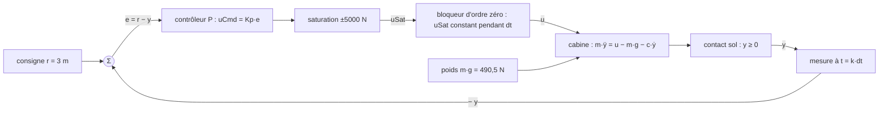

# Physique de l'ascenseur (niveau 1)

À quoi sert cette page : présenter le modèle physique de l'ascenseur du niveau 1, les formules qui prédisent son comportement et les valeurs mesurées sur le code. Elle s'adresse à un lecteur de niveau licence qui découvre l'automatique. Code : `src/sim/plants/elevator.ts` ; fonctionnement du noyau : [simulation.md](../simulation.md).

## Le système en une phrase

Une cabine (le bonhomme est dedans) monte dans une cage. Un moteur la tire vers le haut avec une force u. Le joueur règle un seul nombre, le gain Kp : plus la cabine est loin du quai, plus le moteur tire fort.

## Modèle et équation

Le principe fondamental de la dynamique appliqué à la cabine donne :

```text
m·ÿ = u − m·g − c·ẏ
```

- `m·ÿ` : masse × accélération ;
- `u` : force du moteur, déjà saturée à ±Umax ;
- `m·g` : poids ;
- `c·ẏ` : frottement visqueux des glissières, proportionnel à la vitesse.

Pour le joueur : le moteur doit d'abord vaincre le poids avant de faire monter la cabine, et le frottement freine tout mouvement.

État simulé : `x = [y, ẏ]` (position en m, vitesse en m/s). Le noyau calcule :

```text
dy/dt = ẏ
dẏ/dt = (u − m·g − c·ẏ) / m
```

Contrainte de sol, appliquée après chaque pas : si y < 0, alors y = 0 et ẏ = max(ẏ, 0). La cabine ne traverse pas le sol et ne rebondit pas.

Loi de commande (contrôleur P) :

```text
e    = r − y
uCmd = Kp·e
u    = min(max(uCmd, −Umax), +Umax)
```

## Paramètres

Valeurs de `ELEVATOR_PARAMS`, `ELEVATOR_MAX_FORCE` et `ELEVATOR_SETPOINT` (code), et spec T-001 §5 pour les règles de jeu.

| Symbole | Valeur | Unité | Rôle | Source |
|---|---|---|---|---|
| m | 50 | kg | masse cabine + bonhomme | code |
| g | 9,81 | m/s² | pesanteur | code |
| c | 400 | N·s/m | frottement visqueux | code |
| Umax | 5000 | N | saturation du moteur (≈ 10·m·g) | code |
| r | 3,00 | m | consigne : hauteur du quai d'arrivée | code |
| y0, ẏ0 | 0, 0 | m, m/s | cabine posée au sol | code (`createElevatorLoop`) |
| dt | 1/120 | s | pas de simulation | code (`SIM_DT`) |
| Kp | 0 à 8000, pas de 100 | N/m | gain réglé par le joueur | spec §5 ; curseur et touches de l'interface (T-010) |
| h_poutre | 3,30 | m | poutre : y > 3,30 m ⇒ choc | `BEAM_HEIGHT` de `src/game` (T-007) |
| tolérance de marche | 0,25 | m | marche que le bonhomme peut enjamber | `STEP_TOLERANCE` de `src/game` (T-007) |

Grandeurs dérivées : poids m·g = 490,5 N ; c/m = 8 s⁻¹ ; vitesse limite en chute libre m·g/c = 1,226 m/s.

## Schéma-bloc de la boucle



La flèche du bas est la **rétroaction** : le contrôleur compare sans cesse la hauteur mesurée à la consigne.

## Formules du régime linéaire

Les formules de cette section supposent : pas de saturation, pas de contact avec le sol après le décollage, temps continu. En jeu, la saturation agit au départ ; ces formules servent donc à l'oracle sans saturation (`tests/sim/oracle.test.ts`, Umax = 1e12 N), pas à prédire exactement une partie. Valeurs de jeu : [plus bas](#configuration-de-jeu-saturation-5000-n).

### Seuil de décollage

Au départ, y = 0, donc e = r et le moteur tire avec Kp·r. La cabine décolle seulement si cette force dépasse le poids :

```text
Kp·r > m·g   ⇔   Kp > m·g / r = 490,5 / 3 = 163,5 N/m
```

Pour le joueur : avec Kp ≤ 163,5 N/m, la cabine reste collée au sol. Avec le curseur du jeu (pas de 100 N/m), 100 N/m ne décolle pas et 200 N/m décolle.

### Erreur statique

À l'équilibre, la cabine ne bouge plus : ÿ = ẏ = 0. L'équation devient u = m·g, et comme u = Kp·e :

```text
e_ss = m·g / Kp        y_ss = r − e_ss
```

Pour le joueur : le moteur ne tire que s'il reste une erreur. Pour porter le poids, il faut donc une erreur permanente : la cabine s'arrête toujours sous le quai. Plus Kp est grand, plus cette marche est petite, mais elle ne disparaît jamais avec un contrôleur P seul.

Borne basse de la fenêtre de réussite : la marche doit rester ≤ 0,25 m, donc m·g / Kp ≤ 0,25, soit **Kp ≥ m·g / 0,25 = 1962 N/m**.

### Pulsation propre et amortissement

Posons z = y − y_ss, l'écart à l'équilibre. En remplaçant u = Kp·(r − y) dans l'équation et en retranchant l'équilibre :

```text
m·z̈ + c·ż + Kp·z = 0   ⇔   z̈ + (c/m)·ż + (Kp/m)·z = 0
```

C'est la forme standard du second ordre `z̈ + 2·ζ·ωn·ż + ωn²·z = 0`. Par identification :

```text
ωn = √(Kp / m)                 (rad/s)
ζ  = c / (2·√(Kp·m))           (sans dimension)
```

Pour le joueur : ωn mesure la vivacité de la cabine (Kp grand ⇒ réponse rapide) ; ζ mesure son calme (ζ ≥ 1 : pas de dépassement ; ζ petit : la cabine oscille). Augmenter Kp augmente ωn mais **diminue** ζ.

Amortissement critique (ζ = 1) : Kp = c² / (4·m) = 800 N/m. En dessous, la cabine monte sans jamais dépasser son point d'arrivée.

### Dépassement et instant du pic

Pour ζ < 1, la solution partant du repos est :

```text
z(t) = −(y_ss − y0)·e^(−ζ·ωn·t)·[cos(ωd·t) + ζ/√(1 − ζ²)·sin(ωd·t)]     avec ωd = ωn·√(1 − ζ²)
```

La vitesse s'annule pour la première fois quand ωd·t = π. C'est le premier pic :

```text
t_pic = π / ωd = π / (ωn·√(1 − ζ²))
```

En reportant t_pic dans z(t), le cosinus vaut −1 et le sinus 0. Le dépassement relatif vaut :

```text
Mp = e^(−ζ·ωn·t_pic) = exp(−ζ·π / √(1 − ζ²))        y_pic = y_ss + Mp·(y_ss − y0)
```

Pour le joueur : Mp ne dépend que de ζ. Plus Kp est grand, plus ζ est petit, plus la cabine dépasse le quai… et risque de heurter la poutre à 3,30 m.

### Taux de décroissance

L'enveloppe des oscillations décroît comme e^(−σ·t), avec :

```text
σ = ζ·ωn = c / (2·m) = 400 / 100 = 4 s⁻¹
```

Kp disparaît de la formule. Les oscillations perdent 98 % de leur amplitude quand e^(−4·t) = 0,02, soit t = ln(50)/4 ≈ 0,98 s, quel que soit Kp.

Pour le joueur : augmenter Kp réduit la marche et accélère la montée, mais ne fait pas se stabiliser la cabine plus vite. Il augmente seulement le dépassement. En boucle échantillonnée, σ baisse même un peu quand Kp augmente (voir [plus bas](#effet-du-bloqueur-dordre-zéro)).

## Valeurs : oracle sans saturation

Formules ci-dessus (recalculées par un script jetable du rédacteur, hors dépôt) et mesures du code (`tests/sim/oracle.test.ts`, sortie de `npx vitest run tests/sim/oracle.test.ts` au commit `c00e678`).

| Kp (N/m) | e_ss (m) | ωn (rad/s) | ζ | Mp formule | t_pic formule (s) | Mp mesuré dt = 1/1000 | t_pic mesuré dt = 1/1000 (s) | Mp mesuré dt = 1/120 | t_pic mesuré dt = 1/120 (s) |
|---|---|---|---|---|---|---|---|---|---|
| 500 | 0,98100 | 3,1623 | 1,2649 | aucun (ζ > 1) | — | — | — | — | — |
| 1000 | 0,49050 | 4,4721 | 0,8944 | 0,1867 % | 1,5708 | 0,1942 % | 1,5630 | 0,2550 % | 1,5083 |
| 2500 | 0,19620 | 7,0711 | 0,5657 | 11,5890 % | 0,5388 | 11,7042 % | 0,5380 | 12,5780 % | 0,5333 |
| 4000 | 0,122625 | 8,9443 | 0,4472 | 20,7880 % | 0,3927 | 20,9929 % | 0,3920 | 22,5439 % | 0,3917 |
| 8000 | 0,0613125 | 12,6491 | 0,3162 | 35,0920 % | 0,2618 | — | — | 38,6434 % (T-005) | 0,2583 (T-005) |

Erreur statique simulée à t = 10 s, dt = 1/120 (test T1) : écart à m·g/Kp ≤ 4,32e-7 m (Kp = 500, réponse suramortie encore lente : pôle à −1,55 s⁻¹) et ≤ 1,4e-15 m pour les autres Kp.

Comment lire ce tableau : à dt = 1/1000, la simulation colle aux formules (≤ 0,21 point de dépassement, ≤ 0,008 s sur t_pic). À dt = 1/120, l'écart vient surtout du bloqueur d'ordre zéro, pas de RK4 : voir la section suivante.

## Effet du bloqueur d'ordre zéro

Le contrôleur calcule la commande à t = k·dt, puis le moteur la garde constante jusqu'au pas suivant. Ce maintien agit à peu près comme un retard de dt/2 : la commande réagit un peu tard, ce qui réduit l'amortissement effectif. Le dépassement augmente donc légèrement.

Mesures (rapport T-005 §C, boucle échantillonnée exacte à dt = 1/120 s, recalculées par le rédacteur) :

| Kp (N/m) | Mp formule continue | Mp échantillonné | Δ (points de %) |
|---|---|---|---|
| 1000 | 0,1867 % | 0,2550 % | +0,068 |
| 2500 | 11,5890 % | 12,5780 % | +0,989 |
| 4000 | 20,7880 % | 22,5439 % | +1,756 |
| 5000 | 25,3827 % | 27,6187 % | +2,236 |
| 5500 | 27,3591 % | 29,8077 % | +2,449 |
| 6000 | 29,1640 % | 31,8459 % | +2,682 |
| 8000 | 35,0920 % | 38,6434 % | +3,551 |

**Domaine de validité** : l'écart reste ≤ 2,5 points jusqu'à Kp = 5500 N/m ; il le dépasse dès 6000 N/m. La phrase de la spec « effet du bloqueur ≤ 2,5 points » ne vaut donc que pour Kp ≤ 5500 N/m (errata n° 2).

Le taux de décroissance réel σ = −ln(ρ)/dt (ρ : rayon spectral de la boucle échantillonnée) baisse aussi avec Kp :

| Kp (N/m) | ρ | σ (s⁻¹) | écart à c/(2m) = 4 s⁻¹ |
|---|---|---|---|
| 1000 | 0,967559 | 3,957 | −1,1 % |
| 2500 | 0,968074 | 3,894 | −2,7 % |
| 3800 | 0,968520 | 3,838 | −4,0 % |
| 8000 | 0,969960 | 3,660 | −8,5 % |

`tests/sim/oracle.test.ts` mesure σ = 3,65963 s⁻¹ à Kp = 8000, à 0,013 % de la valeur exacte de la boucle échantillonnée (3,66010 s⁻¹). Le test « σ = c/(2m) à 5 % près » ne couvre que Kp ≤ 4000 N/m, où l'écart mesuré reste ≤ 4,24 %.

Pour le joueur : rien de visible. Le message pédagogique « Kp n'accélère pas la stabilisation » reste vrai, et même un peu plus que vrai.

## Configuration de jeu (saturation ±5000 N)

En jeu, la saturation agit au départ : pour Kp ≥ 1667 N/m, Kp × 3 m dépasse 5000 N. La cabine démarre donc à force constante, et les formules linéaires ne prédisent plus le dépassement. Les valeurs ci-dessous sont mesurées (dt = 1/120 s, pas k compté après le pas).

Valeurs de référence (`tests/sim/reference.test.ts`, tolérance 1e-6 m ; sortie de la commande au commit `c00e678`) :

| Kp (N/m) | y(k=60) (m) | y(k=120) (m) | y(k=240) (m) | y(k=600) (m) | y_max (m) | pas saturés |
|---|---|---|---|---|---|---|
| 1500 | 2,430138 | 2,747366 | 2,671735 | 2,673000 | 2,776872 | 0 |
| 2500 | 3,033662 | 2,784761 | 2,804005 | 2,803800 | 3,116315 | 23 |
| 3500 | 3,236641 | 2,782849 | 2,858821 | 2,859857 | 3,266902 | 30 |
| 4500 | 3,329140 | 2,825564 | 2,892738 | 2,891000 | 3,338958 | 34 |

Écart du code à ces valeurs : ≤ 4,80e-7 m. Écart des valeurs à l'oracle exact MATLAB : ≤ 5,6e-7 m (T-005 §A–B).

Issues selon les règles de la spec §6, évaluées par le validateur T-005 sur l'oracle exact et sur le code (0 désaccord sur 80 valeurs de Kp). La logique de jeu de T-007 (`src/game`) applique ces règles et retrouve les mêmes issues et les mêmes pas (voir [jeu.md](../jeu.md#issues-de-0-à-8000-nm)).

| Kp (N/m) | issue | pas de l'issue | y_max (m) | marge à la poutre 3,30 − y_max |
|---|---|---|---|---|
| 100 | ne décolle pas | 1800 | 0 | +3300 mm |
| 1500 | trop faible (marche 0,327 m) | 1800 | 2,776872 | +523,1 mm |
| 1900 | trop faible | 1800 | 2,944782 | +355,2 mm |
| 2000 | victoire | 311 | 2,979718 | +320,3 mm |
| 2500 | victoire | 291 | 3,116315 | +183,7 mm |
| 3500 | victoire | 278 | 3,266902 | +33,1 mm |
| 3800 | victoire | 273 | 3,294158 | **+5,842 mm** |
| 3900 | choc | 63 | 3,301865 | **−1,865 mm** |
| 4500 | choc | 58 | 3,338958 | −39,0 mm |
| 8000 | choc | 53 | 3,410114 | −110,1 mm |

## Fenêtre de réussite [2000 ; 3800] N/m

- **Borne basse** : 1962 N/m exactement (m·g / 0,25). Avec le curseur du jeu, au pas de 100 N/m, la première valeur gagnante est 2000 N/m.
- **Borne haute** : 3875,36 N/m si l'on juge le choc sur les échantillons (3875,28 N/m sur le maximum entre deux échantillons). Avec ce curseur, la dernière valeur gagnante est 3800 N/m.
- 19 valeurs gagnantes contiguës (T-005 §E). La fenêtre est conservée telle quelle, à ajuster après test de jeu (décision D9 du registre).

**Marges** : à 3800 N/m, la cabine passe 5,842 mm sous la poutre ; à 3900 N/m, elle la dépasse de 1,865 mm. Ces marges valent environ 84 000 et 26 000 fois l'écart numérique RK4/exact (≈ 7e-8 m) : aucune issue ne peut basculer pour une raison numérique. En revanche, toute retouche de g, m, c, Umax, dt ou de la règle de choc peut faire basculer 3800 (défaut D-11 de T-005). Après une telle retouche, relancer `validation/matlab/t005_E.m` (voir [validation/README.md](../../validation/README.md)).

## Stabilité de la boucle échantillonnée

Une boucle numérique peut devenir instable si le gain est trop grand pour le pas d'échantillonnage. Sur un pas, la commande est constante, donc l'état suit exactement :

```text
x(k+1) = Φ·x(k) + Γ·(uSat(k) − m·g)
Φ = [1  u₁/a ; 0  1 − u₁]       Γ = [(a·dt − u₁)/a² ; u₁/a] / m       a = c/m,  u₁ = 1 − e^(−a·dt)
```

Sans saturation, la boucle fermée a pour matrice `A_cl = Φ − Γ·Kp·[1 0]`. Elle est stable si ses valeurs propres sont dans le disque unité. La limite est atteinte quand det(A_cl) = 1, soit :

```text
Kp_critique = (Φ₂₂ − 1) / (Γ₁·Φ₂₂ − Φ₁₂·Γ₂)
```

| dt | Kp critique (N/m) | marge de gain à Kp = 8000 N/m | source |
|---|---|---|---|
| 1/8 s | 7 655 | 0,96 (instable) | script du rédacteur ; cohérent avec `clock.ts` |
| 1/10 s | 9 216 | 1,15 | script du rédacteur ; `clock.ts` : 1,2 |
| 1/20 s | 17 140 | 2,14 | script du rédacteur ; `clock.ts` : 2,1 |
| 1/30 s (`MAX_SIM_DT`) | 25 115 | 3,14 | `clock.ts`, log T-004b |
| 1/60 s | 49 091 | 6,14 | T-005 §D |
| **1/120 s (`SIM_DT`)** | **97 079** | **12,1** | T-005 §D (trois méthodes concordantes) |
| 1/240 s | 193 073 | 24,1 | T-005 §D |

Le code TS bascule entre 97 000 N/m (stable) et 97 200 N/m (instable), en accord avec l'oracle (T-005 §D).

Pour le joueur : le curseur s'arrête à 8000 N/m, douze fois sous la limite. L'instabilité due à l'échantillonnage ne peut pas apparaître dans ce niveau. Pour la montrer un jour, il faudrait un niveau dédié (dt plus grand ou retard).

## Limites du modèle

| Simplification | Conséquence |
|---|---|
| frottement purement visqueux (pas de frottement sec) | la cabine bouge dès que la force nette est non nulle |
| moteur idéal : la force suit la commande sans délai | pas de dynamique électrique ni de limite de vitesse du moteur |
| câble rigide, masse constante | pas d'oscillation de câble ; le bonhomme monte avant le départ (spec §5) |
| capteur parfait, sans bruit ni retard | la mesure est exactement y(k·dt) |
| contact sol inélastique | pas de rebond : y = 0 et ẏ ≥ 0 |
| poutre et marche absentes du modèle | ce sont des règles de jeu, pas des contraintes physiques : elles sont jugées par `src/game` (T-007), voir [jeu.md](../jeu.md#règles-dissue) |
| consigne en échelon (0 → 3 m à k = 0) | la cabine démarre à pleine force dès que Kp ≥ 1667 N/m |
| Kp non borné par le code | au-delà de ≈ 97 079 N/m sans saturation, la boucle diverge ; avec saturation, elle oscille en tout-ou-rien (T-005, D-9). Inaccessible avec le curseur |
