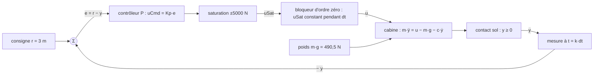

# Physique de l'ascenseur (niveaux 1 et 2)

À quoi sert cette page : présenter le modèle physique de l'ascenseur, les formules qui prédisent son comportement et les valeurs mesurées sur le code. Elle s'adresse à un lecteur de niveau licence qui découvre l'automatique. Code : `src/sim/plants/elevator.ts` ; fonctionnement du noyau : [simulation.md](../simulation.md). Le modèle est le même aux deux niveaux ; la section « Niveau 2 : contrôleur PI » en fin de page décrit ce qui change. État du commit `a308ada` (depuis, `src/sim/plants/elevator.ts` a gagné la fonction `elevatorAcceleration`, T-041, qui donne ÿ = (u − m·g − c·ẏ)/m avec les mêmes opérations que la dérivée du modèle ; ni le modèle ni les valeurs n'ont changé) : les valeurs de jeu du niveau 1 (poutre, tolérance, fenêtre) sont celles de T-020 (2026-11-13), la durée du trajet (10 s) et les valeurs du niveau 2 celles de T-022 ; les valeurs d'avant, validées en T-005, sont signalées comme telles. Vocabulaire : « quai » désigne ici ce que les textes français du jeu appellent « plateau d'arrivée » depuis T-019.

## Le système en une phrase

Une cabine (le bonhomme est dedans) monte dans une cage. Un moteur la tire vers le haut avec une force u. Le joueur règle un seul nombre, le gain Kp : plus la cabine est loin du quai, plus le moteur tire fort.

## Modèle et équation

Le principe fondamental de la dynamique appliqué à la cabine donne :

```text
m·ÿ = u − m·g − c·ẏ
```

- `m·ÿ` : masse × accélération ;
- `u` : force du moteur, déjà saturée à ±Umax ;
- `m·g` : poids ;
- `c·ẏ` : frottement visqueux des glissières, proportionnel à la vitesse.

Pour le joueur : le moteur doit d'abord vaincre le poids avant de faire monter la cabine, et le frottement freine tout mouvement.

État simulé : `x = [y, ẏ]` (position en m, vitesse en m/s). Le noyau calcule :

```text
dy/dt = ẏ
dẏ/dt = (u − m·g − c·ẏ) / m
```

Contrainte de sol, appliquée après chaque pas : si y < 0, alors y = 0 et ẏ = max(ẏ, 0). La cabine ne traverse pas le sol et ne rebondit pas.

Loi de commande (contrôleur P) :

```text
e    = r − y
uCmd = Kp·e
u    = min(max(uCmd, −Umax), +Umax)
```

## Paramètres

Valeurs de `ELEVATOR_PARAMS`, `ELEVATOR_MAX_FORCE` et `ELEVATOR_SETPOINT` (code), et spec T-001 §5 pour les règles de jeu.

| Symbole | Valeur | Unité | Rôle | Source |
|---|---|---|---|---|
| m | 50 | kg | masse cabine + bonhomme | code |
| g | 9,81 | m/s² | pesanteur | code |
| c | 400 | N·s/m | frottement visqueux | code |
| Umax | 5000 | N | saturation du moteur (≈ 10·m·g) | code |
| r | 3,00 | m | consigne : hauteur du quai d'arrivée | code |
| y0, ẏ0 | 0, 0 | m, m/s | cabine posée au sol | code (`createElevatorLoop`) |
| dt | 1/120 | s | pas de simulation | code (`SIM_DT`) |
| Kp | 0 à 8000, pas de 100 | N/m | gain réglé par le joueur | spec §5 ; curseur et touches de l'interface (T-010) |
| h_poutre | 3,3626 | m | poutre : y > 3,3626 m ⇒ choc (3,30 avant T-020) | `BEAM_HEIGHT` de `src/game` (T-020) |
| tolérance de marche | 0,5 | m | marche que le bonhomme peut enjamber (0,25 avant T-020) | `STEP_TOLERANCE` de `src/game` (T-020) |
| durée d'un trajet | 10 | s | 1200 pas ; fin de temps au-delà (6 s, 720 pas, de T-020 à T-021b ; 15 s avant T-020) | `TRIP_MAX_STEPS` de `src/game` (T-022, D27) |

Grandeurs dérivées : poids m·g = 490,5 N ; c/m = 8 s⁻¹ ; vitesse limite en chute libre m·g/c = 1,226 m/s.

## Schéma-bloc de la boucle



La flèche du bas est la **rétroaction** : le contrôleur compare sans cesse la hauteur mesurée à la consigne.

## Formules du régime linéaire

Les formules de cette section supposent : pas de saturation, pas de contact avec le sol après le décollage, temps continu. En jeu, la saturation agit au départ ; ces formules servent donc à l'oracle sans saturation (`tests/sim/oracle.test.ts`, Umax = 1e12 N), pas à prédire exactement une partie. Valeurs de jeu : [plus bas](#configuration-de-jeu-saturation-5000-n).

### Seuil de décollage

Au départ, y = 0, donc e = r et le moteur tire avec Kp·r. La cabine décolle seulement si cette force dépasse le poids :

```text
Kp·r > m·g   ⇔   Kp > m·g / r = 490,5 / 3 = 163,5 N/m
```

Pour le joueur : avec Kp ≤ 163,5 N/m, la cabine reste collée au sol. Avec le curseur du jeu (pas de 100 N/m), 100 N/m ne décolle pas et 200 N/m décolle.

### Erreur statique

À l'équilibre, la cabine ne bouge plus : ÿ = ẏ = 0. L'équation devient u = m·g, et comme u = Kp·e :

```text
e_ss = m·g / Kp        y_ss = r − e_ss
```

Pour le joueur : le moteur ne tire que s'il reste une erreur. Pour porter le poids, il faut donc une erreur permanente : la cabine s'arrête toujours sous le quai. Plus Kp est grand, plus cette marche est petite, mais elle ne disparaît jamais avec un contrôleur P seul.

Borne basse de la fenêtre de réussite : la marche doit rester ≤ 0,5 m, donc m·g / Kp ≤ 0,5, soit **Kp ≥ m·g / 0,5 = 981 N/m**. Avec le curseur au pas de 100 N/m, la première valeur gagnante est 1000 N/m : à 1000 N/m, la marche vaut 0,4905 m, soit 9,5 mm sous la tolérance ; à 900 N/m, elle vaut 0,545 m (T-020). Avant T-020, la tolérance était 0,25 m et la borne 1962 N/m.

### Pulsation propre et amortissement

Posons z = y − y_ss, l'écart à l'équilibre. En remplaçant u = Kp·(r − y) dans l'équation et en retranchant l'équilibre :

```text
m·z̈ + c·ż + Kp·z = 0   ⇔   z̈ + (c/m)·ż + (Kp/m)·z = 0
```

C'est la forme standard du second ordre `z̈ + 2·ζ·ωn·ż + ωn²·z = 0`. Par identification :

```text
ωn = √(Kp / m)                 (rad/s)
ζ  = c / (2·√(Kp·m))           (sans dimension)
```

Pour le joueur : ωn mesure la vivacité de la cabine (Kp grand ⇒ réponse rapide) ; ζ mesure son calme (ζ ≥ 1 : pas de dépassement ; ζ petit : la cabine oscille). Augmenter Kp augmente ωn mais **diminue** ζ.

Amortissement critique (ζ = 1) : Kp = c² / (4·m) = 800 N/m. En dessous, la cabine monte sans jamais dépasser son point d'arrivée.

### Dépassement et instant du pic

Pour ζ < 1, la solution partant du repos est :

```text
z(t) = −(y_ss − y0)·e^(−ζ·ωn·t)·[cos(ωd·t) + ζ/√(1 − ζ²)·sin(ωd·t)]     avec ωd = ωn·√(1 − ζ²)
```

La vitesse s'annule pour la première fois quand ωd·t = π. C'est le premier pic :

```text
t_pic = π / ωd = π / (ωn·√(1 − ζ²))
```

En reportant t_pic dans z(t), le cosinus vaut −1 et le sinus 0. Le dépassement relatif vaut :

```text
Mp = e^(−ζ·ωn·t_pic) = exp(−ζ·π / √(1 − ζ²))        y_pic = y_ss + Mp·(y_ss − y0)
```

Pour le joueur : Mp ne dépend que de ζ. Plus Kp est grand, plus ζ est petit, plus la cabine dépasse le quai… et risque de heurter la poutre à 3,3626 m.

### Taux de décroissance

L'enveloppe des oscillations décroît comme e^(−σ·t), avec :

```text
σ = ζ·ωn = c / (2·m) = 400 / 100 = 4 s⁻¹
```

Kp disparaît de la formule. Les oscillations perdent 98 % de leur amplitude quand e^(−4·t) = 0,02, soit t = ln(50)/4 ≈ 0,98 s, quel que soit Kp.

Pour le joueur : augmenter Kp réduit la marche et accélère la montée, mais ne fait pas se stabiliser la cabine plus vite. Il augmente seulement le dépassement. En boucle échantillonnée, σ baisse même un peu quand Kp augmente (voir [plus bas](#effet-du-bloqueur-dordre-zéro)).

## Valeurs : oracle sans saturation

Formules ci-dessus (recalculées par un script jetable du rédacteur, hors dépôt) et mesures du code (`tests/sim/oracle.test.ts`, sortie de `npx vitest run tests/sim/oracle.test.ts` au commit `c00e678`).

| Kp (N/m) | e_ss (m) | ωn (rad/s) | ζ | Mp formule | t_pic formule (s) | Mp mesuré dt = 1/1000 | t_pic mesuré dt = 1/1000 (s) | Mp mesuré dt = 1/120 | t_pic mesuré dt = 1/120 (s) |
|---|---|---|---|---|---|---|---|---|---|
| 500 | 0,98100 | 3,1623 | 1,2649 | aucun (ζ > 1) | — | — | — | — | — |
| 1000 | 0,49050 | 4,4721 | 0,8944 | 0,1867 % | 1,5708 | 0,1942 % | 1,5630 | 0,2550 % | 1,5083 |
| 2500 | 0,19620 | 7,0711 | 0,5657 | 11,5890 % | 0,5388 | 11,7042 % | 0,5380 | 12,5780 % | 0,5333 |
| 4000 | 0,122625 | 8,9443 | 0,4472 | 20,7880 % | 0,3927 | 20,9929 % | 0,3920 | 22,5439 % | 0,3917 |
| 8000 | 0,0613125 | 12,6491 | 0,3162 | 35,0920 % | 0,2618 | — | — | 38,6434 % (T-005) | 0,2583 (T-005) |

Erreur statique simulée à t = 10 s, dt = 1/120 (test T1) : écart à m·g/Kp ≤ 4,32e-7 m (Kp = 500, réponse suramortie encore lente : pôle à −1,55 s⁻¹) et ≤ 1,4e-15 m pour les autres Kp.

Comment lire ce tableau : à dt = 1/1000, la simulation colle aux formules (≤ 0,21 point de dépassement, ≤ 0,008 s sur t_pic). À dt = 1/120, l'écart vient surtout du bloqueur d'ordre zéro, pas de RK4 : voir la section suivante.

## Effet du bloqueur d'ordre zéro

Le contrôleur calcule la commande à t = k·dt, puis le moteur la garde constante jusqu'au pas suivant. Ce maintien agit à peu près comme un retard de dt/2 : la commande réagit un peu tard, ce qui réduit l'amortissement effectif. Le dépassement augmente donc légèrement.

Mesures (rapport T-005 §C, boucle échantillonnée exacte à dt = 1/120 s, recalculées par le rédacteur) :

| Kp (N/m) | Mp formule continue | Mp échantillonné | Δ (points de %) |
|---|---|---|---|
| 1000 | 0,1867 % | 0,2550 % | +0,068 |
| 2500 | 11,5890 % | 12,5780 % | +0,989 |
| 4000 | 20,7880 % | 22,5439 % | +1,756 |
| 5000 | 25,3827 % | 27,6187 % | +2,236 |
| 5500 | 27,3591 % | 29,8077 % | +2,449 |
| 6000 | 29,1640 % | 31,8459 % | +2,682 |
| 8000 | 35,0920 % | 38,6434 % | +3,551 |

**Domaine de validité** : l'écart reste ≤ 2,5 points jusqu'à Kp = 5500 N/m ; il le dépasse dès 6000 N/m. La phrase de la spec « effet du bloqueur ≤ 2,5 points » ne vaut donc que pour Kp ≤ 5500 N/m (errata n° 2).

Le taux de décroissance réel σ = −ln(ρ)/dt (ρ : rayon spectral de la boucle échantillonnée) baisse aussi avec Kp :

| Kp (N/m) | ρ | σ (s⁻¹) | écart à c/(2m) = 4 s⁻¹ |
|---|---|---|---|
| 1000 | 0,967559 | 3,957 | −1,1 % |
| 2500 | 0,968074 | 3,894 | −2,7 % |
| 3800 | 0,968520 | 3,838 | −4,0 % |
| 8000 | 0,969960 | 3,660 | −8,5 % |

`tests/sim/oracle.test.ts` mesure σ = 3,65963 s⁻¹ à Kp = 8000, à 0,013 % de la valeur exacte de la boucle échantillonnée (3,66010 s⁻¹). Le test « σ = c/(2m) à 5 % près » ne couvre que Kp ≤ 4000 N/m, où l'écart mesuré reste ≤ 4,24 %.

Pour le joueur : rien de visible. Le message pédagogique « Kp n'accélère pas la stabilisation » reste vrai, et même un peu plus que vrai.

## Configuration de jeu (saturation ±5000 N)

En jeu, la saturation agit au départ : pour Kp ≥ 1667 N/m, Kp × 3 m dépasse 5000 N. La cabine démarre donc à force constante, et les formules linéaires ne prédisent plus le dépassement. Les valeurs ci-dessous sont mesurées (dt = 1/120 s, pas k compté après le pas).

Valeurs de référence (`tests/sim/reference.test.ts`, tolérance 1e-6 m ; sortie de la commande au commit `c00e678`, noyau inchangé depuis) :

| Kp (N/m) | y(k=60) (m) | y(k=120) (m) | y(k=240) (m) | y(k=600) (m) | y_max (m) | pas saturés |
|---|---|---|---|---|---|---|
| 1500 | 2,430138 | 2,747366 | 2,671735 | 2,673000 | 2,776872 | 0 |
| 2500 | 3,033662 | 2,784761 | 2,804005 | 2,803800 | 3,116315 | 23 |
| 3500 | 3,236641 | 2,782849 | 2,858821 | 2,859857 | 3,266902 | 30 |
| 4500 | 3,329140 | 2,825564 | 2,892738 | 2,891000 | 3,338958 | 34 |

Écart du code à ces valeurs : ≤ 4,80e-7 m. Écart des valeurs à l'oracle exact MATLAB : ≤ 5,6e-7 m (T-005 §A–B).

Issues selon les règles de jeu du commit `08908b6` (poutre 3,3626 m, tolérance 0,5 m, 1200 pas). Pics échantillonnés : mesures de T-020 pour 5000 et 5100 (log `orchestration/logs/T-020.md`), tableau de référence ci-dessus pour les autres. Marge à la poutre = 3,3626 − y_max (différence recalculée par le rédacteur). Pas de l'issue : mesurés par un script jetable du rédacteur aux commits `119519b` puis `08908b6` (ceux de 1000, 2500, 3500, 3800, 4000, 5000, 5100 et 7000 sont aussi figés par `tests/game/outcomes.test.ts`). L'oracle exact MATLAB a été relancé par T-020, puis par T-022 (horizon de 1200 pas) : 0 désaccord sur 80 valeurs de Kp ([jeu.md](../jeu.md#issues-de-0-à-8000-nm)). Les issues d'avant T-020 (T-005 §E : 3800 gagne avec +5,842 mm, 3900 heurte avec −1,865 mm) valaient pour la poutre à 3,30 m et la tolérance à 0,25 m.

| Kp (N/m) | issue | pas de l'issue | y_max (m) | marge à la poutre 3,3626 − y_max |
|---|---|---|---|---|
| 100 | ne décolle pas | 1200 | 0 | +3362,6 mm |
| 1500 | victoire | 280 | 2,776872 | +585,7 mm |
| 1900 | victoire | 266 | 2,944782 | +417,8 mm |
| 2000 | victoire | 262 | 2,979718 | +382,9 mm |
| 2500 | victoire | 291 | 3,116315 | +246,3 mm |
| 3500 | victoire | 278 | 3,266902 | +95,7 mm |
| 3800 | victoire | 273 | 3,294158 | +68,4 mm |
| 3900 | victoire | 300 | 3,301865 | +60,7 mm |
| 4500 | victoire | 298 | 3,338958 | +23,6 mm |
| **5000** | victoire | 293 | 3,360855 | **+1,74 mm** (T-020) |
| **5100** | choc | 61 | 3,364391 | **−1,79 mm** (T-020) |
| 8000 | choc | 55 | 3,410114 | −47,5 mm |

## Fenêtre de réussite [1000 ; 5000] N/m

Décision D25 de l'utilisateur, réalisée par T-020 (2026-11-13).

- **Borne basse** : 981 N/m exactement (m·g / 0,5). Avec le curseur du jeu, au pas de 100 N/m, la première valeur gagnante est 1000 N/m.
- **Borne haute** : entre 5000 et 5100 N/m. Avec ce curseur, la dernière valeur gagnante est 5000 N/m. Les pics échantillonnés sont 3,357020 m à 4900, 3,360855 m à 5000, 3,364391 m à 5100 et 3,367543 m à 5200 ; la poutre (3,3626 m) a été réglée entre ceux de 5000 et de 5100.
- 41 valeurs gagnantes contiguës (de 1000 à 5000 par pas de 100). Sur la grille : `0-100 noLift | 200-900 step | 1000-5000 win | 5100-8000 bonk`. Victoire la plus lente : pas 301 (Kp = 4000 et 4100), soit 899 pas de marge avant 1200 (419 avant 720, de T-020 à T-021b).
- Oracle exact MATLAB relancé par T-020, puis par T-022 (MATLAB R2025a, `t005_run_all.m`, `kMax` 1200, « horizon 1200 pas (10.0 s) ») : « Kp in [1000 ; 5000] », 0 désaccord sur 80 issues, « T005 : FIN SANS ERREUR ». Écart noyau / solution exacte : 1,112e-7 m au pire (T-020).

**Marges** : à 5000 N/m, la cabine passe 1,74 mm sous la poutre ; à 5100 N/m, elle la dépasse de 1,79 mm ; à 1000 N/m, la marche est 9,5 mm sous la tolérance. La marge de 1,74 mm vaut plus de 15 000 fois l'écart numérique RK4 / exact (1,112e-7 m) : aucune issue ne peut basculer pour une raison numérique. En revanche, elle est faible en valeur absolue, et toute retouche de g, m, c, Umax, dt, de la poutre ou de la règle de choc peut faire basculer 5000 ou 5100 (défaut D-11 de T-005, K7 de [defauts-connus.md](../defauts-connus.md)). Après une telle retouche, relancer `validation/matlab/t005_run_all.m` (voir [validation/README.md](../../validation/README.md)).

## Stabilité de la boucle échantillonnée

Une boucle numérique peut devenir instable si le gain est trop grand pour le pas d'échantillonnage. Sur un pas, la commande est constante, donc l'état suit exactement :

```text
x(k+1) = Φ·x(k) + Γ·(uSat(k) − m·g)
Φ = [1  u₁/a ; 0  1 − u₁]       Γ = [(a·dt − u₁)/a² ; u₁/a] / m       a = c/m,  u₁ = 1 − e^(−a·dt)
```

Sans saturation, la boucle fermée a pour matrice `A_cl = Φ − Γ·Kp·[1 0]`. Elle est stable si ses valeurs propres sont dans le disque unité. La limite est atteinte quand det(A_cl) = 1, soit :

```text
Kp_critique = (Φ₂₂ − 1) / (Γ₁·Φ₂₂ − Φ₁₂·Γ₂)
```

| dt | Kp critique (N/m) | marge de gain à Kp = 8000 N/m | source |
|---|---|---|---|
| 1/8 s | 7 655 | 0,96 (instable) | script du rédacteur ; cohérent avec `clock.ts` |
| 1/10 s | 9 216 | 1,15 | script du rédacteur ; `clock.ts` : 1,2 |
| 1/20 s | 17 140 | 2,14 | script du rédacteur ; `clock.ts` : 2,1 |
| 1/30 s (`MAX_SIM_DT`) | 25 115 | 3,14 | `clock.ts`, log T-004b |
| 1/60 s | 49 091 | 6,14 | T-005 §D |
| **1/120 s (`SIM_DT`)** | **97 079** | **12,1** | T-005 §D (trois méthodes concordantes) |
| 1/240 s | 193 073 | 24,1 | T-005 §D |

Le code TS bascule entre 97 000 N/m (stable) et 97 200 N/m (instable), en accord avec l'oracle (T-005 §D).

Pour le joueur : le curseur s'arrête à 8000 N/m, douze fois sous la limite. L'instabilité due à l'échantillonnage ne peut pas apparaître dans ce niveau. Pour la montrer un jour, il faudrait un niveau dédié (dt plus grand ou retard).

## Limites du modèle

| Simplification | Conséquence |
|---|---|
| frottement purement visqueux (pas de frottement sec) | la cabine bouge dès que la force nette est non nulle |
| moteur idéal : la force suit la commande sans délai | pas de dynamique électrique ni de limite de vitesse du moteur |
| câble rigide, masse constante | pas d'oscillation de câble ; le bonhomme monte avant le départ (spec §5) |
| capteur parfait, sans bruit ni retard | la mesure est exactement y(k·dt) |
| contact sol inélastique | pas de rebond : y = 0 et ẏ ≥ 0 |
| poutre et marche absentes du modèle | ce sont des règles de jeu, pas des contraintes physiques : elles sont jugées par `src/game` (T-007, valeurs de T-020), voir [jeu.md](../jeu.md#règles-dissue) |
| consigne en échelon (0 → 3 m à k = 0) | la cabine démarre à pleine force dès que Kp ≥ 1667 N/m |
| Kp non borné par le code | au-delà de ≈ 97 079 N/m sans saturation, la boucle diverge ; avec saturation, elle oscille en tout-ou-rien (T-005, D-9). Inaccessible avec le curseur |

## Niveau 2 : contrôleur PI

Le niveau 2 « La mémoire » (T-021a pour le noyau, T-021b pour le niveau) garde la même cabine, la même saturation (±5000 N), le même pas (1/120 s, RK4, bloqueur d'ordre zéro) et la même consigne (3 m). Seule la loi de commande change :

```text
e    = r − y
uCmd = Kp·e + I            (I : valeur avant la mise à jour du pas)
I   ← I + Ki·dt·e          (« rectangle à gauche », I en newtons)
u    = min(max(uCmd, −Umax), +Umax)
```

L'intégrale est calculée à partir de l'erreur e, jamais de la commande saturée : le contrôleur ne voit pas la saturation et continue d'accumuler pendant qu'elle agit (windup ; aucun anti-windup, décision de l'utilisateur, [ADR-016](../decisions/ADR-016-controleur-pi-sans-anti-windup.md)). À Ki = 0, I reste 0 et la trace est identique bit à bit à celle du contrôleur P.

À l'équilibre (cabine immobile), u = m·g, et comme İ = Ki·e, l'erreur est nulle et I vaut m·g = 490,5 N : le terme I porte seul le poids, ce qui supprime l'erreur statique m·g/Kp du niveau 1. Les mesures de T-021a vont dans ce sens (« I tend vers m·g = 490,5 N », log `orchestration/logs/T-021a.md`).

**Valeurs du niveau 2** (`src/game/constants.ts`) : Kp fixé à 2500 N/m, Ki réglable de 0 à 8000 N/(m·s) par pas de 100 (défaut 2000 depuis T-022 ; 500 jusqu'à T-021b), même poutre (3,3626 m) et même durée (1200 pas, 10 s depuis T-022) que le niveau 1, mais tolérance d'arrivée propre de 0,10 m depuis T-022 (`LEVEL2_ARRIVAL_TOLERANCE` ; égale à celle du niveau 1, 0,5 m, jusqu'à T-021b).

**Mesures du noyau PI** (T-021a, Kp = 2500 N/m, règles d'issue de l'époque : poutre 3,3626 m, tolérance 0,5 m, 720 pas ; valeurs historiques, les mesures actuelles sont à la suite) :

- Ki gagnants [0 ; 800], chocs [900 ; 8000], aucune fin de temps. Par pas de 10 : 840 gagne (pic 3,362216 m, marge 0,384 mm), 850 heurte (pic 3,365122 m) ;
- pas saturés au départ : 23 à Ki = 0, 25 à Ki = 800, 26 à 1000, 36 à 4000 ;
- intégrale maximale : 582,1 N (Ki = 800), 724,8 N (Ki = 1000), 2829,8 N (Ki = 4000) : le terme I dépasse nettement le poids (490,5 N) quand Ki grandit, c'est le windup ;
- intégrale recalculée indépendamment : écart ≤ 1,8e-12 N (relatif 3,8e-15) pour Ki ∈ {100, 800, 1000, 4000}.

**Issues du niveau 2 depuis T-022** (Kp = 2500 N/m, tolérance 0,10 m, 1200 pas ; log `orchestration/logs/T-022.md`) : grille de Ki de 100 : `0-100 step | 200-800 win | 900-8000 bonk`, aucun `slow` ; au pas de 10 : `0-120 step`, `130 slow`, `140-840 win`, `850+ bonk`. Le P seul (Ki = 0) s'arrête à m·g/Kp = 0,196 m, au-delà de 0,10 m : Ki est nécessaire. Victoire la plus lente : Ki = 200 au pas 733 (grille), Ki = 140 au pas 1185 (hors grille). Défaut Ki = 2000 : choc au pas 57. Détail et marges : [jeu.md](../jeu.md#niveau-2--arbitre-et-fin-de-temps).

**Oracle exact du PI (T-023, K28 corrigé).** Avec I en newtons et mis à jour après usage, la boucle fermée non saturée est un système linéaire discret à trois états [y, ẏ, I] ; `validation/matlab/t018_*.m` (8 fichiers, lancés par `t018_run_all.m`) la propage en forme exacte, sans RK4, avec le contact au sol, la saturation, le bloqueur d'ordre zéro et les règles d'issue du niveau 2, et la compare pas à pas au noyau (Kp = 2500 N/m, tolérance 0,10 m, 1200 pas). Mesures de `orchestration/logs/T-023.md`, recoupées par un validateur indépendant :

- 0 désaccord noyau / exact sur 113 valeurs de Ki (grille de 100, plus des points fins de 120 à 140 et de 840 à 850) : issues, pas d'issue, pas saturés et pas du pic identiques ;
- pire écart : 1,5e-7 m sur y, 1,524e-6 m/s sur ẏ, 2,144e-4 N sur I (Ki = 8000), erreur de RK4 d'ordre 4 ;
- bornes exactes de Ki : « trop court » puis « trop lent » à partir de 128,3759 (step → slow), première victoire à 138,5864, choc à 841,3209 (841,0670 si y est évalué entre deux pas) ; marge réelle de 0,384 mm sous la poutre à Ki = 840, soit 9 300 fois l'écart numérique (K29) ;
- Ki critique de la boucle échantillonnée : 18 310,30 N/(m·s) (rayon spectral et critère de Jury), soit 0,9155 fois la limite continue 8·Kp = 20 000.

Le test TypeScript `tests/sim/pi-exact.test.ts` (22 tests, sans MATLAB) refait la propagation exacte et la compare à `createElevatorPiLoop` avec les tolérances y 1e-6 m, ẏ 1e-5 m/s, I 1e-3 N ; il détecte quatre mutants (ordre de u et de I inversé, intégration conditionnelle, rétro-calcul, trapèzes). Détails : [tests.md](../tests.md#oracle-exact-du-pi-testssimpi-exacttestts).

**Ce qui reste non consigné.** Le journal de T-023 ne consigne pas de valeur pour le pôle lent ≈ −Ki/Kp de la spec T-018 §4.2 (`t018_stability.m` le compare à Kp/Ki, mais cette page ne cite aucun chiffre). Le défaut K32 (Ki = 0 gagnait avec la tolérance de 0,5 m) est corrigé depuis T-022 ; reste K34 (« trop lent » inatteignable sur la grille de 100, mais atteint de Ki = 129 à 138 : l'oracle exact le confirme) : voir [jeu.md](../jeu.md#niveau-2--arbitre-et-fin-de-temps).
