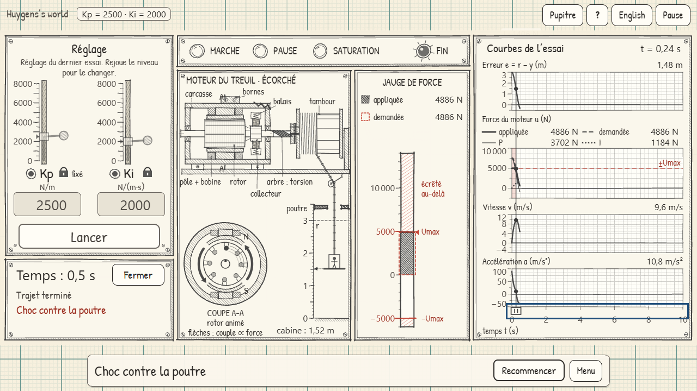
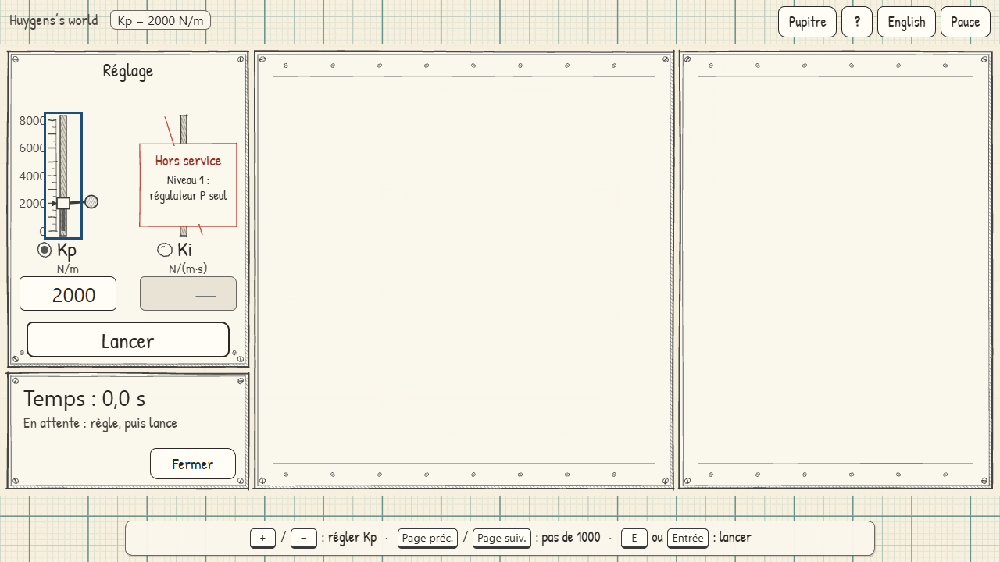
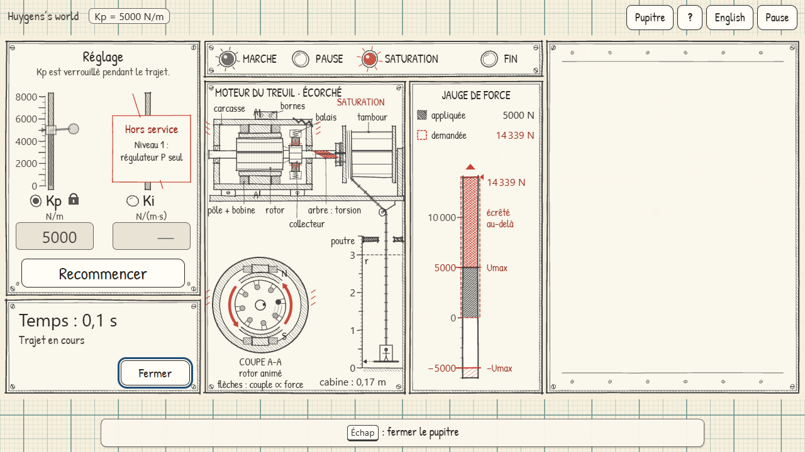
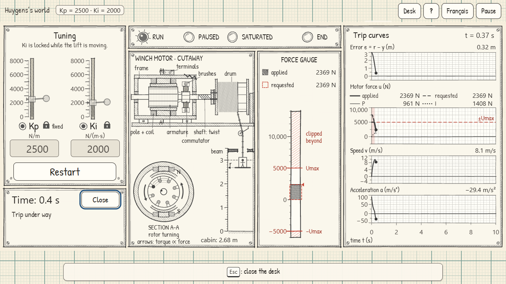

# Pupitre de contrôle (`src/ui/pupitre`) et journal du trajet

À quoi sert cette page : décrire le pupitre de contrôle de la v0.3 (décisions D35 et D36, tâches T-048 à T-052) : ce qu'il montre, quand il s'ouvre, comment il est dessiné, d'où viennent les nombres qu'il affiche (signaux du dernier pas, journal du trajet) et ce qui n'est pas prouvé. Elle décrit le commit `908a62e` (branche `v0.3-salle-de-controle`, version 0.3.0). Le tableau d'école, autre ajout de la v0.3, est dans [tableau-ecole.md](tableau-ecole.md) ; le reste de l'interface dans [interface.md](interface.md).

## Ce que c'est

Le pupitre **remplace le panneau de réglage** de la v0.2 (D35). C'est un plan dessiné en **canvas 2D** (deux canvas superposés : un fond et un « vif ») posé par-dessus la scène, avec par-dessus les contrôles DOM accessibles (leviers `<input type="range">` transparents, champs numériques, boutons « Lancer », « Recommencer » et « Fermer »). Rien n'est porté dans le pipeline three.js : le pupitre est de l'interface (`src/ui`), il n'importe pas `three` (règle `ui-deps`). Les textes dessinés viennent des locales (clés `pupitre.*`).

Trois colonnes dans un plan de 1280 × 580 unités (`PLAN_LARGEUR`, `PLAN_HAUTEUR` de `plan.ts` ; une unité = un pixel CSS à l'échelle 1, atteinte à 1280 × 720) :

| Colonne | Rectangle (x, y, largeur, hauteur) | Contenu | Fichiers |
|---|---|---|---|
| réglage | 10, 10, 308, 560 | leviers Kp et Ki, champs numériques, « Lancer » / « Recommencer », plaque d'état (temps, phase, issue) | `reglage.ts` |
| machine | 326, 10, 536, 560 | écorché du moteur du treuil, voyants, jauge de force | `machine*.ts` |
| courbes | 870, 10, 400, 560 | quatre enregistreurs à papier et curseur de relecture | `courbes*.ts`, `curseur.ts` |

Le plan est mis à l'échelle et centré dans la zone laissée entre la barre du haut (`RESERVE_HAUT` = 56 px, 76 px en portrait étroit) et le bandeau du bas (`RESERVE_BAS` = 84 px). Sous `LARGEUR_ETROITE` = 900 px de large (portrait), **seule la colonne de réglage est montrée**, à l'échelle la plus grande qui tient, plafonnée à `ECHELLE_ETROITE_MAX` = 1,5 (`placerPlan`). Les trois colonnes se branchent par le contrat `ColonnePupitre` (`colonne.ts` : `dessinerFond`, `dessiner`, `monter` optionnel) ; `creerPupitre` assemble réglage, machine et courbes.

Habillage : les primitives « au crayon » du pupitre (`crayon.ts` : traits tremblés à aléa à graine, hachures, vis, rivets, plaques) sont propres à l'interface ; le tremblé est reproductible (même dessin, mêmes traits). Le crayon rouge n'y marque que la saturation et les alertes ; la police des nombres (`POLICE_NOMBRES`, système) est choisie pour que la virgule se distingue du point, ce que Patrick Hand ne fait pas à 12 ou 13 px (constat du lot B).

## Ouverture, fermeture, modes

Règles pures dans `modele.ts` (`reglageDe`, `pupitreVisible`), touches dans `keys.ts`, ouverture dans `overlay.ts` (`Ui.setPupitre`) :

- **Phase de réglage (`tuning`)** : le pupitre s'ouvre tout seul, mode `edition`, leviers libres (celui qui n'a pas d'objet au niveau est verrouillé ou hors service, voir plus bas). En pause, il se masque et revient à la reprise.
- **Lecture seule** : en trajet, à l'issue ou en pause (et par le bouton ou le clic pendant l'embarquement et la sortie), le joueur ouvre le pupitre en **mode `lecture`** : valeurs affichées, leviers et « Lancer » grisés, et **aucune pause** : le jeu continue. Pendant l'embarquement et la sortie, la touche E *passe l'animation* : elle n'ouvre donc pas le pupitre. Une ouverture en approche passe par `level.interact()` : elle mène à la phase de réglage, où le pupitre s'ouvre seul.
- **Comment l'ouvrir** : touche **E** (en approche : ouvre le réglage ; en réglage : lance ; en trajet, à l'issue et en pause : ouvre la lecture seule ; quand la lecture est ouverte : la ferme ; `useIntentOf` et `keyToIntent` de `keys.ts`), bouton « Pupitre » de la barre du haut (`pupitre.bouton`, `aria-controls="ui-pupitre"`, `aria-expanded`), ou **clic sur le pupitre dessiné dans la scène** (`isConsoleHit`, toutes phases). **Échap** ferme la lecture seule avant tout autre rôle (après le tableau et l'aide) ; en phase de réglage, Échap ferme le pupitre comme il fermait l'ancien panneau (`closeTuning`) ; « Fermer » fait de même.
- **Au lancement**, le pupitre se ferme (la phase passe à l'embarquement et l'affichage en lecture n'est pas ouvert : `pupitreVisible`) ; on le rouvre en lecture seule quand on veut suivre le trajet.
- **Issue** : à l'issue, le panneau d'issue se replie dans la bande du bas (`outcomeDocked` dans `overlay.ts`) tant que le pupitre est visible, et ses boutons restent accessibles.

États des leviers (`reglageDe`, `EtatLevier`) :

| Niveau | Levier Kp | Levier Ki |
|---|---|---|
| 1 | `libre` en réglage, `verrouille` ensuite (trajet, pause, issue) | `hors-service` (barré, mention « Hors service · Niveau 1 : régulateur P seul ») |
| 2 | `fixe` (valeur imposée, grisée, cadenas) | `libre` en réglage, `verrouille` ensuite |

« Lancer » est visible hors embarquement et trajet et actif en réglage libre ; « Recommencer » le remplace en embarquement et en trajet, actif hors pause (`lancerVisible`, `lancerActif`, `recommencerVisible`, `recommencerActif`). Les valeurs des leviers sont celles du niveau (`level.tuning` : de 0 à 8000, par pas de 100) ; graduations tous les 1000, un chiffre tous les 2000.

Gestes : manette tirée le long de la fente (souris, doigt), champ numérique (Entrée), clavier sur le levier (flèches, Page précédente et suivante, Début, Fin, comme un curseur natif) ; Tab et Maj+Tab sont piégés dans le pupitre ouvert (`Pupitre.focalisables`). **Mouvement réduit** (`prefers-reduced-motion`) : le pupitre n'anime rien, les leviers sautent à la valeur ; la préférence est lue à chaque image.

## Colonne du centre, la machine

`machine.ts` (colonne), `machine-fond.ts` (couche fixe), `machine-vif.ts` (couche vive), `machine-plan.ts` (géométrie), `machine-etat.ts` (état affiché). Le dessin reprend celui de la maquette A du lot B, sans importer `src/proto` ; les textes passent par les locales.

- **Écorché du moteur du treuil** : carcasse, pôles et bobines, rotor, collecteur, balais, arbre (torsion), tambour, câble et cabine au bout, **coupe A-A** (rotor animé, flèches de couple proportionnelles à la force), règle de hauteur de 0 à `REGLE_MAX` = 3,5 m (poutre à `BEAM_HEIGHT`, consigne à `LEVEL1_SETPOINT`), étincelles et rouge en saturation. Le rotor et le tambour tournent d'un angle donné par la **hauteur de la cabine** (`angleRotor`, `RAD_PAR_M` = 1 : c'est une donnée, pas une animation) ; la pulsation des alertes et la secousse de la carcasse en saturation (`animationMachine`) sont décoratives et figées en pause et en mouvement réduit.
- **Voyants** (rangée de `VOYANTS_H` = 56 unités) : MARCHE (trajet en cours, hors pause et avant l'issue), PAUSE (jeu en pause), SATURATION (la force demandée est écrêtée), FIN (issue atteinte).
- **Jauge de force** : force appliquée et force demandée sur une échelle de `JAUGE_MIN` = −6000 à `JAUGE_MAX` = 14000 N, graduations tous les 1000 N, un chiffre tous les 5000 N, butées ±`FORCE_MAX` (5000 N, `ELEVATOR_MAX_FORCE`). Au-delà, la zone « écrêté au-delà » est hachurée en rouge et les valeurs hors échelle sont marquées (`depassement`).
- **État affiché** : `EtatMachine` (y, v, uCmd, uSat, sature, marche, pause, fin), construit à chaque image par `etatMachineDirect` d'après l'instantané du niveau ; à l'issue, par le curseur (voir plus bas). Un résumé texte (`resumeMachine`) est écrit pour les lecteurs d'écran au plus deux fois par seconde (`PERIODE_RESUME` = 500 ms).

## Colonne de droite, les courbes

`courbes.ts`, `courbes-fond.ts`, `courbes-vif.ts`, `courbes-plan.ts`, `courbes-echelles.ts`. Quatre enregistreurs à papier millimétré alignés sur un axe du temps commun de 0 à 10 s (`DUREE_MAX_S`, soit `TRIP_MAX_STEPS` = 1200 pas de 1/120 s) : **erreur** e = r − y, **force du moteur** (appliquée en trait plein, demandée en tirets ; au niveau 2, les termes P en trait fin et I en pointillés), **vitesse** et **accélération**. Les courbes sont tracées en direct d'après le journal du trajet (plume à la fin) et gardées à l'issue.

**Échelles fixes par niveau** (table `ECHELLES` de `courbes-echelles.ts`, seule source des bornes ; elles couvrent les trajets de tous les réglages permis, mesurés sur 197 réglages par le validateur du lot B) :

| Signal | Niveau 1 | Niveau 2 |
|---|---|---|
| erreur (m) | −0,5 à 3, trait tous les 0,5 | idem |
| force du moteur (N) | −5000 à 25000, trait tous les 5000 | −2500 à 10000, trait tous les 2500 |
| vitesse (m/s) | −4 à 12, trait tous les 2 | idem |
| accélération (m/s²) | −100 à 100, trait tous les 25 | −50 à 100, trait tous les 25 |

Une valeur qui sort de l'échelle est **écrêtée au bord de la bande avec un chevron**, jamais ignorée ; une zone rouge marque les pas saturés et la ligne ±Umax la limite du moteur. Les valeurs lues à droite de chaque titre sont celles de l'instant courant (ou du curseur). Coût : au plus 1200 points par signal et sept signaux, environ 8 400 segments par image, sans décimation ; aucune allocation par image (tracés en boucle directe sur les colonnes typées, textes recalculés seulement quand la valeur arrondie ou la langue change) ; le test e2e (h) de `pupitre-courbes.spec.ts` mesure ce coût mais la valeur n'est pas reprise ici.

### Curseur de relecture

`curseur.ts`, `colonnes-trajet.ts` (`creerColonnesTrajet` crée les colonnes machine et courbes qui partagent **un seul** curseur). À l'issue, le joueur reparcourt le trajet terminé : glisser sur les courbes (souris, doigt) ou, au clavier, une poignée `<input type="range">` accessible (`pupitre.courbes.curseur.label`) : flèches gauche et bas −1 pas, droite et haut +1 pas, Page précédente −10, Page suivante +10, Début, Fin (`indiceApresTouche`). L'indice va de 0 à `count` (le nombre d'enregistrements du journal), et revient à la fin à chaque nouvel essai. Les valeurs lues, la cabine, les forces et les voyants de la machine suivent le curseur. **Le curseur ne touche jamais au jeu** : ni pause, ni issue, ni instantané modifiés ; il disparaît dès qu'un nouveau trajet est lancé. Les touches du curseur ne règlent pas Kp (e2e (f) de `pupitre-courbes.spec.ts`).

À l'indice j < `count`, tout vient de l'enregistrement j ; à j = `count` (fin), la cabine et l'erreur viennent de l'instantané (état après le dernier pas) et les forces du dernier enregistrement (`valeursAuPas`, `etatMachineAuPas`).

## Journal du trajet (`TripLog`, T-048) et signaux du dernier pas (T-041)

Le noyau et le niveau fournissent au pupitre des signaux **de chaque pas** ; ils ont été ajoutés sans changer le trajet (identique bit à bit, vérifié sur 394 trajets par le validateur de T-041, log `T-041.md` ; trajet identique aussi pour T-048).

**Dans `src/sim`** : `elevatorAcceleration(y, v, force, params?)` (exportée par `src/sim/index.ts`) donne l'accélération ÿ = (u − m·g − c·ẏ)/m du modèle, avec les mêmes opérations que la dérivée de `createElevator` ; 0 si la cabine est posée (y ≤ 0, ẏ ≤ 0, force nette < 0). Elle ne vient jamais d'une différence entre deux pas. Le niveau lit en plus `proportionalTerm` sur le contrôleur PI (`controller?: { integral, proportionalTerm }` sur `TripLoop` ; la propriété existait déjà dans `src/sim/controllers/pi.ts`) ; au niveau 1, `pTerm` vaut la force demandée.

**Dans l'instantané** (`LevelSnapshot`), les signaux du dernier pas simulé, tous à l'**instant où la commande a été calculée** (convention `LoopSample` : état *avant* le pas) :

| Champ | Unité | Sens |
|---|---|---|
| `stepY` | m | hauteur de la cabine à cet instant (mesure du contrôleur) |
| `stepVelocity` | m/s | vitesse ẏ |
| `stepAcceleration` | m/s² | accélération donnée par le modèle (voir ci-dessus) |
| `stepError` | m | e = r − `stepY` |
| `uCmd` | N | force demandée, avant saturation |
| `pTerm` | N | terme proportionnel Kp·e |
| `iTermUsed` | N | terme intégral utilisé pour calculer `uCmd` (l'intégrale *avant* sa mise à jour) ; 0 au niveau 1 |

Cohérents entre eux : `uCmd` = `pTerm` + `iTermUsed`, `uSat` = `uCmd` borné à ±Umax, `saturated` = (`uSat` ≠ `uCmd`). Tous à 0 avant le premier lancement, pendant l'embarquement et après `restart` ; ils gardent la valeur du dernier pas à l'issue. À ne pas confondre avec `cabinY`, `cabinVelocity`, `e` et `iTerm`, qui décrivent l'état *après* le dernier pas.

**`level.tripLog`** (`src/game/trip-log.ts`, types `TripLog` et `TripLogColumn` exportés par `src/game`) : un enregistrement par pas du trajet courant, dans des `Float64Array` préallouées (colonnes `y`, `v`, `a`, `e`, `uCmd`, `uSat`, `p`, `i`, et `saturated` en `Uint8Array`) de capacité `TRIP_MAX_STEPS` (1200). L'enregistrement j décrit le pas j → j + 1 à t = j·dt et est égal bit à bit aux champs de l'instantané de ce pas. `count` = `snapshot.k` pendant le trajet ; le journal est **vidé au lancement** et à `restart`, et conservé tel quel pendant la sortie, à l'issue et en pause. L'objet est unique, gelé et réutilisé : l'interface le lit, le niveau seul écrit, et le jeu ne le relit jamais. La doc du fichier explique quelle cabine afficher pour un curseur donné (au choc, y[count − 1] est encore sous la poutre : ne pas la dessiner à la fin).

## Accessibilité

- Le pupitre est un `role="dialog"` nommé par `pupitre.titre` ; les deux canvas sont `aria-hidden`.
- Chaque levier est un vrai `<input type="range">` avec `aria-valuetext` (« Kp : 2500 N/m »), une description et un champ numérique ; au niveau 1, Ki est lu « Hors service ».
- Un paragraphe masqué par colonne dessinée résume la machine et les courbes (`pupitre.machine.resume`, `pupitre.courbes.resume`, avec P et I au niveau 2), sans `aria-live` (la région live du jeu est unique) ; une **annonce unique** est faite à l'issue (`pupitre.annonce.issueSature` ou `issueLibre`), une fois par essai.
- Bandeau d'aide en lecture seule : « Échap : fermer le pupitre » (`pupitre.hint.fermer`, bandeau `pupitre` de `hints.ts`).
- Textes : 277 clés par langue (164 au commit `3810193`), dont les familles `pupitre.*` et `board.*` ; voir [i18n-accessibilite.md](i18n-accessibilite.md).

## Scène : la jauge de force n'y est plus (D36, T-052)

La jauge de force quitte la scène (elle est sur le pupitre). Retirés : son cadre, ses graduations, son repère du poids, le fil vers le moteur, son remplissage (graphite et rouge), le lot « rouge » du rendu (les lots passent de cinq à quatre), les étiquettes « Force du moteur » et « Force : … N », la légende « Jauge… » des mesures et le nom accessible de la jauge ; clés supprimées : `hud.legend.force`, `hud.force.value`, `hud.gauge.title`, `a11y.forceGauge` (et, avec le panneau de réglage, T-049 : `controls.kpDecrease`, `kiDecrease`, `kpIncrease`, `kiIncrease`, `controls.help.pauseKi`, `a11y.kpPanel`). **Conservés** : la courbe de position sur le mur, la **jauge du terme intégral I du niveau 2** (cadre, repère m·g, « I : … N », étiquettes « 5000 N max » et « poids », visibles seulement au niveau 2) et la mise en page, qui garde l'ancien emplacement de la jauge de force comme repère. `StrokeBatch.skipStrokes(count)` saute les numéros de trait de la jauge disparue (`FORCE_GAUGE_STROKES` = `GAUGE_FRAME_STROKES` + 1 = 23 traits) pour que le reste du décor garde sa graine de tremblé : hors jauge, 0 pixel de différence sur les captures déterministes (log de T-052 au registre). Détail du rendu : [rendu.md](rendu.md).

## Maquette conservée, `?proto=c`

Le lot B de la v0.3 a produit quatre maquettes jetables du pupitre (`src/proto`, A analogique, B instruments, C tube cathodique, D planche de l'ingénieur) ; le choix (D35) a repris l'écorché et l'habillage de A, la lisibilité de B et la partie « d'où vient la force ? » de D (dans le tableau d'école). **D38 (T-054)** a supprimé A, B, D, la page `?proto=tous` et leurs captures ; **seule la maquette C reste lançable** par `npm run dev` puis `http://localhost:5173/pid-game/?proto=c` (import dynamique dans `main.ts`, rien de `src/proto` n'entre dans le jeu normal). Touches de la coque : `1` victoire, `2` choc, `3` saturation, `P` pause, `R` rejouer, `H` aide ; paramètres d'URL `trajet=victoire|choc|saturation`, `autoplay=1`, `chrome=0`. Elle rejoue des trajets de référence (`src/proto/common`, purs), pas le vrai jeu ; elle n'a pas de texte anglais. Captures : `img/proto/c-1-avant.png`, `c-2-trajet.png`, `c-3-saturation.png`. Idée reportée (K54) : le treuil et l'ascenseur en fil de fer 3D de C pourraient remplacer l'écorché plus tard, sans le tube vert. Coûts mesurés par le log du lot B (Chromium headless, rendu logiciel, pas de GPU réel) : C 2,8 à 3,5 ms par image de JS, 47 à 53 images par seconde.

Règles de dépendances sur `src/proto` : voir [architecture.md](architecture.md#qui-peut-importer-qui).

## Tests

- Unitaires (`tests/ui/pupitre/`, 91 tests) : `modele.test.ts` (17), `plan.test.ts` (7), `reglage.test.ts` (13), `machine.test.ts` (25), `courbes.test.ts` (29). `tests/game/signals.test.ts` (64), `tests/game/trip-log.test.ts` (66), `tests/sim/acceleration.test.ts` (7) et `tests/sim/signals.test.ts` (8, enregistreur circulaire du noyau, antérieur) couvrent les signaux et le journal ; `tests/proto/` (21 tests, un ignoré) les trajets de référence.
- e2e : `pupitre.spec.ts` (11), `pupitre-machine.spec.ts` (12), `pupitre-courbes.spec.ts` (13). Captures `docs/img/pupitre-*.png` (26 fichiers).

## Ce qui n'est pas prouvé

- Rendu sur un vrai GPU, écran tactile réel et lecteur d'écran : non essayés (réserves des lots B et C).
- Mesure du tas des allocations par image : établie par construction, pas mesurée.
- Les captures sont produites dans Chrome headless en rendu logiciel, en français ou en anglais selon le test.
