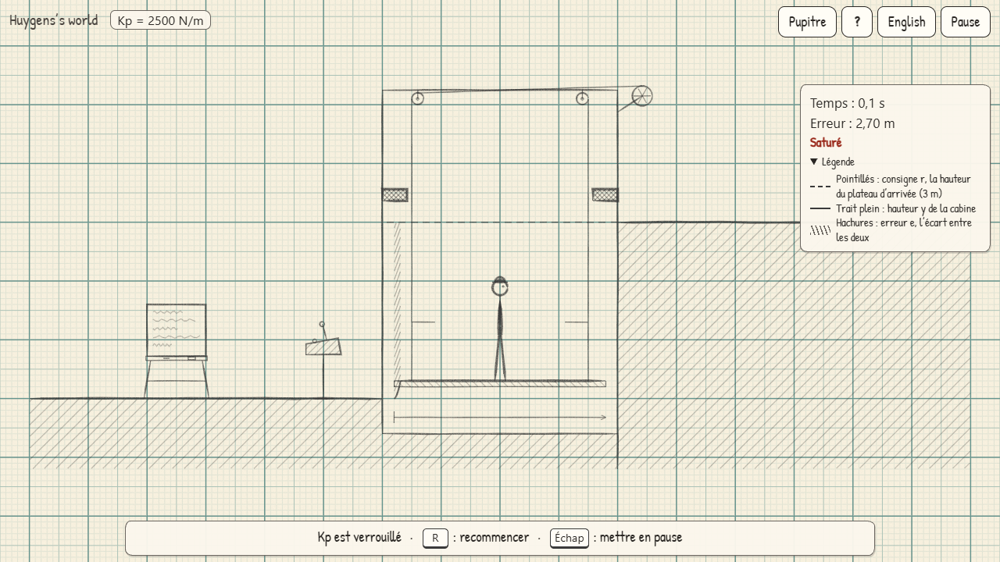
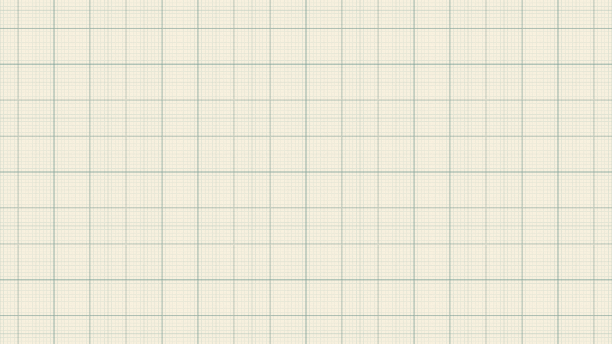
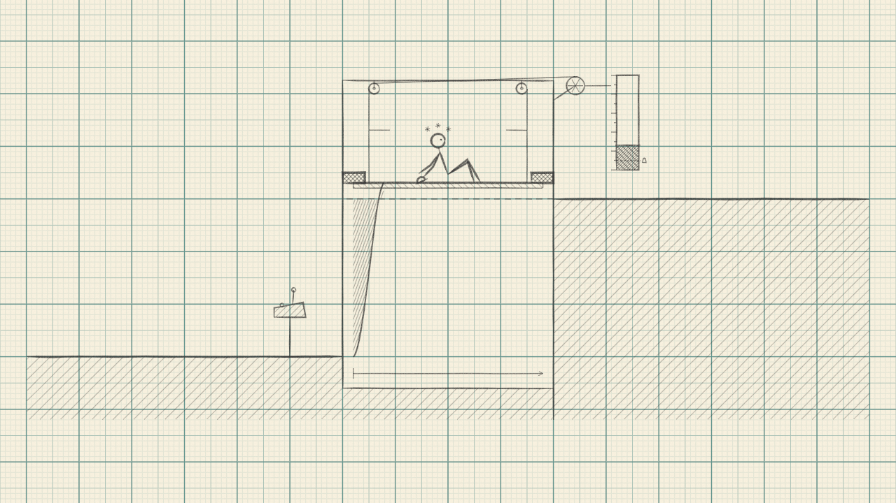

# Rendu au crayon (`src/render`)

À quoi sert cette page : expliquer comment le jeu dessine la scène : démarrage du moteur graphique, cadrage, papier millimétré, traits de crayon, bonhomme, courbe et jauge, budget de dessin. Elle décrit le commit `566a8a3` (rendu validé en T-008 et T-009). Les textes posés par-dessus la scène sont dans [interface.md](interface.md).



## Vue d'ensemble

`src/render` est le seul module qui importe three.js (`three/webgpu` et `three/tsl`, règle `three-only-in-render`). Il lit l'instantané du niveau (`level.snapshot`) et l'enregistreur de signaux (`level.signals`) à chaque image ; il ne les modifie jamais et n'en garde aucune référence.

Le point de composition (`src/main.ts`) n'appelle qu'une fonction : `startRendering(canvas, choice, { level, onFrame })`. Elle renvoie une session (`RenderSession`) ou un échec, sans jamais lever d'exception.

### Fichiers purs et fichiers three

Sur les 18 fichiers du module, 12 n'importent pas three (dont `index.ts`) et `camera.ts` n'en importe qu'un type : ils se testent sous Node, sans navigateur (`tests/render/`, 118 tests).

| Fichier | three ? | Rôle |
|---|---|---|
| `options.ts` | non | `parseRendererChoice` (`?renderer=`), `capPixelRatio` (plafond 2) |
| `camera.ts` | type seulement | cadrage `computeFrame`, conversions monde → pixel ; `applyFrame` touche la caméra |
| `pencil-style.ts` | non | charte crayon : couleurs, épaisseurs, tremblé, mise en page du décor, proportions du bonhomme |
| `noise.ts` | non | hachage et bruit à graine (`hash01`, `valueNoise`, `boilSeed`) |
| `stroke-batch.ts` | non | `StrokeBatch` : polylignes → rubans de triangles dans des tableaux préalloués |
| `patterns.ts` | non | hachures (`hatchPolygon`) et pointillés (`dashLine`) |
| `walker-pose.ts` | non | articulations du bonhomme pour chaque attitude |
| `curve.ts` | non | échelle de temps de la courbe y(t), tampon de points |
| `gauge.ts` | non | graduations et remplissage de la jauge de force |
| `level-display.ts` | non | phase effective, interpolation, attitude, ancres écran pour l'interface |
| `level-painter.ts` | non | `LevelPainter` : remplit les 5 lots de traits à chaque image |
| `session.ts` | non (passe par les fichiers three) | `startRendering` : assemble tout, boucle d'images |
| `bootstrap.ts` | oui | `bootRenderer`, boucle `setAnimationLoop`, suivi de taille, mouvement réduit |
| `stage.ts` | oui | scène, caméra orthographique, papier |
| `paper.ts` | oui | matériau TSL du papier millimétré |
| `pencil-material.ts` | oui | matériau TSL du trait de crayon |
| `level-view.ts` | oui | un mesh par lot, attributs qui enveloppent les tableaux du lot |

## Démarrage et choix du moteur

`bootRenderer` (fichier `bootstrap.ts`) crée un `WebGPURenderer` de three 0.187.0, sans anticrénelage matériel (`antialias: false`), puis attend `renderer.init()`.

| URL | Comportement |
|---|---|
| sans paramètre, ou `?renderer=auto` | WebGPU si le navigateur le fournit ; sinon three bascule seul sur WebGL2 |
| `?renderer=webgl` | WebGL2 imposé (`forceWebGL: true`) |
| `?renderer=none` | absence de GPU simulée : page de repli (tests) |

La valeur est lue sans tenir compte de la casse ni des espaces ; une valeur inconnue (`webgpu`, `webgl2`…) donne `auto`. Le backend obtenu est écrit dans `document.body.dataset.backend` (`webgpu`, `webgl` ou `none`).

Échecs possibles, tous rendus comme une valeur (`BootFailureReason`) : `disabled` (`?renderer=none`), `unsupported` (ni WebGPU ni WebGL2 annoncés), `init-failed` (`init()` a échoué). Dans les trois cas, `main.ts` cache le canvas et affiche la page de repli traduite (clés `fallback.`), avec un lien vers le dépôt GitHub.


**Ce qui a été exercé.** Les tests e2e tournent dans Chrome headless avec le rendu logiciel SwiftShader : WebGL2 imposé, repli FR et EN, et mode automatique. En mode automatique, aucun adaptateur WebGPU n'est trouvé (« No available adapters. ») et three passe sur WebGL2 (log T-008). **WebGPU réel n'a été exercé par aucun test automatique.** Le 2026-11-13, l'utilisateur a constaté sur son PC Windows que « tout fonctionne » (décision D16, log T-010), sans relever quel backend était actif.

## Boucle d'images

`createFrameLoop` s'appuie sur `renderer.setAnimationLoop`. À chaque image, il calcule le temps écoulé depuis l'image précédente (0 à la première) et appelle le rappel `onFrame` de `main.ts`. Celui-ci met à jour l'interface, puis fait avancer le niveau (`level.update`). La session repeint ensuite le niveau et dessine. Ordre complet : [architecture.md](architecture.md#flux-dune-image).

Le temps n'est pas plafonné ici : l'horloge à pas fixe du noyau s'en charge (0,25 s et 8 pas au plus par image, voir [simulation.md](simulation.md#horloge-à-pas-fixe)).

La taille du canvas est suivie par un `ResizeObserver` et par l'événement `resize` (le zoom du navigateur change le rapport de pixels). Le rapport de pixels est plafonné à 2 (`MAX_PIXEL_RATIO`).

## Cadrage : zone de 17 × 7 m

La caméra est orthographique, vue de face, 1 unité = 1 m. La zone de jeu `PLAY_ZONE` est toujours entièrement visible :

```text
x ∈ [−6,5 ; 10,5] m   (décor de −6 à 10 m, plus 0,5 m de marge de chaque côté)
y ∈ [−1,5 ; 5,5] m    (1,5 m sous le sol ; 2,2 m au-dessus de la poutre à 3,30 m)
```

`computeFrame(largeurPx, hauteurPx)` est une fonction pure. Elle garde la même échelle en x et en y (pas de déformation) :

```text
pixelsParMètre = min(largeurPx / 17, hauteurPx / 7)
```

Le surplus d'écran, réparti également des deux côtés, montre plus de papier. Exemples : 75,3 px/m à 1280 × 720 ; à 390 × 844 (portrait), la largeur limite et la scène devient très petite (22,9 px/m). Une taille nulle ou invalide renvoie exactement la zone, sans NaN.

**Écart à la spec.** La spec T-001 §7 prévoyait « ~12 m × 6,75 m » et une vue « légèrement plongeante (2,5D) ». 12 m ne contiennent pas les 16 m du décor : la zone est élargie à 17 m. La vue est de face, sans plongée (log T-008). Voir les [errata](specs/T-001-errata.md).

## Papier millimétré

Un seul plan couvre tout le champ de la caméra (avec 2 % de débord). Sa couleur est calculée par un matériau à nœuds TSL (`paper.ts`), compilé en WGSL pour WebGPU et en GLSL pour WebGL2 : un seul code pour les deux backends.

La grille est en coordonnées **monde** : une ligne de mètre passe par chaque entier (x = 0, x = 4, y = 3…). On lit donc les hauteurs directement sur la feuille.

| Famille | Pas | Épaisseur | Couleur | Opacité |
|---|---|---|---|---|
| « millimètre » | 0,1 m | 0,006 m | `#86b9b2` | 0,6 |
| demi-centimètre | 0,5 m | 0,012 m | `#5f9f99` | 0,6 |
| « centimètre » | 1 m | 0,022 m | `#3d8580` | 0,8 |

Papier `#f7f0de`, grain discret (± 1,5 %) par cellules de 1 cm, sans texture ni image.



**Anticrénelage.** La distance au trait le plus proche est convertie en pixels par `fwidth` (dérivée écran). Un trait plus fin qu'un pixel est dessiné sur un pixel avec une intensité réduite d'autant. Anti-moiré : une famille s'estompe quand son pas à l'écran tombe sous 6 px et disparaît sous 2,5 px.

**Régime « un seul pixel ».** Sur petit écran, les traits de mètre font moins d'un pixel (0,50 px en portrait 390 px). Selon sa position sous-pixel, un trait tombait alors tantôt sur un pixel plein (bleu-vert), tantôt sur deux pixels à moitié (teinte brunâtre) : la grille paraissait irrégulière. Sous ce seuil, chaque trait est posé sur un seul pixel entier, sa position étant quantifiée au 1/16 de pixel pour que le choix soit stable.

Ce régime s'applique **seulement** quand le trait de mètre fait moins d'un pixel (fondu de 0,7 à 1,0 px). Au-dessus, le calcul est exactement celui de T-008.

**Incident T-009b/c (log T-009).** Une première version activait ce régime jusqu'à 1,66 px, donc aussi au format bureau 1280 × 720. Les lignes de mètre y devenaient pâles et inégales, avec une demi-ligne forte au centre de l'écran : une ligne posée pile sur une frontière de pixels (640,0 ; 360,0) était tranchée de façon non déterministe. Les tests de pixels de l'époque vérifiaient la position des traits, pas leur aspect : l'orchestrateur a vu la régression sur les captures (leçon L9 du registre). Correctif T-009c : seuil ramené sous 1 px et quantification. Trois tests e2e d'uniformité des lignes ont été ajoutés (1280 × 720, 1281 × 721, 390 × 844), dont une comparaison à la capture de référence de T-008.

## Trait de crayon

Tout le niveau (décor, cabine, bonhomme, courbe, jauge) est fait de traits. Chaque trait est une polyligne transformée en **ruban** de triangles par le CPU (`StrokeBatch`, fichier `stroke-batch.ts`) :

- 6 sommets par segment (deux triangles), jointures en onglet limitées à 3 demi-largeurs, segments nuls ignorés, demi-tours sans NaN ;
- tableaux **préalloués** à la création, réécrits en place à chaque image ; `level-view.ts` les enveloppe dans des `BufferAttribute` sans copie ;
- tremblé de position et d'épaisseur à **graine** (`noise.ts`, arithmétique entière 32 bits : même graine, même dessin sur toute machine), extrémités effilées ;
- épaisseur minimale de 1,25 px à l'écran et frange d'anticrénelage d'1 px.

**Charte** (`pencil-style.ts`) : toutes les constantes de style sont regroupées dans ce fichier. Graphite `#3a3a3a` à 85 % d'opacité ; crayon rouge `#c23a2b`, seule couleur, réservé à la jauge saturée. Chaque élément a son style (épaisseur, encre, tremblé) : sol 0,04 m, contour 0,03 m, bonhomme 0,042 m, plancher de la cabine 0,045 m (le trait le plus appuyé : il porte la mesure y), courbe 0,03 m **sans tremblé** (elle reste fidèle aux mesures). Les positions qui comptent pour les règles (quais, cage, poutre, console) viennent de `src/game` ; la charte ne fixe que des choix de dessin.

**Matériau** (`pencil-material.ts`, TSL) : opacité = opacité du crayon × encre du sommet × couverture du bord × grain du graphite.

- **Pas de MSAA.** Le bord est adouci au shader : la coordonnée transversale vaut −1 et +1 sur les bords du ruban, `fwidth` donne une rampe d'un pixel. Coût mémoire nul et même rendu sur les deux backends.
- **Correction d'opacité.** WebGPURenderer mélange les couleurs en espace linéaire ; un gris à 85 % y paraît bien plus pâle qu'au crayon. L'opacité voulue (mélange sRGB, comme sur une feuille) est convertie : `a' = (P^γ − (P + (C − P)·a)^γ) / (P^γ − C^γ)`, avec P et C les teintes moyennes du papier et de la mine et γ = 2,2.

**« Boiling ».** La graine du tremblé change 8 fois par seconde (64 graines en boucle) : le dessin frémit comme une animation image par image. Avec `prefers-reduced-motion: reduce`, la graine reste à 0 : le dessin est immobile.

## Lots et budget de dessin

Le peintre (`level-painter.ts`) répartit les traits en 5 lots, un par matériau et par fréquence de mise à jour. Chaque lot non vide coûte un appel de dessin.

| Lot | Contenu | Mis à jour | Capacité (sommets) |
|---|---|---|---|
| `decor` | quais, cage, poutre, poulies, moteur, cadre de la jauge, pupitre, axe des temps | quand la graine du boiling ou la taille d'un pixel change | 12 000 |
| `error` | hachures de l'erreur e entre la courbe et la consigne | à chaque image (trajet) | 8 000 |
| `curve` | courbe y(t), graduations de seconde | à chaque image (trajet) | 12 000 |
| `actors` | cabine, câbles, levier, consigne pointillée, bonhomme, cote, jauge | à chaque image | 4 000 |
| `red` | jauge saturée, au crayon rouge | à chaque image | 1 200 |

Total préalloué : 37 200 sommets, soit 12 400 triangles au plus, sous le budget de 30 000 triangles de la spec §7 même lots pleins.

**Appels de dessin.**

| Situation | Appels | Détail |
|---|---|---|
| état initial | **4** (testé, e2e) | papier 1 + `decor` 1 + `actors` 1 + passe de sortie 1 ; `error`, `curve` et `red` vides, donc masqués |
| maximum | **7** | papier 1 + 5 lots + passe de sortie 1 |

La passe de sortie est ajoutée par WebGPURenderer : un triangle plein écran convertit la cible de travail linéaire vers l'espace sRGB du canvas (`stage.ts`, log T-008).

**Pourquoi `forceSinglePass`.** Les matériaux du crayon sont transparents et `DoubleSide` (rubans d'orientation quelconque). Sans `forceSinglePass = true`, three dessine un tel objet deux fois (faces arrière puis faces avant) : T-009 mesurait 6 appels à l'état initial au lieu de 4 (log T-009, `Renderer.js` l. 3986 de three).

**Triangles**, comptés sous Node par le rédacteur avec `LevelPainter` (1280 × 720, script jetable hors dépôt) ; s'y ajoutent 2 triangles de papier et 1 de la passe de sortie :

| Situation | `decor` | `error` | `curve` | `actors` | `red` | Total des lots |
|---|---|---|---|---|---|---|
| état initial | 2 268 | 0 | 0 | 372 | 0 | 2 640 |
| victoire à Kp = 2500 N/m | 2 268 | 222 | 588 | 428 | 0 | 3 506 |

Les tests e2e vérifient seulement « plus de 1 000 triangles et au plus 30 000 » à l'état initial, et « au plus 50 appels, au plus 30 000 triangles » pendant un trajet. Le compte exact relevé par le GPU n'est pas consigné dans les logs.

**Aucune allocation par image** : établie par construction et par l'identité des tableaux après 1 000 mises à jour (`tests/render/level-painter.test.ts`), sans mesure du tas (réserve des logs T-009 et T-010).

## Décor

Vue de face : quai de départ hachuré à gauche, cage d'ascenseur avec poulies et tambour du moteur, quai d'arrivée hachuré à 3 m, jauge de force à droite de la cage, console à levier sur le quai de départ. Le levier de la console s'incline avec Kp (0,7 rad de part et d'autre de la verticale, de 0 au maximum).

La poutre est dessinée en **deux corbeaux** hachurés de 0,42 m à 3,30 m, fixés aux montants de la cage. Le choc reste jugé sur toute la largeur (règle `y > 3,30 m` de `src/game`). La spec décrivait une poutre « au-dessus de la cabine » ; choix accepté en T-009.



## Courbe y(t)

La courbe est tracée sur le mur de la cage. L'axe vertical est la **hauteur réelle** : la pointe de la courbe touche le plancher de la cabine. L'axe des temps part du bord gauche du plancher (x = 0,2 m) vers la droite, sur 3,6 m au plus (la largeur du plancher).

Échelle de temps à deux régimes (`curveTimeScale`, fichier `curve.ts`) :

```text
échelle (m/s) = 1,2                si t_fin ≤ 3 s
              = 3,6 / t_fin        sinon (la courbe entière est resserrée)
x(t) = 0,2 + t × échelle
```

Raison (log T-009) : les issues qui s'apprennent sur la forme de la courbe sont courtes (choc avant 0,53 s, victoire vers 2,3 à 2,6 s) et se lisent en grand. Les trajets de 15 s (marche trop haute, cabine au sol) n'ont qu'une montée puis un palier, lisibles même resserrés (0,24 m/s à 15 s). L'échelle fixe de la spec (0,4 m/s) donnerait 6 m pour 15 s, plus que la cage (4 m).

La consigne r est en pointillés (tirets de 0,12 m, vides de 0,08 m) ; l'erreur e est hachurée entre la courbe et la consigne, avec un angle différent des hachures du décor. À la victoire, une cote d'atelier mesure la marche résiduelle.

Les points viennent de `level.signals` (valeurs **avant** chaque pas) ; la pointe est interpolée jusqu'à la position affichée de la cabine. Capacité : 1 801 points.

## Bonhomme

Le bonhomme bâton a un chapeau melon. `walker-pose.ts` calcule ses 13 articulations pour 7 attitudes, choisies par `choosePose` d'après la phase :

| Phase | Attitude |
|---|---|
| approche, à l'arrêt | `stand` (debout, jambes tendues) |
| approche, en marche | `walk` |
| réglage | `reach` (main sur le levier) |
| trajet | `stand`, au centre de la cabine |
| victoire | `cheer` (bras levés) |
| choc | `bonk` (assis, chapeau tombé) |
| marche trop haute | `akimbo` (mains sur les hanches) |
| cabine au sol | `shrug` (haussement d'épaules) |

En pause, l'attitude est celle de la phase qui reprendra.

Cinématique : jambes en cinématique inverse (hanche et pied imposés, genou calculé), buste et bras en cinématique directe. Les longueurs des membres sont donc identiques dans toutes les attitudes (testé). La marche suit la **distance parcourue** (un cycle de deux pas par 1,1 m), pas le temps : à l'arrêt, les jambes ne bougent pas, et le pied d'appui reste au sol.

L'embarquement dans la cabine et la sortie après la victoire ne sont pas animés : le bonhomme apparaît directement au centre de la cabine (réserve des logs T-009 et T-010).

## Jauge de force

À droite de la cage : échelle de 0 N (en bas) à 5000 N (en haut), graduations tous les 500 N (principales tous les 1000 N), repère du poids m·g = 490,5 N. Le remplissage hachuré montre |uSat| : la force peut être négative quand le moteur freine un dépassement, la jauge en montre l'intensité. Quand la commande est écrêtée, le remplissage passe au crayon rouge.

## Interpolation et ancres pour l'interface

`computeDisplay` applique le contrat de [jeu.md](jeu.md#contrats-pour-le-rendu-et-linterface) : cabine à `lerp(cabinPrevY, cabinY, alpha)` pendant le trajet, figée à l'issue ; bonhomme à `lerp(walkerPrevX, walkerX, alpha)` sur le quai.

`computeAnchors` calcule, à chaque image, la position en pixels CSS des éléments que l'interface annote : dessus du pupitre de la console, centre du plancher de la cabine, milieu de la cote d'erreur, haut de la tête du bonhomme, haut de la jauge. Ces ancres sont un objet réutilisé, réécrit à chaque image (`session.anchors()`). `main.ts` les transmet à `src/ui` sous forme de données, car `src/ui` n'a pas le droit d'importer `src/render`.

## Mesures

| Grandeur | Valeur | Source |
|---|---|---|
| JavaScript du build | 885,25 kB, **246,57 kB gzip** (un seul fichier) | `npx vite build` sur une extraction de `566a8a3` (rédacteur) |
| CSS du build | 5,86 kB, 2,09 kB gzip | idem |
| budget JS initial | 400 ko gzip | spec T-001 §7 |
| polices | 23 944 + 20 112 octets (woff2) | `public/fonts/` |
| appels de dessin | 4 à l'état initial (e2e), 7 au plus | `render.spec.ts`, `level-view.ts` |
| triangles des lots | 2 640 à l'état initial ; 3 506 à la victoire (Kp = 2500 N/m) | script du rédacteur |

Vite affiche l'avertissement « Some chunks are larger than 500 kB after minification » : three/webgpu fait l'essentiel du fichier. Aucun découpage n'est fait.

## Exports de `src/render/index.ts`

Liste complète au commit `566a8a3`, vérifiée par script (82 noms). Les fichiers internes (`level-painter.ts`, `stroke-batch.ts`, `noise.ts`, `patterns.ts`, `pencil-style.ts`, `pencil-material.ts`, `level-view.ts`, `walker-pose.ts`, `gauge.ts`) ne sont pas réexportés : seuls les tests les importent directement.

| Fichier | Valeurs | Types |
|---|---|---|
| `session.ts` | `startRendering` | `LevelSource`, `RenderSession`, `RenderStats`, `StartOptions`, `StartResult` |
| `bootstrap.ts` | `bootRenderer`, `createFrameLoop`, `detectBackend`, `disposeRenderer`, `hasGraphicsApi`, `observeCanvasSize`, `prefersReducedMotion` | `Backend`, `BootFailureReason`, `BootResult`, `FrameLoop` |
| `options.ts` | `parseRendererChoice`, `capPixelRatio`, `MAX_PIXEL_RATIO` | `RendererChoice` |
| `camera.ts` | `computeFrame`, `applyFrame`, `worldXToPixel`, `worldYToPixel`, `PLAY_ZONE`, `PLAY_ZONE_MARGIN_X` (0,5 m), `PLAY_ZONE_BELOW_GROUND` (1,5 m), `PLAY_ZONE_ABOVE_BEAM` (2,2 m) | `Frame`, `WorldRect` |
| `stage.ts` | `createPaperStage`, `CAMERA_Z` (10 m), `CAMERA_NEAR` (0,1 m), `CAMERA_FAR` (100 m) | `PaperStage` |
| `paper.ts` (`export *`) | `createPaper`, `createPaperMaterial`, `fitPaperToFrame`, `PAPER_COLOR`, `PAPER_Z`, `PAPER_OVERSCAN`, `GRAIN_CELL`, `GRAIN_AMPLITUDE`, `GRID_FINE_STEP`, `GRID_HALF_STEP`, `GRID_MAJOR_STEP`, `GRID_FINE_WIDTH`, `GRID_HALF_WIDTH`, `GRID_MAJOR_WIDTH`, `GRID_FINE_COLOR`, `GRID_HALF_COLOR`, `GRID_MAJOR_COLOR`, `GRID_FINE_OPACITY`, `GRID_HALF_OPACITY`, `GRID_MAJOR_OPACITY`, `GRID_FINE_MIN_ENERGY`, `GRID_HALF_MIN_ENERGY`, `GRID_MAJOR_MIN_ENERGY`, `GRID_FADE_START_PX`, `GRID_FADE_END_PX`, `GRID_SNAP_START_PX`, `GRID_SNAP_END_PX`, `GRID_SNAP_QUANTUM` | — |
| `level-display.ts` | `computeDisplay`, `createDisplay`, `choosePose`, `effectivePhase`, `computeAnchors`, `createAnchors`, `CONSOLE_ANCHOR_Y`, `WALKER_HEAD_TOP` | `LevelDisplay`, `LevelAnchors`, `ScreenPoint` |
| `curve.ts` | `curveTimeScale`, `curveX`, `CURVE_ORIGIN_X` (0,2 m), `CURVE_SPAN` (3,6 m), `CURVE_MAX_SPEED` (1,2 m/s), `CURVE_FULL_SPEED_SECONDS` (3 s), `CURVE_CAPACITY` (1 801) | — |

Valeurs des constantes du papier : tableau de la section « Papier millimétré » (pas, épaisseurs, couleurs, opacités) ; `GRID_*_MIN_ENERGY` (0 ; 0,4 ; 1) est l'intensité minimale gardée par un trait plus fin qu'un pixel ; `GRAIN_CELL` = 0,01 m, `GRAIN_AMPLITUDE` = 0,03 ; `PAPER_Z` = −1 m ; `PAPER_OVERSCAN` = 0,02.

## Tests

Tests Vitest de `tests/render/` (118) et tests e2e de `tests/e2e/render.spec.ts` et `level.spec.ts` : voir [tests.md](tests.md). Justification des choix : [ADR-010](decisions/ADR-010-rendu-crayon.md).
