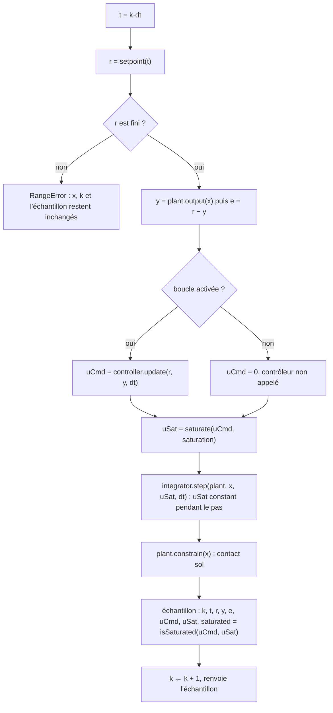

# Noyau de simulation (`src/sim`)

À quoi sert cette page : expliquer comment le noyau calcule un pas de simulation, ce qu'exporte `src/sim/index.ts` et quelles règles garantissent le déterminisme. Elle décrit le noyau validé (T-003, T-004, T-004b), complété par le contrôleur PI de T-021a. État du commit `908a62e` : depuis `119519b`, `src/sim` n'a changé que par l'ajout de `elevatorAcceleration` (T-041, voir ci-dessous) ; le reste de la page décrit un code identique à celui d'`a308ada`. La physique de l'ascenseur est dans [physique/ascenseur.md](physique/ascenseur.md).

## Rôle du noyau

Le noyau simule un système physique piloté par un contrôleur, pas à pas, avec un pas de temps fixe. Il est pur : il n'importe que lui-même, n'utilise ni le DOM, ni l'horloge murale, ni l'aléa. Trois garde-fous automatiques l'imposent (voir [architecture.md](architecture.md#les-trois-garde-fous-du-noyau-pur) et [ADR-003](decisions/ADR-003-noyau-pur.md)).

Ce que le noyau fait aujourd'hui :

- il fournit une boucle fermée générique (`createClosedLoop`) qui accepte n'importe quel modèle, contrôleur et intégrateur ;
- il fournit un modèle (l'ascenseur), deux contrôleurs (proportionnel, puis proportionnel-intégral depuis T-021a) et un intégrateur (RK4) ;
- il fournit une horloge à pas fixe et un enregistreur de signaux, utilisés par `src/game` et lus par le rendu des courbes (voir [rendu.md](rendu.md#courbe-yt)).

Ce qu'il ne fait pas : il ne décide ni de la victoire ni de l'échec. Ces règles sont dans `src/game/` (validé en T-007, voir [jeu.md](jeu.md#règles-dissue)). Le noyau est importé par `src/game/` (boucle de l'ascenseur, horloge, enregistreur) et par `src/render/` (force maximale du moteur pour la jauge, type `SignalRecorder`) ; `src/main.ts` ne l'importe plus directement depuis T-010.

Unités : SI partout (m, s, kg, N). Le temps est un entier de pas `k` ; `t = k·dt` est calculé par multiplication, jamais accumulé.

## Un pas de boucle fermée

`step()` (fichier `src/sim/loop.ts`) exécute ces opérations dans cet ordre. L'ordre est normatif (spec T-001 §4) : les valeurs de référence et l'empreinte SHA-256 en dépendent.



Points à retenir :

- La mesure `y` est lue **avant** l'intégration : elle vaut y(k·dt).
- Le drapeau `saturated` est calculé après l'intégration, mais à partir de `uCmd` et `uSat` du même pas.
- La consigne est lue une fois par pas, jamais à la création de la boucle (T-004b, défaut D-1 de T-005).

## Exports de `src/sim/index.ts`

Liste complète, comptée sur `src/sim/index.ts` au commit `119519b` : 23 valeurs et 19 types (21 et 16 au commit `c00e678`, inchangé jusqu'à T-021a, qui a ajouté deux fabriques et trois types).

### Constantes

| Nom | Valeur | Rôle |
|---|---|---|
| `SIM_DT` | `1 / 120` s | pas de simulation du jeu |
| `MAX_SIM_DT` | `1 / 30` s | plus grand pas accepté par `createClosedLoop` (voir plus bas) |
| `MAX_STEPS_PER_FRAME` | `8` | plafond de pas exécutés pour une image |
| `MAX_FRAME_SECONDS` | `0.25` s | durée d'image maximale prise en compte |
| `SIGNAL_STRIDE` | `5` | valeurs stockées par échantillon dans l'enregistreur : t, r, y, e, uSat |
| `ELEVATOR_PARAMS` | `{ mass: 50, gravity: 9.81, damping: 400 }` (gelé par `Object.freeze`) | paramètres physiques de la cabine (kg, m/s², N·s/m) |
| `ELEVATOR_MAX_FORCE` | `5000` N | saturation du moteur Umax |
| `ELEVATOR_SETPOINT` | `3` m | consigne : hauteur du quai d'arrivée |
| `ELEVATOR_STATE_SIZE` | `2` | dimension de l'état x = [y, ẏ] |
| `ELEVATOR_POSITION` | `0` | indice de y (m) dans l'état |
| `ELEVATOR_VELOCITY` | `1` | indice de ẏ (m/s) dans l'état |

### Fabriques et fonctions

| Nom | Signature courte | Rôle | Erreurs levées |
|---|---|---|---|
| `createFixedStepClock` | `(dt = SIM_DT, maxStepsPerFrame = MAX_STEPS_PER_FRAME) → ResettableFixedStepClock` | horloge à accumulateur | `RangeError` si `dt` n'est pas fini et > 0, ou si `maxStepsPerFrame` n'est pas un entier ≥ 1. `advance` ne lève jamais |
| `createRk4` | `(stateSize) → Integrator` | intégrateur Runge-Kutta d'ordre 4, sans allocation par pas | `RangeError` si `stateSize` n'est pas un entier ≥ 1 ; `step` lève `RangeError` si `x.length` ou `m.stateSize` diffère de `stateSize` |
| `createSaturation` | `(min, max) → Saturation` | bornes validées de l'actionneur (N) ; ±Infinity accepté | `RangeError` si une borne est NaN ou si min > max |
| `saturate` | `(u, s) → number` | uSat = min(max(u, s.min), s.max) ; NaN propagé | `RangeError` si les bornes de `s` sont invalides |
| `isSaturated` | `(uCmd, uSat) → boolean` | vrai si la saturation a modifié la commande ; faux si uCmd est NaN | aucune |
| `createSignalRecorder` | `(capacity) → CircularSignalRecorder` | enregistreur circulaire préalloué | `RangeError` si `capacity` n'est pas un entier ≥ 1 ; `forEach` lève `RangeError` sur un nom de signal inconnu |
| `createProportionalController` | `(kp) → ProportionalController` | contrôleur u = Kp·(r − y), sans état | `RangeError` si `kp` est NaN, infini ou négatif |
| `createProportionalIntegralController` | `(kp, ki) → ProportionalIntegralController` | contrôleur PI u = Kp·e + I, intégrale « rectangle à gauche » en newtons, sans anti-windup (voir plus bas) | `RangeError` si `kp` ou `ki` est NaN, infini ou négatif |
| `elevatorAcceleration` | `(y, v, force, params = ELEVATOR_PARAMS) → number` | accélération ÿ = (u − m·g − c·ẏ)/m du modèle (T-041) : mêmes opérations que la dérivée de `createElevator`, identique bit à bit hors contact ; 0 si la cabine est posée (y ≤ 0, ẏ ≤ 0, force nette < 0) ; NaN propagé ; ne revalide pas `params` | aucune |
| `createElevator` | `(params = ELEVATOR_PARAMS) → PlantModel` | modèle de l'ascenseur | `RangeError` si `mass` n'est pas finie et > 0, si `gravity` n'est pas finie, ou si `damping` n'est pas fini et ≥ 0 |
| `createElevatorLoop` | `(options: ElevatorLoopOptions) → SteppableClosedLoop` | assemble la boucle du niveau 1 : ascenseur, P, saturation ±Umax, RK4, consigne constante, cabine au sol | `RangeError` si la consigne n'est pas finie, plus toutes les erreurs des fabriques appelées (Kp, Umax négatif ou NaN, dt, paramètres physiques) |
| `createElevatorPiLoop` | `(options: ElevatorPiLoopOptions) → ElevatorPiLoop` | même assemblage que `createElevatorLoop`, avec le contrôleur PI ; expose `loop.controller` (`integral`, `proportionalTerm`) en lecture | `RangeError` si la consigne n'est pas finie, plus celles de `createElevatorLoop` et du PI (Kp, Ki) |
| `createClosedLoop` | `(config: ClosedLoopConfig) → SteppableClosedLoop` | boucle fermée générique | `RangeError` si `dt` n'est pas fini et dans ]0, `MAX_SIM_DT`], si `x0.length ≠ plant.stateSize`, si x0 contient une valeur non finie, ou si `plant.constrain` modifie x0 ; `step()` lève `RangeError` si la consigne lue n'est pas finie |

### Types

| Nom | Défini dans | Contenu |
|---|---|---|
| `PlantModel` | `types.ts` | `stateSize`, `derivative(x, u, out)`, `output(x)`, `constrain(x)` |
| `Controller` | `types.ts` | `reset()`, `update(r, y, dt) → uCmd` |
| `Saturation` | `types.ts` | `min`, `max` (N) |
| `Integrator` | `types.ts` | `step(m, x, u, dt)` : avance x en place, u constant |
| `LoopSample` | `types.ts` | `k`, `t`, `r`, `y`, `e`, `uCmd`, `uSat`, `saturated`, `x` (voir le piège plus bas) |
| `ClosedLoopConfig` | `types.ts` | `plant`, `controller`, `saturation`, `integrator`, `dt`, `x0`, `setpoint(t)` |
| `ClosedLoop` | `types.ts` | `reset()`, `step()`, `enabled`, `setEnabled(on)` |
| `FixedStepClock` | `types.ts` | `dt`, `advance(frameSeconds) → pas`, `alpha` |
| `SignalName` | `types.ts` | `'r' \| 'y' \| 'e' \| 'uSat'` |
| `SignalRecorder` | `types.ts` | `capacity`, `push(s)`, `forEach(name, fn)`, `length` |
| `ResettableFixedStepClock` | `clock.ts` | `FixedStepClock` + `reset()` |
| `CircularSignalRecorder` | `signals.ts` | `SignalRecorder` + `buffer` (lecture) + `clear()` |
| `ProportionalController` | `controllers/p.ts` | `Controller` + `kp` (lecture) |
| `ProportionalIntegralController` | `controllers/pi.ts` | `Controller` + `kp`, `ki`, `integral` (N), `proportionalTerm` (N) (lecture) |
| `ElevatorParams` | `plants/elevator.ts` | `mass`, `gravity`, `damping` |
| `ElevatorLoopOptions` | `plants/elevator.ts` | `kp` (obligatoire), `maxForce`, `dt`, `setpoint`, `params` (facultatifs) |
| `ElevatorPiLoopOptions` | `plants/elevator.ts` | `ElevatorLoopOptions` + `ki` (obligatoire) |
| `ElevatorPiLoop` | `plants/elevator.ts` | `SteppableClosedLoop` + `controller` (`ProportionalIntegralController`) |
| `SteppableClosedLoop` | `loop.ts` | `ClosedLoop` + `k`, `dt`, `x` (lecture) |

Les six derniers types étendent les interfaces de la spec T-001 §4. Ces extensions sont listées dans les [errata de la spec](specs/T-001-errata.md).

## Horloge à pas fixe

Le rendu (T-008) tourne à la cadence de l'écran (30, 60, 144 images/s…). La simulation, elle, avance toujours par pas de `dt = 1/120` s. L'horloge convertit la durée de chaque image en un nombre entier de pas. Elle ne lit jamais l'heure : l'appelant lui donne la durée de l'image.

Fonctionnement de `advance(frameSeconds)` (fichier `src/sim/clock.ts`) :

1. Une durée négative, nulle ou NaN compte pour 0 s. Une durée supérieure à `MAX_FRAME_SECONDS` (0,25 s) est ramenée à 0,25 s.
2. L'accumulateur, tenu **en pas** (sans unité), reçoit `frameSeconds / dt`.
3. Le nombre de pas est la partie entière de `accumulateur + 1e-9`. Ce epsilon absorbe l'erreur d'arrondi : sans lui, 6 images de 1/144 s pourraient donner 4 pas au lieu de 5.
4. Les pas sont retirés de l'accumulateur. S'il en reste plus de `MAX_STEPS_PER_FRAME` (8), le surplus est jeté ; la fraction de pas restante est conservée.
5. `alpha` vaut la fraction restante, dans [0, 1). Le rendu s'en sert pour interpoler entre l'état précédent et l'état courant (voir [rendu.md](rendu.md#interpolation-et-ancres-pour-linterface)).

Exemples mesurés par `tests/sim/clock.test.ts` :

| Durée des images | Pas par image |
|---|---|
| 1/30 s | 4 |
| 1/60 s | 2 |
| 1/144 s | motif 0, 1, 1, 1, 1, 1 (5 pas pour 6 images) |
| à-coup de 0,5 s | 8 (plafond), le reste est jeté |

Le plafond de 8 pas évite la « spirale de la mort » : si la simulation prend du retard, elle n'essaie pas de rattraper un temps qu'elle n'aura jamais. L'horloge elle-même n'est pas bornée en `dt` ; c'est la boucle qui refuse un `dt` trop grand (log T-004b).

## Intégration : RK4 et bloqueur d'ordre zéro

`createRk4` implémente le schéma de Runge-Kutta classique d'ordre 4. Les tampons de travail (k1 à k4 et un état intermédiaire) sont alloués une fois, à la création. `step` n'alloue rien.

La commande `uSat` reste **constante pendant tout le pas** : c'est un bloqueur d'ordre zéro, comme dans un contrôleur numérique réel. Le contrôleur calcule une commande à t = k·dt ; le moteur l'applique telle quelle jusqu'à t = (k+1)·dt.

Conséquence : la boucle simulée est une boucle **échantillonnée**, pas la boucle continue des formules de cours. L'écart est petit mais mesurable (dépassement un peu plus fort, amortissement un peu plus faible). Il est chiffré dans [physique/ascenseur.md](physique/ascenseur.md#effet-du-bloqueur-dordre-zéro).

Précision de RK4 dans la boucle de jeu, mesurée par `tests/sim/exact.test.ts` contre la solution exacte du système échantillonné (forme fermée Φ, Γ) : écart maximal 1,420e-7 m sur y et 2,311e-6 m/s sur ẏ (Kp = 8000 N/m, 1200 pas). Quand dt est divisé par 2, l'écart est divisé par 16,45 (Kp = 2500 N/m) : c'est la signature d'un schéma d'ordre 4.

`createRk4` n'applique pas `constrain` : c'est le rôle de la boucle (étape 5 de l'algorithme).

Le choix de RK4 est justifié dans [ADR-005](decisions/ADR-005-rk4-bloqueur.md).

## Saturation

`saturate(u, s)` renvoie `min(max(u, s.min), s.max)`. Cas particuliers (fichier `src/sim/saturation.ts`) :

| Entrée | uSat | `isSaturated(uCmd, uSat)` |
|---|---|---|
| dans les bornes | u | faux |
| au-delà d'une borne | la borne | vrai |
| ±Infinity | la borne correspondante | vrai |
| NaN | NaN (propagé) | **faux** |

Le cas NaN s'écarte de la formule littérale de la spec (`saturated = uSat !== uCmd`, qui vaudrait vrai). Choix accepté en T-003 : NaN n'est pas un écrêtage, et la valeur NaN signale elle-même le problème. Une commande invalide n'est jamais masquée par une borne.

`saturate` revérifie les bornes à chaque appel : un littéral `{ min: 1, max: 0 }` qui n'est pas passé par `createSaturation` lève `RangeError` au lieu de donner un résultat arbitraire.

## Enregistreur circulaire

`createSignalRecorder(capacity)` alloue une seule fois un `Float64Array` de `capacity × SIGNAL_STRIDE` valeurs. Chaque `push(sample)` copie t, r, y, e et uSat du pas. À capacité atteinte, le plus ancien échantillon est écrasé et `length` reste égal à `capacity`.

- `forEach(name, fn)` parcourt un signal du plus ancien au plus récent et appelle `fn(t, valeur)`.
- `buffer` expose le tampon en lecture. L'ordre y est physique, pas chronologique.
- `clear()` vide l'enregistreur sans réallouer.
- `push` et `forEach` n'allouent rien.

L'enregistreur copie des nombres : il ne garde aucune référence vers l'échantillon. Il ne stocke pas ẏ ni uCmd. Capacité utilisée par le jeu : `TRIP_MAX_STEPS` = 1200 échantillons, soit 10 s (`src/game/elevator-level.ts` ; 720 échantillons, 6 s, de T-020 à T-021b ; 1800 échantillons, 15 s, avant T-020) ; le rendu y lit la courbe y(t) (T-009).

## Borne `MAX_SIM_DT` = 1/30 s

`createClosedLoop` refuse un pas `dt` supérieur à `MAX_SIM_DT` (T-004b, défaut D-2 de T-005). Avant cette borne, `dt = 1` s était accepté : RK4 divergeait sans erreur ni NaN (y = 3,7e20 m après 10 pas, rapport T-005 §F).

Justification chiffrée (commentaire de `src/sim/clock.ts`, recalculée par le rédacteur avec la forme fermée du bloqueur d'ordre zéro, voir [physique/ascenseur.md](physique/ascenseur.md#stabilité-de-la-boucle-échantillonnée)) :

| Grandeur, à dt = 1/30 s et Kp = 8000 N/m (maximum du curseur) | Valeur |
|---|---|
| Kp critique de la boucle échantillonnée | 25 115 N/m (forme exacte) ; 25 125 N/m avec RK4 (log T-004b) |
| marge de gain | 3,14 |
| rayon spectral de la boucle | 0,917 |
| stabilité de RK4 seul : (c/m)·dt | 0,27, loin de la limite ≈ 2,79 de RK4 sur l'axe réel |
| écart RK4 / exact sur 10 s | ≤ 6,1e-5 m sur y, 8,3e-4 m/s sur ẏ (contre 1,4e-7 m et 2,3e-6 m/s à 1/120 s) |

La marge tombe à 2,14 à dt = 1/20 s et 1,15 à 1/10 s ; la boucle est instable à 1/8 s.

Cette borne protège le moteur pour l'ascenseur. Elle ne garantit rien pour un autre modèle : un modèle plus rapide doit refaire ce calcul.

## Déterminisme

Même séquence d'entrées ⇒ mêmes bits en sortie, quelle que soit la cadence d'images. Ce qui le garantit :

| Mécanisme | Où |
|---|---|
| pas fixe ; le temps vient d'un entier `k` (t = k·dt, jamais accumulé) | `loop.ts` |
| la cadence d'images ne change que le nombre de pas par image, pas leur contenu | `clock.ts` |
| ni aléa, ni horloge murale (`Math.random`, `Date`, `performance` interdits par ESLint) | `eslint.config.js` |
| ordre des opérations fixe (schéma ci-dessus) | `loop.ts` |
| seules opérations : `+ − × ÷`, `Math.min`, `Math.max` et `Math.floor` (horloge), toutes exactes ou correctement arrondies en IEEE-754 ; pas de `Math.exp` ni de `Math.sin` | `src/sim/**` |

Trois tests le vérifient (`tests/sim/determinism.test.ts`), sur la boucle de jeu Kp = 2500 N/m, 1800 pas :

- (a) deux exécutions donnent des traces identiques bit à bit ;
- (b) la même simulation pilotée par l'horloge avec des images de 1/60 s puis de 1/144 s donne les mêmes états aux mêmes k ;
- (c) l'empreinte SHA-256 de la trace est figée. La trace contient 1800 × 4 valeurs `Float64` : y et ẏ après le pas, uCmd, uSat. Empreinte :

```text
5f85e15aa78afeeb834bf30e651b062be643a3e763b2821d7d534bcbbb38a821
```

Le contrôleur PI a sa propre empreinte (`tests/sim/pi-determinism.test.ts`, T-021a) : trace de 5 valeurs `Float64` par pas (y, ẏ, uCmd, uSat, puis l'intégrale I après le pas), 1800 pas, Kp = 2500 N/m, Ki = 1000 N/(m·s) :

```text
0d9d331a5a4a9df28a188dd71b599a3559bd47ccc04f6d4ab78b7db5b725744b
```

L'empreinte du P ci-dessus n'a pas changé (log T-021a).

Limite : l'empreinte porte sur les octets en ordre machine petit-boutiste (x86-64, ARM64). Le déterminisme entre navigateurs n'a pas été vérifié (rapport T-005, « Doutes et limites »).

## Contrôleur PI (T-021a)

`createProportionalIntegralController(kp, ki)` (fichier `src/sim/controllers/pi.ts`) respecte le contrat `Controller` sans le modifier : `loop.ts`, `LoopSample` et `createElevatorLoop` n'ont pas changé. Ordre dans `update(r, y, dt)` :

1. `e = r − y` ;
2. `P = Kp·e` ;
3. `u = P + I`, avec I **avant** mise à jour (si I vaut exactement 0, `u = P` sans l'addition : le zéro signé du P est conservé) ;
4. `I ← I + Ki·dt·e` ;
5. renvoie `u`.

Propriétés (tests `tests/sim/pi.test.ts`, 14 tests, et `tests/sim/pi-determinism.test.ts`, 4 tests) :

- **L'intégrale est stockée en newtons**, ce qui la rend comparable à la jauge de force et au poids m·g. Elle est mise à jour à partir de e, **jamais de la commande saturée** : pas d'anti-windup ([ADR-016](decisions/ADR-016-controleur-pi-sans-anti-windup.md)). Elle est lue par `controller.integral`, le terme proportionnel du dernier appel par `controller.proportionalTerm`.
- **Ki = 0 est identique au P bit à bit** sur 1800 pas, pour Kp ∈ {0, 150, 1000, 2500, 4500, 8000} (mesure de T-021a).
- `RangeError` si Kp ou Ki n'est pas fini ou est négatif ; aucune allocation dans `update` (le test vérifie l'identité des objets, pas le tas).
- `createElevatorPiLoop({ kp, ki, … })` assemble la boucle et ajoute `controller` à l'objet de la boucle (`Object.assign`) ; il ne faut pas appeler `controller.update` ni `controller.reset` soi-même, la boucle s'en charge.

Validation : tests unitaires et de déterminisme (T-021a), puis oracle exact MATLAB du PI (`validation/matlab/t018_*.m`) et test d'oracle exact TypeScript `tests/sim/pi-exact.test.ts` (22 tests, sans MATLAB), faits en T-023 (K28 corrigé) : 0 désaccord noyau / exact sur 113 valeurs de Ki, pire écart 1,5e-7 m sur y, 1,524e-6 m/s sur ẏ et 2,144e-4 N sur I (journal `orchestration/logs/T-023.md`) ; détails dans [physique/ascenseur.md](physique/ascenseur.md#niveau-2--contrôleur-pi) et [tests.md](tests.md#oracle-exact-du-pi-testssimpi-exacttestts). `src/sim` n'a pas été modifié par T-023.

## Le piège de `LoopSample`

`step()` renvoie un échantillon qui mélange deux instants, et c'est **toujours le même objet**.

| Champ | Instant décrit |
|---|---|
| `k`, `t`, `r`, `y`, `e`, `uCmd`, `uSat`, `saturated` | t = k·dt : l'instant où la commande a été calculée |
| `x` | **après** le pas : x((k+1)·dt) |

Exemple chiffré, boucle de jeu Kp = 2500 N/m (valeurs calculées par une réimplémentation jetable du même algorithme, qui retrouve à 1e-9 près les valeurs de `tests/sim/reference.test.ts`) :

| Appel | `k` | `t` (s) | `y` (m) | `e` (m) | `uCmd` (N) | `uSat` (N) | `saturated` | `x[0]` (m) | `x[1]` (m/s) |
|---|---|---|---|---|---|---|---|---|---|
| 1er `step()` | 0 | 0 | 0 | 3 | 7500 | 5000 | vrai | 0,003063166 | 0,727078005 |
| 2e `step()` | 1 | 0,008333 | 0,003063166 | 2,996936834 | 7492,342 | 5000 | vrai | 0,011987763 | 1,407264566 |

Lecture : au 1er appel, `y` vaut 0 (mesure à t = 0) mais `x[0]` vaut déjà 0,003063 m (position à t = 1/120 s). Au 2e appel, `y` reprend cette valeur. La mesure au pas k + 1 est donc `plant.output(sample.x)` du pas k.

Trois règles pour tout appelant. `src/game/` les applique (T-007) : il juge l'issue sur l'état après le pas et copie les nombres (voir [jeu.md](jeu.md#convention-de-pas) et [ses contrats](jeu.md#contrats-pour-le-rendu-et-linterface)) :

1. **Choisir l'instant jugé.** Pour un seuil (choc à 3,3626 m, par exemple), utiliser `sample.y` (avant le pas) ou `sample.x[0]` (après le pas). Le maximum est le même, décalé d'un pas (rapport T-005, recommandation 4).
2. **Ne jamais garder une référence à l'échantillon.** `step()` réécrit le même objet. Trois échantillons rangés dans un tableau affichent tous le dernier k (T-005, attaque F8c : k stockés = 2, 2, 2). Copier les champs utiles.
3. **Ne jamais modifier `x`.** `sample.x` et `loop.x` sont le tableau interne de la boucle. Le type est en lecture seule, mais un transtypage suffit à corrompre la simulation (T-005, attaque F8). Copier avec `Float64Array.from(sample.x)` pour conserver un état.

## Ajouter un nouveau système

1. Créer `src/sim/plants/<nom>.ts` avec une fabrique qui renvoie un `PlantModel` :
   - `stateSize` : dimension de l'état ;
   - `derivative(x, u, out)` : écrit dx/dt dans `out`, sans allouer ni modifier `x` ;
   - `output(x)` : grandeur mesurée ;
   - `constrain(x)` : contraintes physiques en place (ne rien faire s'il n'y en a pas). Ne pas corriger NaN.
2. Valider les paramètres dans la fabrique et lever `RangeError` hors domaine (modèle : `createElevator`).
3. Exporter la fabrique, ses constantes et ses types depuis `src/sim/index.ts`.
4. Vérifier la stabilité et la précision au pas choisi, au moins jusqu'à `MAX_SIM_DT`. La borne actuelle ne vaut que pour l'ascenseur.
5. Écrire les tests dans `tests/sim/` : dérivée, contraintes, oracle analytique ou solution exacte, déterminisme. Garder `npm run test:cov` au-dessus des seuils (95 % des lignes, 90 % des branches).
6. Lancer `npm run check`. Les garde-fous refusent tout import hors de `src/sim/` et tout accès au DOM ou à l'horloge.
7. Faire valider le modèle par un oracle indépendant, comme T-005 l'a fait pour l'ascenseur (voir [ADR-006](decisions/ADR-006-oracle-matlab.md)).

## Ajouter un nouveau contrôleur

1. Créer `src/sim/controllers/<nom>.ts` avec une fabrique qui renvoie un `Controller` :
   - `update(r, y, dt)` renvoie la commande demandée, avant saturation, sans allouer ;
   - `reset()` remet l'état interne à zéro (intégrale, mesure précédente…).
2. Valider les gains dans la fabrique (`RangeError`), comme `createProportionalController`.
3. Exporter depuis `src/sim/index.ts`.
4. Tester `update` seul, puis dans une boucle avec un oracle.

Un contrôleur à mémoire existe depuis T-021a (le PI). Quand la boucle est désactivée (`setEnabled(false)`), `update` n'est pas appelé du tout : l'intégrale reste donc figée pendant ce temps, sans remise à zéro. Le niveau 2 n'utilise pas `setEnabled`. `reset()` de la boucle appelle `controller.reset()` (I et terme proportionnel remis à 0) et réactive la boucle (log T-004, « à reporter »).
