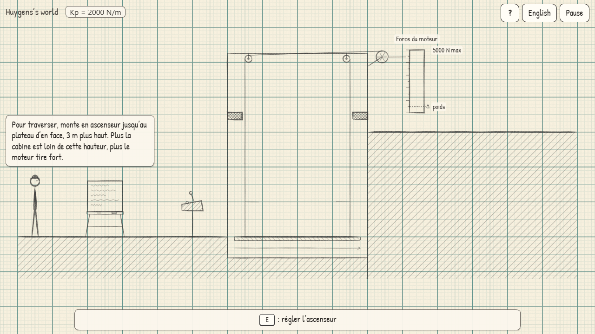
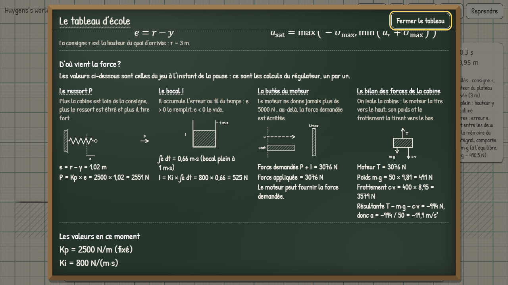
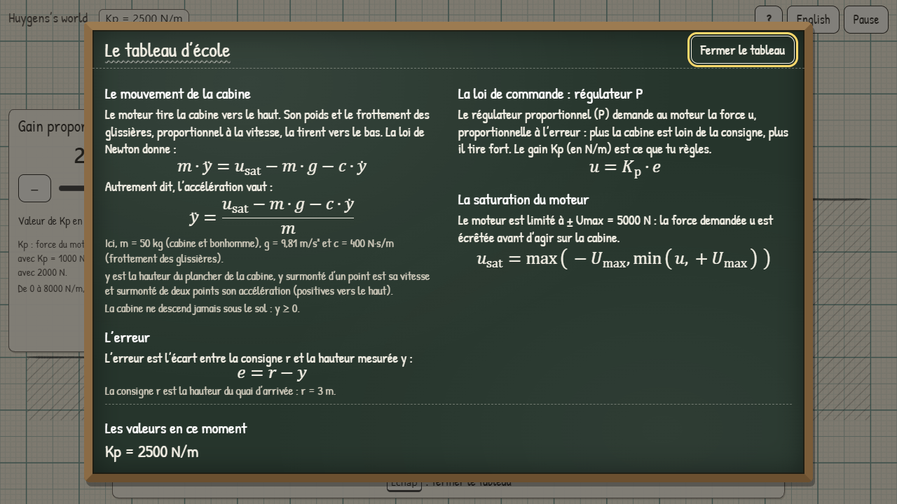

# Tableau d'école (`src/ui/board*.ts`)

À quoi sert cette page : décrire le tableau d'école de la v0.3 : un chevalet sur le quai qui ouvre un tableau noir à la craie avec les équations du niveau (T-042, lot B) et, depuis T-053 (décision D37), la section « D'où vient la force ? » calculée avec les valeurs de l'instant de la pause. Elle décrit le commit `908a62e` (branche `v0.3-salle-de-controle`, version 0.3.0). Le pupitre de contrôle est dans [pupitre.md](pupitre.md).

## Ouverture et fermeture

- **Chevalet** : un chevalet au crayon est dessiné sur le quai de départ par `src/render` (`EASEL_CENTER_X` = −3,5 m, entre le point d'apparition à −5,5 m et le poste à −1,55 m). Son rectangle à l'écran est transmis à l'interface (`boardTopLeft`, `boardBottomRight` dans `UiGeometry`, `main.ts`) ; une zone cliquable de 44 px au moins le recouvre (`boardHit`).
- **Ouvrir** : touche **T** (`openBoard`, ignorée dans un champ numérique), clic sur le chevalet. **Fermer** : T, Échap, bouton « Fermer le tableau », clic hors du tableau ; un double-clic n'ouvre pas puis ne referme pas. Le focus est rendu à l'élément d'origine, ou au chevalet à défaut.
- **Pause** : le tableau met le jeu en pause **comme l'aide** (`modalPauseDecision`, `setModal` de `overlay.ts`) et ne reprend que la pause qu'il a posée ; la pause du joueur n'est pas reprise par la fermeture. Aide et tableau s'excluent (une seule fenêtre modale à la fois, une seule pause tenue pour les deux). Tant que le tableau est ouvert, aucune commande de jeu ne passe, au clavier comme au pointeur (`commandsBlocked`).
- Le tableau a le focus et un titre accessible (`board.title`, « Le tableau d'école ») ; la fenêtre tient dans 1280 × 720 et dans 390 × 844, « Fermer » restant visible (e2e de `tableau.spec.ts`).

## Contenu

`board.ts` construit le contenu de façon pure (testable sous Node) ; seul `renderBoard` touche au DOM. Les valeurs physiques (m, g, c, Umax, r) sont **lues du jeu** (`ELEVATOR_PARAMS`, `ELEVATOR_MAX_FORCE`, `LEVEL1_SETPOINT` de `src/game`), jamais recopiées ; les textes viennent des locales (`board.*`), les formules sont en **MathML natif** (`board-math.ts`) et ne dépendent pas de la langue. Six sections, sur trois colonnes (les colonnes 1 et 2 côte à côte, l'une sous l'autre en portrait, la 3 pleine largeur) :

| Section (`id`) | Colonne | Contenu |
|---|---|---|
| `motion` | 1 | le mouvement de la cabine : m·ÿ = u_sat − m·g − c·ẏ, tel que dans `createElevator`, avec m, g et c |
| `error` | 1 | l'erreur e = r − y, avec r = 3 m |
| `law` | 2 | la loi de commande : régulateur P au niveau 1, PI au niveau 2 |
| `saturation` | 2 | la saturation à ±Umax |
| `forces` | 3 | « D'où vient la force ? » (T-053, voir ci-dessous) |
| `values` | 3 | « Les valeurs en ce moment » : Kp (et Ki au niveau 2), réécrites en direct d'après l'instantané |

## « D'où vient la force ? » (T-053, D37)

`board-forces.ts` (calculs purs, testables sous Node) et `board-forces-view.ts` (dessin SVG à la craie et lignes de calcul, réécrits seulement quand les valeurs changent). Quatre vignettes, chacune avec un dessin `role="img"` dont l'`aria-label` est réécrit avec les valeurs :

| Vignette | Niveau | Ce qu'elle montre | Calcul affiché |
|---|---|---|---|
| le ressort P | 1 et 2 | un ressort étiré de l'erreur e | P = Kp × e |
| le bocal I | 2 seulement | un bocal qui se remplit de ∫e dt (plein à `JAR_CAPACITY` = 1 m·s) | I = Ki × ∫e dt |
| la butée du moteur | 1 et 2 | la règle des forces avec la butée à Umax ; force demandée et force appliquée | force demandée P + I, force appliquée, part perdue par la saturation |
| le bilan des forces de la cabine | 1 et 2 | la cabine isolée avec la poussée du moteur T, le poids m·g et le frottement c·v | résultante T − m·g − c·v et a = résultante / m ; « cabine posée au sol : a = 0 » si le sol la retient |

Les grandeurs (`computeForces`, type `ForcesModel`) sont **celles du dernier pas simulé** : `stepError`, `pTerm`, `iTermUsed`, `uCmd`, `uSat`, `saturated`, `stepVelocity`, `stepAcceleration` de l'instantané (voir [pupitre.md](pupitre.md#journal-du-trajet-triplog-t-048-et-signaux-du-dernier-pas-t-041)), donc cohérentes entre elles (uCmd = pTerm + iTermUsed, uSat = uCmd borné). L'intégrale ∫e dt est recalculée comme `iTermUsed / ki` (0 au niveau 1 ou si Ki = 0). Le remplissage du bocal est borné à [0 ; 1]. Les flèches de force du bilan ont une longueur croissante mais **pas à l'échelle** (racine carrée, `arrowLength`, de 6 px à un maximum), pour que le poids (m·g = 50 × 9,81 ≈ 491 N) reste visible à côté de 5 000 N. Avant tout trajet (`k` = 0), tout est à zéro et le texte `board.forces.idle` demande de lancer un trajet puis d'ouvrir le tableau pendant qu'il tourne.

## Accessibilité et langues

Tous les textes sont dans `board.*` (FR et EN, mêmes clés) ; les formules MathML portent une étiquette textuelle (`board.motion.label`, `board.error.label`…) et les dessins un `aria-label`. Les assertions des e2e ne dépendent que des boîtes, pas des glyphes.

## Défauts connus liés

- K52 (T-042) : au poste, le panneau de gauche du pupitre peut recouvrir visuellement le chevalet, qui reste ouvrable par T ; en portrait 390 px le chevalet dessiné ne fait que 26 × 37 px (zone cliquable de 44 px) ; à 1280 × 720 au niveau 1, le bas du cadre recouvre en partie le bandeau « Échap : fermer le tableau » derrière le voile. Cette entrée parle du « panneau de gauche » de la v0.2 : le pupitre a remplacé ce panneau depuis, et le recouvrement n'a pas été remesuré.
- K53 (T-042) : les formules utilisent une pile de polices mathématiques système (`Latin Modern Math`, `STIX Two Math`, `Cambria Math`, `math`), essayée sous Chrome sur Windows seulement ; elle peut différer sous Linux, dans la CI et dans d'autres navigateurs (à vérifier).

## Tests

- Unitaires : `tests/ui/board.test.ts` (13), `tests/ui/board-math.test.ts` (8), `tests/ui/board-forces.test.ts` (11), `tests/render/board-anchors.test.ts` (3).
- e2e : `tests/e2e/tableau.spec.ts` (28 tests : ouverture et fermeture, pause, formules MathML rendues, valeurs en direct, « D'où vient la force ? » à l'instant de la pause et avant tout trajet, blocage des commandes, exclusion avec l'aide, tailles d'écran, anglais). Captures `docs/img/t042-*.png` et `t053-*.png`.
