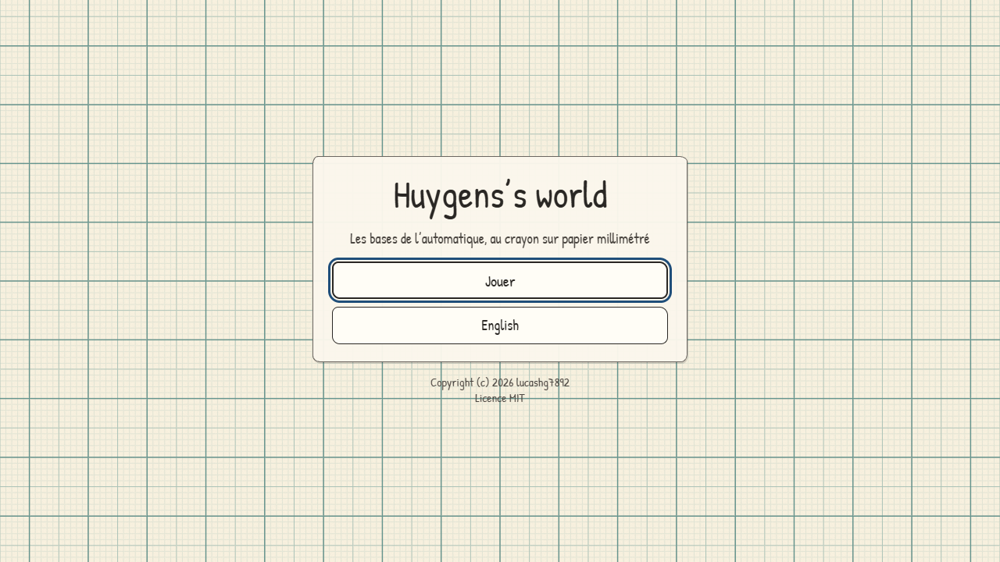

# Tutoriel : lancer le projet sur son PC (Windows)

À quoi sert cette page : guider pas à pas, sous Windows et dans PowerShell, l'installation d'une copie du projet, son lancement dans le navigateur, une partie du niveau 1 (et un mot du niveau 2), les tests et la validation MATLAB. Aucune connaissance en développement n'est supposée. État décrit : commit `a308ada` (les durées et les sorties de terminal recopiées plus bas datent de `566a8a3`, sauf mention ; elles n'ont pas été relancées).

> **Statut des commandes.** Sous Windows, l'utilisateur a exécuté avec succès le clone, `npm.cmd ci` et `npm.cmd run dev` le 2026-11-13 (décision D16 du registre), puis a joué le niveau. La validation MATLAB (étape 6) a été exécutée sous Windows par le rédacteur. Les autres commandes (`git pull`, `npm run test`, `npm run test:cov`, `npm run check`, réinstallation) ont été exécutées sous Linux seulement et restent marquées « non exécuté sous Windows ».
>
> **Si PowerShell refuse `npm`** (« l'exécution de scripts est désactivée sur ce système »), écrivez `npm.cmd` à la place de `npm` dans toutes les commandes : voir le [dépannage](#7-dépannage).

## Avant de commencer : travaillez dans une copie

**Ne lancez aucune commande `npm` dans le dossier `PID_GAME` lui-même.** Travaillez dans une copie, par exemple `pid-game-test`.

Pourquoi : les agents de développement du projet utilisent le dossier `node_modules` de `PID_GAME`. Il a été installé pour Linux et contient des programmes compilés pour Linux (par exemple `@rolldown/binding-linux-x64-gnu`, utilisé par Vite). Un `npm ci` lancé sous Windows dans `PID_GAME` remplacerait ces programmes par leur version Windows : les contrôles des agents ne fonctionneraient plus. L'inverse est vrai aussi : le `node_modules` de `PID_GAME` ne fonctionne pas sous Windows.

## 1. Vérifier les prérequis

Il vous faut deux logiciels.

| Logiciel | Version | Où le trouver |
|---|---|---|
| Node.js | 22.12.0 ou plus récent | version LTS sur [nodejs.org](https://nodejs.org) ; npm est installé avec |
| git | toute version récente | [git-scm.com](https://git-scm.com) |

Ouvrez PowerShell (menu Démarrer, tapez « PowerShell ») et tapez :

```powershell
node -v
git --version
```

`node -v` doit afficher `v22.12.0` ou un numéro plus grand (par exemple `v22.23.4`, ou `v24.…`). Si le numéro commence par `v22.` mais est inférieur à `v22.12`, ou s'il commence par `v20`, installez la version LTS. Le minimum vient de `package.json` (`"node": ">=22.12.0"`) : Vitest 5.1.0 l'exige.

## 2. Créer la copie

Placez-vous dans le dossier qui contient `PID_GAME` (remplacez `<vous>` par votre nom d'utilisateur Windows) :

```powershell
cd "C:\Users\<vous>\Documents\GitHub"
git clone PID_GAME pid-game-test
cd pid-game-test
npm ci
```

- `git clone PID_GAME pid-game-test` copie le dépôt local, avec tous ses commits, y compris ceux qui n'ont pas encore été envoyés sur GitHub. Il ne copie pas les fichiers modifiés mais non encore enregistrés dans un commit.
- `npm ci` installe exactement les versions de `package-lock.json` dans `pid-game-test\node_modules`. Comptez de quelques secondes à quelques minutes selon la connexion (4 s sous Linux avec un cache déjà rempli). Il peut afficher un message sur des vulnérabilités « moderate » : elles concernent les outils de développement (réserve E7 de T-002), pas le jeu.

Exécuté sous Windows par l'utilisateur le 2026-11-13, avec `npm.cmd ci` (décision D16). Sous Linux : `git clone` d'un dépôt local → code 0 ; `npm ci` → code 0.

**Variante** : cloner depuis GitHub.

```powershell
cd "C:\Users\<vous>\Documents\GitHub"
git clone https://github.com/lucashg7892/pid-game.git pid-game-test
cd pid-game-test
npm ci
```

Le dépôt GitHub est privé pour l'instant : git vous demandera de vous connecter à votre compte. Cette copie ne contient que ce qui a été poussé sur GitHub, pas forcément les derniers commits de `PID_GAME`. Non exécuté.

## 3. Lancer le site

```powershell
npm run dev
```

Vite affiche quelques lignes, dont l'adresse à ouvrir :

```text
  VITE v8.3.8  ready in 687 ms

  ➜  Local:   http://localhost:5173/pid-game/
```

Ouvrez cette adresse dans votre navigateur. Le chemin `/pid-game/` vient de `base: '/pid-game/'` dans `vite.config.ts` (nom du futur site GitHub Pages). Le port est celui affiché par Vite : 5173 par défaut.

Pour arrêter le serveur : revenez dans PowerShell et tapez `Ctrl+C` (confirmez par `O` ou `Y` si Windows le demande).

Exécuté sous Windows par l'utilisateur le 2026-11-13, avec `npm.cmd run dev` (décision D16) : le niveau tourne. La sortie ci-dessus a été recopiée sous Linux.

### Ce que vous voyez

L'onglet s'appelle « Huygens’s world ». Le jeu s'ouvre sur un **écran titre** (« Huygens’s world », un bouton « Jouer » et la mention de copyright). Cliquez sur « Jouer » (ou appuyez sur Entrée) pour ouvrir le **menu des niveaux**, puis choisissez « Niveau 1 : le vide ». Le niveau montre une feuille de papier millimétré, un bonhomme bâton au crayon à gauche, une console, une cage d'ascenseur au milieu et un plateau en hauteur à droite. En haut : le titre, la valeur de Kp et trois boutons (« ? » pour l'aide, la langue, « Pause »). En bas : un bandeau qui dit quoi faire et avec quelle touche. En pause, un bouton « Menu » ramène au menu.




### Jouer

1. Maintenez **→** (ou **D**) : le bonhomme marche jusqu'à la console.
2. Appuyez sur **E** : le panneau de réglage s'ouvre.
3. Réglez Kp avec **+** et **−** (pas de 100) ou **Page préc.** / **Page suiv.** (pas de 1000). Le jeu commence à 2000 N/m (500 de T-020 à T-021b, 1000 avant) : un lancement sans réglage gagne.
4. Appuyez sur **E** ou **Entrée** : l'ascenseur part. La courbe de sa hauteur se trace sur le mur de la cage.
5. Lisez l'issue, puis appuyez sur **R** pour réessayer.

Pour réussir, Kp doit être entre 1000 et 5000 N/m (2000 et 3800 avant T-020) ; un trajet dure 10 s au plus (6 s de T-020 à T-021b) : trop faible, la cabine s'arrête trop bas ; trop fort, elle dépasse et heurte la poutre. Le **niveau 2** du menu (« la mémoire ») garde les mêmes touches, mais règle Ki, avec Kp fixé à 2500 N/m ; la cabine doit s'arrêter à 0,1 m près, ce que Kp seul ne permet pas.

| Touche | Action |
|---|---|
| ← / → ou Q / D (A / D en QWERTY) | marcher |
| E, Entrée ou Espace | utiliser la console, puis lancer |
| + / − | Kp ± 100 N/m (niveau 2 : Ki) |
| Page préc. / Page suiv. | Kp ± 1000 N/m (niveau 2 : Ki) |
| R | recommencer |
| Échap | fermer l'aide ou le réglage de Kp ; sinon pause, reprise |

Table complète : [interface.md](interface.md#touches). À la souris : cliquez sur la console, puis utilisez le panneau. Pour jouer en anglais : bouton « English », ou ajoutez `?lang=en` à l'adresse.

## 4. Mettre à jour la copie

Quand le projet a avancé, depuis `pid-game-test` :

```powershell
git pull
```

Avec une copie faite par `git clone PID_GAME`, `git pull` récupère les nouveaux commits de `PID_GAME` (pas ceux de GitHub).

Relancez `npm ci` **seulement si** `package.json` ou `package-lock.json` ont changé. Pour le savoir, juste après `git pull` :

```powershell
git diff --stat "HEAD@{1}" HEAD -- package.json package-lock.json
```

Si la commande n'affiche rien, ces fichiers n'ont pas changé. Non exécuté sous Windows.

## 5. Vérifier le travail fait

Ces commandes ne sont pas nécessaires pour jouer. Elles vérifient le code.

| Commande | Durée indicative | Ce qu'elle montre |
|---|---|---|
| `npm run test` | ≈ 30 s | les 649 tests unitaires (47 fichiers) au commit `a308ada` (relevé par le rédacteur sous Windows, `npm.cmd test`) ; la fin doit afficher `Test Files  47 passed (47)` et `Tests  649 passed (649)`. Les lignes `T1`, `REF`, `EXACT` comparent la simulation aux formules et à la solution exacte |
| `npm run test:cov` | ≈ 40 s | les mêmes tests, puis un tableau de couverture de `src/sim` : 100 % partout. Échoue sous 95 % des lignes |
| `npm run check` | ≈ 1 à 2 min | toute la chaîne : vérification des types, lint, formatage, règles d'architecture, tests, construction du site dans `dist\`. Doit se terminer sans erreur |

Durées mesurées sous Linux ; non exécuté sous Windows. Détail des tests : [tests.md](tests.md).

Les tests de bout en bout (`npm run e2e`, 74 tests dans un vrai navigateur au commit `a308ada`) demandent d'abord `npx playwright install chromium`, qui télécharge un navigateur. Non exécuté sous Windows ; voir [tests.md](tests.md#tests-de-bout-en-bout-playwright).

## 6. Relancer la validation MATLAB

La validation indépendante du noyau (tâche T-005) compare la simulation à un calcul exact fait dans MATLAB. MATLAB sert uniquement à cette vérification : rien de MATLAB n'est dans le site.

1. Ouvrez MATLAB (R2025a ; aucune toolbox nécessaire).
2. Placez le dossier courant de MATLAB sur la racine du dépôt (`pid-game-test`, ou `PID_GAME` : les scripts ne font que lire). Par exemple, dans la fenêtre de commande :

```matlab
cd('C:\Users\<vous>\Documents\GitHub\pid-game-test')
run('validation/matlab/t005_run_all.m')
```

3. MATLAB affiche cinq blocs (A + B, C, D, E) : écarts entre la simulation et le calcul exact, effet du bloqueur d'ordre zéro, limite de stabilité (97078,6 N/m à dt = 1/120 s), fenêtre de réussite et marges à la poutre. Depuis T-020, la fenêtre est [1000 ; 5000] N/m (la sortie affiche « Kp in [1000 ; 5000], 41 valeurs, contiguë : true » ; depuis T-022, elle annonce aussi « horizon 1200 pas (10.0 s) ») et les marges sont 1,74 mm sous la poutre à 5000 N/m et 1,79 mm au-dessus à 5100 N/m ; avant T-020 : [2000 ; 3800], +5,842 mm à 3800 et −1,865 mm à 3900.
4. La dernière ligne doit être :

```text
T005 : FIN SANS ERREUR
```

Exécuté sous Windows le 2026-11-12 dans `PID_GAME` : MATLAB 25.1 (R2025a), « T005 : FIN SANS ERREUR », 1,1 s. Mode d'emploi complet : [validation/README.md](../validation/README.md). T-020 l'a relancé le 2026-11-13 sur le nouveau réglage (log T-020) : même ligne finale.

**Contrôleur PI (niveau 2, T-023).** Un second oracle valide la boucle PI :

```matlab
run('validation/matlab/t018_run_all.m')
```

La dernière ligne doit être `T018 : FIN SANS ERREUR` ; le script annonce aussi « 0 sur 113 » (désaccords entre le noyau et l'oracle exact sur 113 valeurs de Ki). Ces sorties sont celles du journal `orchestration/logs/T-023.md` (relancé par le réalisateur, le validateur et l'orchestrateur) ; le rédacteur n'a pas lancé MATLAB. Le test TypeScript équivalent, `tests/sim/pi-exact.test.ts`, tourne sans MATLAB avec `npm run test`.

## 7. Dépannage

| Symptôme | Cause probable | Solution |
|---|---|---|
| PowerShell répond « Impossible de charger le fichier C:\Program Files\nodejs\npm.ps1, car l’exécution de scripts est désactivée sur ce système » | la politique d'exécution de PowerShell bloque le script `npm.ps1` | voir ci-dessous (**cas rencontré par l'utilisateur le 2026-11-13**) |
| `npm ci` refuse de s'installer, ou une erreur parle de `engine` ou de version de Node | Node trop ancien | installer Node LTS (≥ 22.12) puis vérifier `node -v` |
| `Cannot find module '@rolldown/binding-win32-x64-msvc'` ou erreur de « native binding » au lancement de `npm run dev` | le dossier `node_modules` a été copié depuis un autre système (Linux) | supprimer `node_modules`, puis refaire `npm ci` (voir ci-dessous) |
| Vite affiche une autre adresse que `5173`, ou `Port 5173 is in use` | un autre programme (souvent un ancien `npm run dev`) utilise déjà le port | ouvrir l'adresse affichée par Vite, ou fermer l'autre fenêtre PowerShell |
| `npm run e2e` échoue en disant que le navigateur est introuvable (message de Playwright non reproduit ici) | le navigateur de Playwright n'est pas installé | lancer `npx playwright install chromium`, puis `npm run e2e` |
| page de repli « Ton navigateur ne peut pas afficher le jeu » | ni WebGPU ni WebGL2 disponible (navigateur ancien, accélération graphique désactivée) | mettre le navigateur à jour, activer l'accélération matérielle |

### PowerShell refuse `npm`

Sous Windows, `npm` est lancé par un petit script PowerShell (`npm.ps1`). Si la politique d'exécution l'interdit, trois solutions, au choix :

1. **Utiliser `npm.cmd`** (aucun réglage changé) : écrire `npm.cmd` à la place de `npm`. C'est ce que l'utilisateur a fait le 2026-11-13, avec succès :

```powershell
npm.cmd ci
npm.cmd run dev
```

2. **Utiliser l'invite de commandes** `cmd` (menu Démarrer, tapez « cmd ») au lieu de PowerShell : `npm ci` et `npm run dev` y fonctionnent tels quels. Non exécuté.

3. **Autoriser les scripts locaux pour votre compte** (réglage de sécurité de Windows, à décider vous-même) :

```powershell
Set-ExecutionPolicy -Scope CurrentUser RemoteSigned
```

Ce réglage autorise les scripts écrits sur votre PC et les scripts téléchargés signés, pour votre compte seulement. Non exécuté.

### Réinstaller `node_modules`

Supprimer `node_modules` et réinstaller (depuis `pid-game-test`, jamais dans `PID_GAME`) :

```powershell
Remove-Item -Recurse -Force node_modules
npm ci
```

Non exécuté sous Windows. Le nom exact du message d'erreur de Rolldown n'a pas été reproduit : le paquet attendu sous Windows x64 est `@rolldown/binding-win32-x64-msvc` (listé dans `package-lock.json`).

Pour aller plus loin : [developpement.md](developpement.md) (scripts, conventions) et [README.md](README.md) (index de la documentation).
